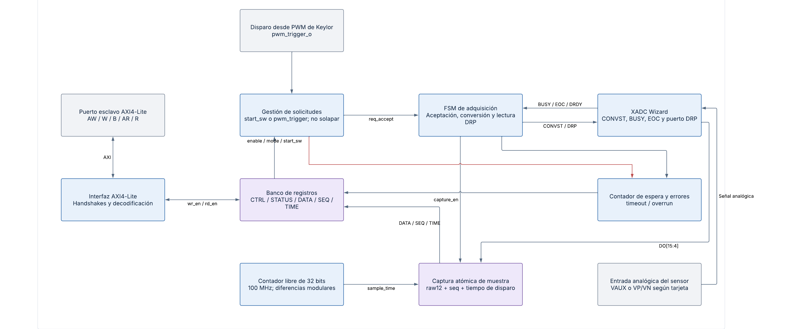
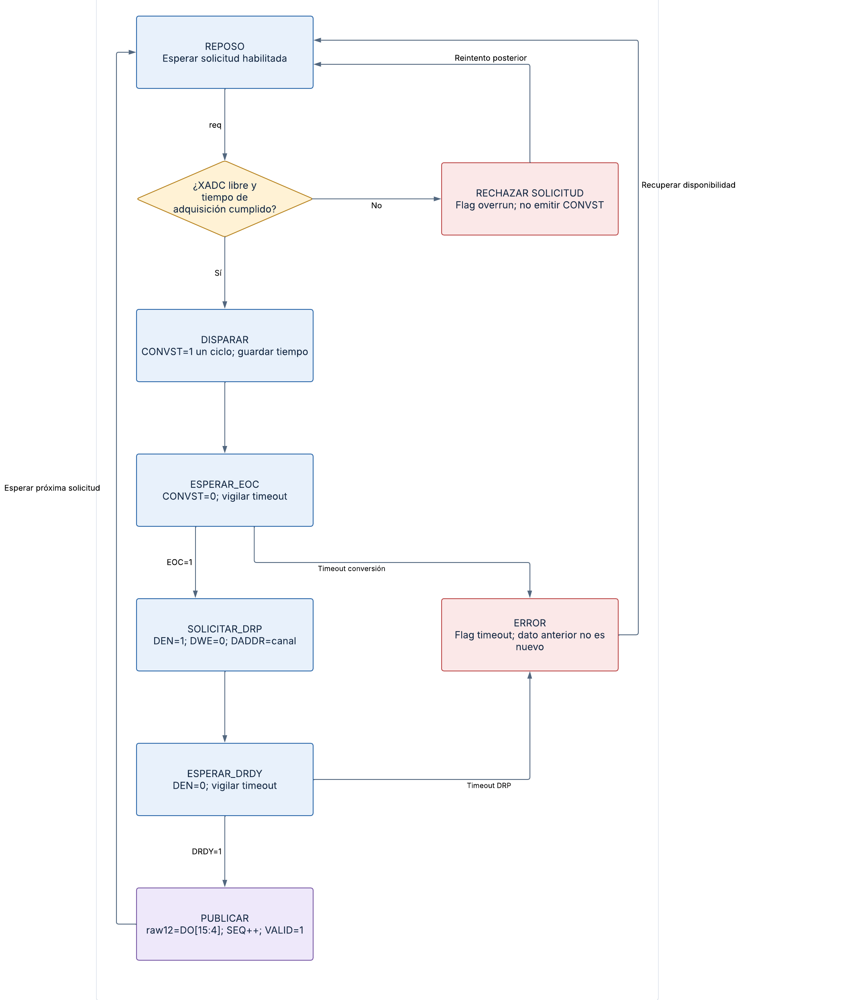
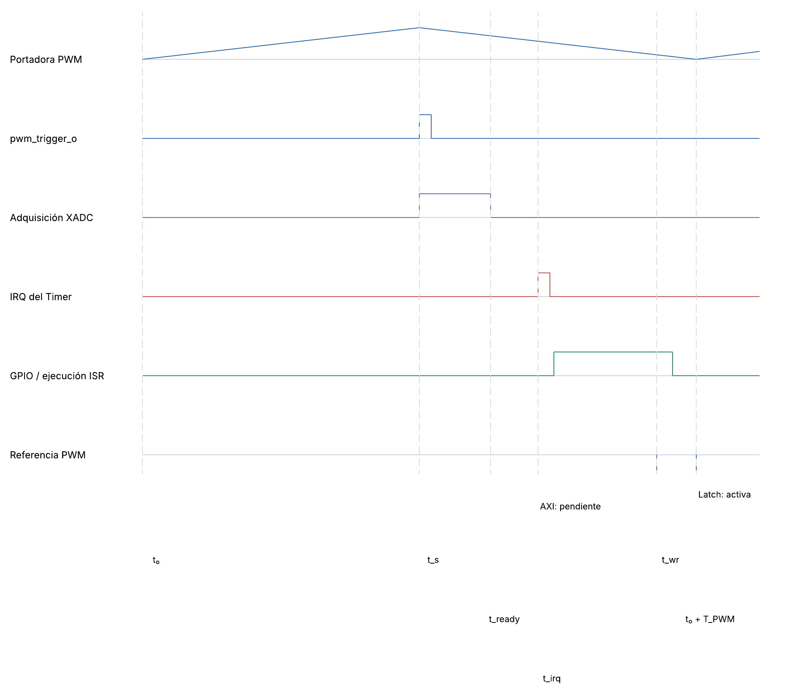
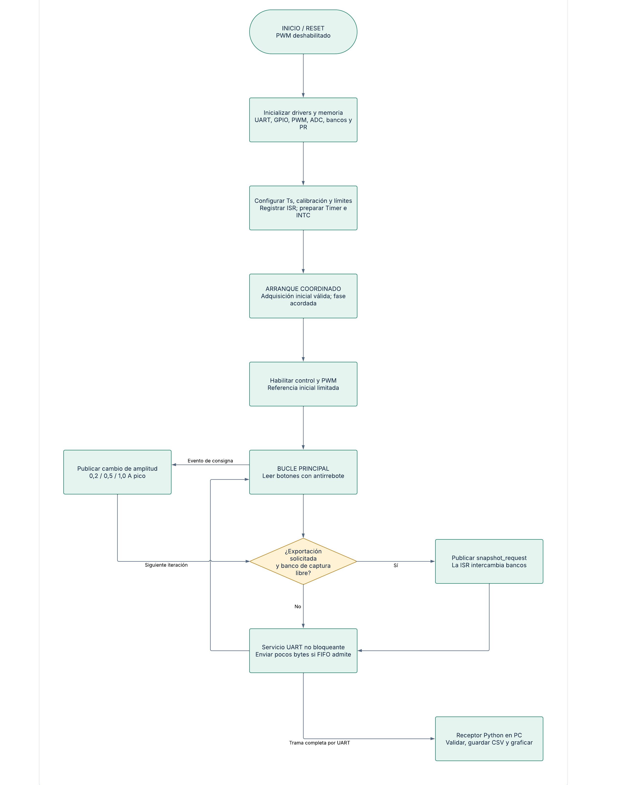
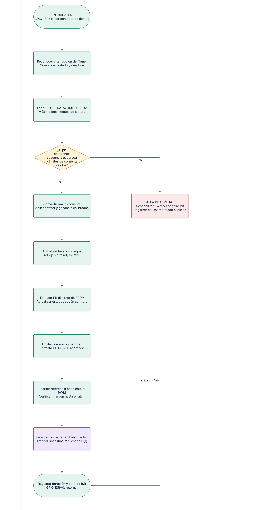
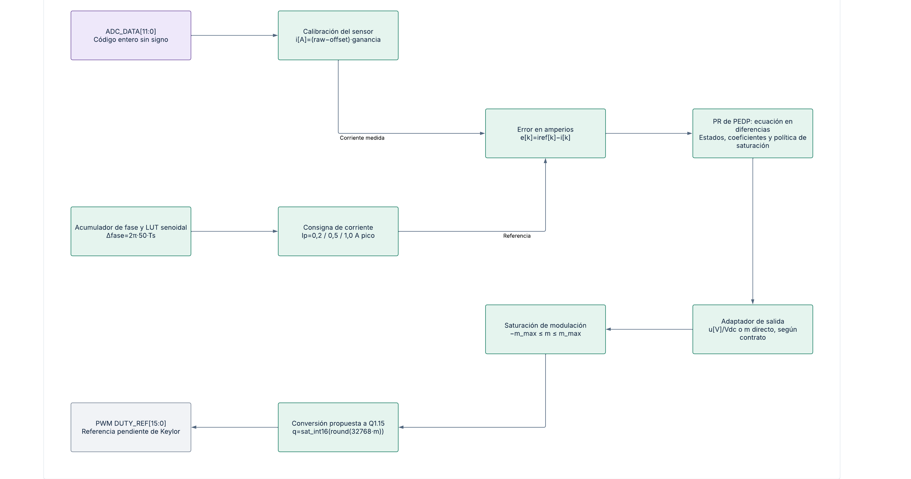
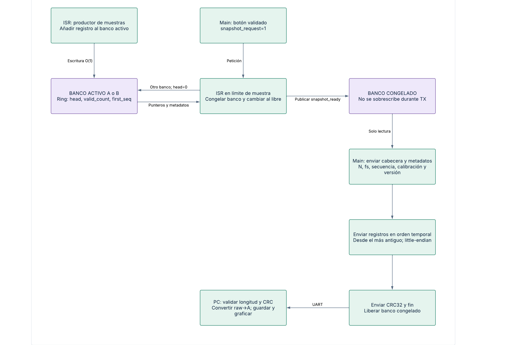

# Adquisición ADC/XADC, firmware y temporización

**Proyecto:** EL3313, Proyecto 4, II semestre de 2026

**Estado:** propuesta de diseño para revisión; implementación y ensayos pendientes

## 1. Contexto del subsistema

El subsistema adquiere la corriente de carga, ejecuta periódicamente el regulador PR discreto en MicroBlaze V y actualiza la referencia del PWM. Incluye interfaces, temporización, calibración, almacenamiento de muestras, botones y exportación UART. PEDP proporciona la ecuación del controlador, sus coeficientes y los parámetros de la etapa de potencia.

El repositorio declara Vivado 2026.1 y el enunciado indica Vivado/Vitis 2025.1. Se debe utilizar una combinación acordada de herramientas, IP y BSP, sin asumir compatibilidad binaria entre exportaciones XSA.

## 2. Requisitos y decisiones base

| Elemento | Definición | Estado |
|---|---|---|
| Procesador | MicroBlaze V a 100 MHz, caché de instrucciones de 8 KB y memoria local de 32 KB | Mínimos del enunciado §4.2.1 |
| Reloj AXI/PWM/ADC | Dominio común de 100 MHz y DCLK continuo | Propuesta de integración; por confirmar en la plataforma |
| Señal medida | Corriente alterna de la carga, representada con offset analógico | Contrato con PEDP |
| Referencia | 50 Hz; 0,2 / 0,5 / 1,0 A pico | Requisito |
| Adquisición | XADC Wizard mediante DRP, wrapper AXI4-Lite propio, un canal unipolar con offset, modo por evento | Propuesta |
| Muestreo y control | Una muestra y una ISR por período PWM | Propuesta base |
| Caso de dimensionamiento | fs = fPWM = 20 kHz; Ts = 50 µs | Por validar con PEDP y WCET |
| Control en C | float32 para calibración, referencia y PR | Decisión inicial sujeta a WCET |
| Referencia del PWM | Q1.15 con signo; saturación previa | Pendiente de definir en la especificación del PWM |
| Histórico | Dos bancos circulares de 2048 registros de 4 bytes | Propuesta |
| UART | 115200 baudios, 8N1, trama binaria y CRC32 | Propuesta |
| Error de adquisición/tiempo | Deshabilitar PWM; PR congelado; rearme explícito | Política propuesta |

Los valores propuestos permiten evaluar recursos y contratos; no constituyen mediciones ni parámetros aprobados por Potencia. La selección final del canal, pinout y rango eléctrico requiere conocer la tarjeta y el sensor. El pinout se determina a partir del esquema de la tarjeta seleccionada.

## 3. Arquitectura de adquisición



*Arquitectura interna del periférico ADC/XADC.*

### 3.1. Recorrido de la muestra

La corriente pasa por el sensor y su acondicionamiento antes de ingresar al canal analógico seleccionado del XADC. El PWM genera **pwm_trigger_o** en el instante acordado. La interfaz acepta la solicitud, solicita conversión, lee el resultado por DRP y publica una tupla formada por dato, secuencia y tiempo del disparo.

El periférico contiene interfaz AXI4-Lite, registros, árbitro de solicitudes, FSM, contador de espera, captura y XADC Wizard. El firmware accede mediante registros MMIO de 32 bits; la dirección base se obtiene de la plataforma exportada desde Vivado.

El XADC trabaja en modo por evento: CONVST determina el inicio de la muestra; EOC señala resultado convertido; la lectura DRP concluye al recibir DRDY. Se mantiene DCLK continuo y se respeta el intervalo de adquisición entre conversiones [R1, R2]. El diseño base no activa promediado multiconversión, para conservar una relación directa entre disparo y muestra.

### 3.2. Señales

| Señal | Dirección respecto de la interfaz | Función |
|---|---|---|
| clk, rst_n | Entrada | Reloj de 100 MHz y reset de lógica |
| pwm_trigger_o | Entrada desde PWM | Solicitud de adquisición sincronizada |
| VAUXP/VAUXN o VP/VN | Entrada analógica al XADC | Canal externo; selección pendiente |
| convst | Salida al XADC | Pulso de inicio de N_convst ciclos; ancho por validar |
| reset_xadc | Salida al XADC | Reset coordinado con el wrapper; esperar disponibilidad antes del primer disparo |
| busy, eoc | Entrada desde XADC | Ocupación y conversión terminada |
| den, dwe, daddr[6:0] | Salida al XADC | Solicitud DRP; lectura con DWE=0 |
| do[15:0], drdy | Entrada desde XADC | Dato y confirmación DRP |
| sample_data[11:0] | Interna | Resultado publicado, alineado a la derecha |
| sample_seq[31:0] | Interna/MMIO | Identificador de muestra |
| sample_time[31:0] | Interna/MMIO | Tiempo del disparo, en ciclos |
| adc_ticks[31:0] | Interna/MMIO | Contador vivo; continúa aunque ENABLE=0 |
| S_AXI | Bidireccional | Configuración y lectura desde MicroBlaze V |

Se supone un dominio síncrono para AXI, PWM e interfaz, con DCLK compatible. Si la integración usa otro dominio, se debe diseñar el cruce de reloj de pulsos y datos; un sincronizador de dos registros por bit no garantiza coherencia de un bus.

### 3.3. Estados y manejo de solicitudes



*FSM de adquisición y lectura DRP.*

La recuperación desde ERROR exige reset coordinado. El ancho CONVST se parametriza en N_convst ciclos; un ciclo requiere validación con el dispositivo.


La FSM recorre REPOSO → DISPARAR → ESPERAR_EOC → SOLICITAR_DRP → ESPERAR_DRDY → PUBLICAR. Cada espera tiene timeout configurable por parámetro de síntesis. El ancho alto/bajo de CONVST se selecciona conforme al dispositivo y al XADC Wizard; la etapa DISPARAR dura N_convst ciclos y no supone sin verificación que un pulso de 10 ns sea suficiente. Ante vencimiento se activa TIMEOUT y no se incrementa SEQ. Una solicitud con adquisición ocupada o sin disponibilidad del XADC se descarta y activa OVERRUN.

START_SW se utiliza en diagnóstico, con SYNC_MODE=0. Durante el control, SYNC_MODE=1 selecciona exclusivamente el trigger PWM. Una escritura START_SW en modo sincronizado se ignora y registra OVERRUN. ENABLE=0 bloquea nuevas solicitudes; una operación ya aceptada puede terminar. Un reset interrumpe la operación, limpia VALID/errores y devuelve la FSM a REPOSO.

Las solicitudes con ENABLE=0 se ignoran sin error. SYNC_MODE solo se cambia con ENABLE=0 y BUSY=0; cambiarlo con operación activa devuelve SLVERR y conserva CTRL. ENABLE y START_SW pueden escribirse juntos en diagnóstico: la aceptación usa el ENABLE resultante. No hay cola de solicitudes.

Tras timeout, la FSM queda en ERROR bloqueado: no emite CONVST/DEN ni acepta disparos y descarta EOC/DRDY tardíos. Borrar TIMEOUT por W1C no rearma la FSM; BUSY permanece en 1 en ERROR. Se exige reset coordinado del wrapper y XADC, con potencia bloqueada, para volver a WARMUP. Esto evita asociar una respuesta vieja a una solicitud nueva. La integración de plataforma debe definir cómo aplicar ese reset; el mapa actual no propone un bit de reset software.

Reset domina todos los estados, cancela la publicación pendiente y limpia CTRL/VALID/errores/DATA/SEQ/TIME/TICKS. La admisión permanece bloqueada hasta terminar la inicialización del XADC y el asentamiento analógico. El tiempo tras reset y el divisor ADCCLK se justifican con la hoja de datos del FPGA seleccionado; BUSY=0 inmediatamente tras reset no basta para admitir una conversión.

En PUBLICAR se captura raw12, se incrementa SEQ y se publica TIME en el mismo flanco. El instante TIME se conserva desde la aceptación del disparo; no se toma al finalizar DRP. Las lecturas no borran la muestra ni VALID. Los errores permanecen hasta limpieza explícita; un error nuevo domina una limpieza coincidente.

Con un canal sin promediado se espera BUSY bajo y se concede el asentamiento recomendado de cuatro ADCCLK antes de la próxima conversión [R1]. DEN se activa un DCLK con DWE=0 y DADDR estable; se captura DO únicamente con DRDY y no se inicia otra lectura hasta que DRDY baje [R9]. El retardo entre aceptar el trigger y el flanco CONVST se mide como parte de la fase real: ADC_TIME no es por sí solo el instante analógico exacto.

El acondicionamiento debe ubicar todo el rango de corriente dentro del rango analógico permitido por el XADC y por la tarjeta [R3]. Una corriente negativa se representa mediante el offset del sensor; no se conecta directamente una tensión negativa al canal unipolar.

### 3.4. Contratos por subbloque de cuarto nivel

| Subbloque y objetivo | Entradas | Salidas | Reset y casos especiales | Validación prevista |
|---|---|---|---|---|
| Interfaz AXI: separar bus y adquisición | AW/W/AR, BREADY/RREADY | B/R y operaciones de registros | Vaciar pendientes; AW/W independientes y backpressure | A12–A14 |
| Registros: exponer configuración y tupla | Escrituras, captura, errores | CTRL, STATUS, DATA/SEQ/TIME/TICKS | Reset a cero; W1C con set dominante | A01, A09–A11, A16 |
| Árbitro: admitir una solicitud | ENABLE, modo, START_SW, trigger, disponibilidad | req_accept, overrun | Sin cola; rechazar ocupado; ignorar deshabilitado | A02–A05, A15 |
| FSM/DRP: obtener conversión válida | req_accept, BUSY, EOC, DRDY, DO | CONVST, DEN/DWE/DADDR, capture_en | Timeout bloquea hasta reset; sin publicación residual | A06–A08, A17–A19 |
| Contador/watchdog: acotar tiempo | clk, reset, inicio/fin | ticks, timestamp, TIMEOUT | TICKS solo reinicia con reset; diferencias modulares | A16–A19, T09 |
| Captura: publicar indivisiblemente | DO[15:4], tiempo del disparo, capture_en | DATA/SEQ/TIME, VALID | Un incremento por éxito; VALID persiste hasta reset | A06–A11 |

Esta separación permite simular protocolo y conversión por separado. Las figuras de adquisición y FSM muestran las relaciones; §3.3 define funcionamiento, reset y condiciones de borde sin atribuir implementación a los bloques.

## 4. Interfaz AXI4-Lite propuesta

### 4.1. Registros del ADC

Todos los offsets son relativos a ADC_BASE. Los bits reservados se leen como cero. Tras reset, ENABLE=0, SYNC_MODE=0, VALID=0, SEQ=0 y errores=0. DATA/TIME no se consideran válidos hasta VALID=1.

Todos los registros y bits definidos reinician a cero. ADC_TICKS incrementa desde el ciclo posterior a retirar reset, independientemente de ENABLE. START_SW y ERR_CLEAR se leen siempre como cero; leer STATUS no limpia flags.

| Offset | Registro | Acceso | Bits y semántica |
|---|---|---|---|
| 0x00 | ADC_CTRL | R/W | bit0 ENABLE; bit1 SYNC_MODE; bit2 START_SW, escritura de pulso y lectura cero |
| 0x04 | ADC_STATUS | RO | bit0 VALID; bit1 BUSY de la interfaz; bit2 OVERRUN; bit3 TIMEOUT |
| 0x08 | ADC_DATA | RO | bits[11:0] raw12; bits[31:12]=0 |
| 0x0C | ADC_SEQ | RO | Contador que incrementa al publicar una muestra |
| 0x10 | ADC_TIME | RO | Tiempo del disparo de la muestra publicada, módulo 2^32 |
| 0x14 | ADC_ERR_CLEAR | WO | Escribir 1 en bit2/3 borra OVERRUN/TIMEOUT; leer devuelve cero |
| 0x18 | ADC_TICKS | RO | Contador RTL vivo de 32 bits a 100 MHz; lectura sin efectos laterales |

DATA se obtiene del campo de conversión de 12 bits del resultado XADC; el wrapper lo entrega alineado a la derecha. Canal, dirección DRP y reloj ADC se parametrizan en hardware y se registran en el contrato de integración.

Se usa `raw12=DO[15:4]` para el canal unipolar propuesto [R10]. OVERRUN significa solicitud rechazada por ocupación, indisponibilidad o START_SW en modo sincronizado; no significa «muestra no leída». El wrapper no conoce los consumos de software: una muestra sobrescrita antes de la ISR se detecta por SEQ.

La interfaz propia acepta AW y W independientemente, respeta WSTRB y solo escribe cuando dispone de ambas transferencias. Mantiene BVALID y RVALID, junto con sus respuestas y datos, hasta su aceptación. Escrituras en registros RO no los modifican; accesos desalineados o a offsets no implementados devuelven SLVERR. Esta política corresponde al IP propio, no redefine el comportamiento de las IP de AMD.

Se propone SLVERR también al escribir RO. WSTRB selecciona bytes en CTRL y ERR_CLEAR; strobe nulo no tiene efectos. Bits reservados escritos se ignoran. MMIO usa accesos ordenados de 32 bits sin caché. RDATA se fija al aceptar AR y no cambia mientras RREADY esté bajo aunque se publique una nueva muestra.

### 4.2. Lectura coherente

La ISR lee SEQ1, DATA, TIME, STATUS y SEQ2. Acepta la tupla si SEQ1=SEQ2, VALID=1, no hay errores y SEQ2 es el siguiente identificador esperado, usando aritmética uint32. Se admite como máximo un reintento adicional. La ISR no espera indefinidamente una conversión.

En WARMUP se establece last_seq a partir de una primera tupla válida y se inicia la fase de referencia. Desde RUNNING se exige el incremento de uno. Un salto de secuencia, dato repetido o tiempo excesivamente antiguo genera falla. El desbordamiento de 0xFFFFFFFF a 0 es válido.

La guardia SEQ1/SEQ2 requiere publicación simultánea en hardware y lecturas MMIO en el orden indicado, sin caché. Se valida la antigüedad modular `now-ADC_TIME` contra la ventana de fase acordada. Un reset durante RUNNING causa FAULT y nueva línea de base en WARMUP; no se interpreta como wrap normal.

### 4.3. Interfaz con el PWM

Se conservan CONTROL_STATUS en offset 0x00 y DUTY_REF en 0x04 según el enunciado. El driver escribe solo campos R/W, conserva frecuencia y habilitación y no interpreta running como campo escribible.

DUTY_REF se escribe como valor pendiente y se aplica en el valle siguiente de la portadora, conforme al contrato de actualización del PWM. Los offsets de tiempo muerto, sincronización y otras funciones se definen en la especificación del PWM. Un GPIO de falla software y una protección rápida de hardware deben disponer de una ruta de deshabilitación definida.

## 5. Temporización e interrupciones

### 5.1. AXI Timer

Se propone AXI Timer con dos contadores independientes de 32 bits, sin cascada ni modo PWM del Timer. El contador 0 produce la interrupción de control y generateout0. El contador 1 queda disponible como instrumento auxiliar, con interrupción deshabilitada; las métricas ISR usan ADC_TICKS. Los dos usan s_axi_aclk=100 MHz [R4].

Offsets respecto de TIMER_BASE [R5]:

| Offset | Registro | Uso |
|---|---|---|
| 0x00 / 0x04 / 0x08 | TCSR0 / TLR0 / TCR0 | Configuración, recarga y cuenta de control |
| 0x10 / 0x14 / 0x18 | TCSR1 / TLR1 / TCR1 | Canal auxiliar opcional; interrupción deshabilitada |

Para cuenta descendente en Generate, PG079 especifica [R6]:

$$T_s=(TLR0+2)T_{clk}$$

$$TLR0=\operatorname{round}(f_{clk}T_s)-2$$

| fs propuesta | Ts | Ciclos de período | TLR0 |
|---|---:|---:|---:|
| 10 kHz | 100 µs | 10000 | 9998 |
| 20 kHz | 50 µs | 5000 | 4998 |
| 25 kHz | 40 µs | 4000 | 3998 |

Estos son casos de cálculo, no una aprobación de las frecuencias del PWM. Si se utiliza un driver que recibe ciclos en lugar del valor crudo TLR, se revisa su implementación para no aplicar dos veces la compensación.

El código oficial de `XTmrCtr_SetResetValue` consultado escribe ResetValue directamente en TLR [R11]: para ese contrato se pasa 4998, sin una segunda resta. Aún se debe comprobar la revisión incluida en el BSP real y medir el intervalo; no hay XSA/BSP en esta base.

Configuración de TCSR0 [R7]:

| Campo | Valor de operación |
|---|---|
| MDT0 | 0: Generate |
| UDT0 | 1: descendente |
| GENT0 | 1: salida de evento |
| ARHT0 | 1: recarga automática |
| ENIT0 | 1: interrupción habilitada |
| ENT0 | 1 después de preparar el sistema |
| LOAD0 | Pulso de carga; 0 durante operación |
| CASC / PWMA0 | 0 |
| T0INT | Reconocimiento mediante escritura de 1 |

Orden de configuración: detener; programar TLR0; activar LOAD; retirar LOAD; limpiar interrupción pendiente; registrar y habilitar el handler; armar el arranque PWM; habilitar el Timer. La ISR reconoce T0INT y el controlador de interrupciones según los drivers del BSP, sin borrar accidentalmente los campos de control [R6, R7].

La medición principal usa ADC_TICKS, contador RTL que incrementa cada ciclo módulo 2^32, sin recarga programada. Se calculan diferencias uint32 entre lecturas separadas menos de un wrap (42,95 s). Así, una ejecución de 50 s sigue midiendo correctamente sus intervalos de 50 µs aunque el contador se desborde. ADC_TIME conserva el valor de ese mismo contador asociado a la muestra; no es un reloj vivo. Timer 1 puede configurarse para diagnóstico separado, sin asumir que una recarga del Timer tiene el mismo comportamiento que un contador RTL libre.

### 5.2. Camino de interrupción

Timer interrupt → AXI Interrupt Controller → entrada Interrupt de MicroBlaze V → despachador del BSP → ISR de control. Se configura el tipo de interrupción coherente con la fuente; la condición del Timer se reconoce antes de retornar. MicroBlaze V requiere habilitar las interrupciones externas y globales correspondientes [R8].

Para seguir el reconocimiento temprano de §6.2 se propone conectar a INTC un adaptador ISR propio del Timer: comprueba T0INT/ENIT0 y escribe el W1C conservando los bits R/W antes del cálculo. No debe encadenar además `XTmrCtr_InterruptHandler`, cuyo código oficial invoca el callback antes de limpiar el flag [R12]. Si se elige ese handler AMD, se adapta y documenta el orden del flujo. INTC y el prólogo/epílogo del BSP conservan sus responsabilidades; no se duplican reconocimientos ni se recarga el Timer en cada ISR.

El control tiene prioridad sobre UART y botones. En el diseño base, main consulta GPIO/UART sin interrupciones de transmisión y la ISR de control no se anida. Las secciones críticas de main se limitan al intercambio de metadatos y su duración se incorpora al presupuesto temporal. ADC_TICKS es una ampliación propuesta de la interfaz conceptual de Lucid y debe incluirse al implementar el wrapper.

### 5.3. Sincronización propuesta y presupuesto



*Relación temporal entre PWM, adquisición, Timer e ISR.*

La misma frecuencia no establece fase. Como contrato propuesto entre los subsistemas PWM y plataforma se define un arranque en hardware: con el PWM de potencia bloqueado, un circuito armado emite **sync_start_i** al primer generateout0. El PWM carga una posición inicial de su portadora que representa la fase de IRQ acordada. Este puerto y su lógica todavía requieren aceptación e implementación por los responsables; no existen por defecto en AXI Timer ni se suponen presentes en el PWM.

Caso de diseño a 20 kHz:

- Portadora triangular de 5000 ciclos, N=2500, sin repetir extremos.
- Muestra en el pico: fase 2500, equivalente a 25 µs desde el valle.
- IRQ en fase 3500: 35 µs desde el valle.
- Latch de referencia en fase 5000: siguiente valle, a 50 µs.
- Al primer generateout0, cargar carrier=1500 y dirección descendente; a continuación la portadora evoluciona normalmente. El primer servicio es WARMUP y no ejecuta el PR. La base de tiempo debe operar durante WARMUP aunque las cuatro salidas de potencia estén bloqueadas; este bloqueo es independiente del arranque de la portadora.
- Con reloj común y períodos de 5000 ciclos, las IRQ posteriores conservan esa fase. Cualquier latencia de registros de sincronización se mide y compensa en la carga de fase.

El margen muestra→IRQ es 10 µs. El margen IRQ→latch es 15 µs y debe contener latencia de interrupción, lectura, cálculo, escritura y margen de establecimiento. El retardo nominal muestra→actuación es 25 µs, más los efectos analógicos; PEDP debe incluirlo en el modelo.

$$T_{trigger\to CONVST,max}+T_{adc\to EOC,max}+T_{drp\to publicacion,max}+M_{adc}<10\,\mu s$$

$$L_{irq,max}+C_{hasta\ escritura,max}+T_{AXI,max}+M_{act}<15\,\mu s$$

$$L_{irq,max}+C_{ISR,total,max}<50\,\mu s$$

Los términos no son tiempos medidos. C_hasta escritura excluye la transferencia final; C_ISR,total incluye registro de muestras, instrumentación y retorno. Si float32 no cumple, se optimiza o se cambia Ts y se recalculan PR, fase y registros antes de energizar. El primer PWM habilitado utiliza referencia segura; RUNNING requiere muestra válida y sincronización verificada.

En ciclos, los presupuestos del ejemplo son 1000 desde trigger hasta IRQ, 1500 desde IRQ hasta latch y 5000 hasta la siguiente IRQ. Los márgenes M_adc/M_act, el timeout de conversión/DRP y la cota máxima de antigüedad se fijan después de conocer ADCCLK y medir la plataforma; no se usa 50 µs como único deadline de escritura. Una comprobación previa a MMIO reserva T_AXI,max y el margen, y una posterior detecta cualquier incumplimiento. Detectar una escritura tardía no deshace un latch: el bloqueo independiente de compuertas y su prioridad sobre DUTY_REF se definen en el contrato de protección del PWM. La seguridad no depende de que el software siempre alcance ese límite.

Un cambio de frecuencia del sistema cerrado se realiza con PWM bloqueado: detener, reconfigurar Timer/PWM/PR, rearmar fase y reiniciar WARMUP. La prueba de cambio de frecuencia en caliente del IP PWM corresponde a la validación del periférico PWM y no implica que el controlador integrado pueda cambiar Ts sin rediseño.

## 6. Arquitectura del firmware

| Componente previsto | Ubicación | Responsabilidad |
|---|---|---|
| Aplicación y estados | vitis/app/ | Inicialización, main, WARMUP/RUNNING/FAULT |
| ISR y control | vitis/app/ | Lectura periódica, PR, actualización y registro |
| Drivers propios ADC/PWM | vitis/drivers/ | Accesos MMIO y semántica de registros |
| Drivers AMD | BSP generado | Timer, INTC, GPIO y UART Lite |
| Receptor Python | scripts/ | Decodificar trama, convertir, graficar y guardar CSV |

Se mantienen INIT, WARMUP, RUNNING y FAULT como estados de control. El estado de transmisión es independiente: IDLE, WAIT_SNAPSHOT, HEADER, RECORDS y CRC. Por tanto, RUNNING puede coexistir con una exportación.

### 6.1. Inicialización y main



*Inicialización y bucle principal del firmware.*

La inicialización mantiene las salidas bloqueadas, comprueba configuración y calibra a partir de valores suministrados. Después prepara coeficientes, memoria, drivers y sincronización. WARMUP establece la primera secuencia válida; RUNNING habilita el control cuando los contratos están satisfechos. Si falta calibración o PR válido, se permite diagnóstico con potencia deshabilitada.

WARMUP mantiene portadora y disparos activos con compuertas bloqueadas; la primera IRQ del arranque no exige una muestra previa. La espera de una primera tupla válida tiene límite de períodos y diagnóstico de fallo. La liberación del bloqueo se solicita para un valle, con referencia limitada y PR inicializado; no por una escritura asíncrona que recorte un pulso. El contrato debe distinguir ENABLE de potencia, portadora activa y running. Si el PWM solo permite detener todo con ENABLE=0, este arranque no puede darse por válido y se debe rediseñar su mecanismo de habilitación.

Main filtra botones, publica cambios de amplitud, solicita snapshots y transmite un número acotado de bytes si la FIFO UART dispone de espacio. No transmite bloques completos dentro de una sección crítica ni deshabilita interrupciones durante el envío.

### 6.2. Atención periódica



*Rutina periódica de control.*

1. Elevar GPIO_ISR y capturar el tiempo de entrada.
2. Reconocer el Timer; distinguir WARMUP, RUNNING o FAULT.
3. Leer una tupla ADC coherente con hasta dos intentos.
4. Comprobar secuencia, antigüedad, errores y umbrales raw calibrados.
5. Convertir la muestra y evaluar la referencia en el instante de muestreo.
6. Calcular error y PR.
7. Saturar, cuantizar y comprobar tiempo restante hasta el latch.
8. Escribir DUTY_REF pendiente y confirmar la finalización MMIO.
9. Registrar raw e iref; atender intercambio de bancos en O(1).
10. Actualizar métricas; bajar GPIO_ISR y retornar.

Cada rama tiene tiempo acotado. Un fallo de dato, cálculo no finito, sobrecorriente o deadline conduce a FAULT, deshabilita PWM y congela estados del PR. No se reutiliza un dato anterior fingiendo que se adquirió una muestra nueva. FAULT sigue atendiendo las interrupciones necesarias para exportar diagnóstico; el rearme es explícito con potencia bloqueada.

### 6.3. Pseudocódigo de contrato

```text
timer_isr():
    entrada = ADC_TICKS; GPIO_ISR = 1
    reconocer_fuente_timer_sin_recargar()
    si FAULT: atender_snapshot_de_diagnostico(); ir a salida
    tupla = leer_SEQ_DATA_TIME_STATUS_SEQ(max_intentos=2)
    si WARMUP:
        validar_primera_muestra_o_limite_de_espera(tupla)
        fijar_last_seq_y_fase_si_valida(); ir a salida
    si tupla invalida, vieja, con errores o seq != last_seq+1:
        bloquear_compuertas_y_entrar_FAULT(); ir a salida
    aplicar_consigna_pendiente_en_limite_de_muestra()
    i = calibrar(tupla.raw); iref = referencia(tiempo_de_muestreo)
    u = PR_PEDP(iref-i); q = limitar_escalar_y_cuantizar(u)
    si no_finito(u) o no_hay_margen_para_MMIO_y_latch():
        bloquear_compuertas_y_entrar_FAULT(); ir a salida
    escribir_referencia_pendiente_y_completar_MMIO(q)
    comprobar_deadline_posterior_y_registrar_fallo_si_procede()
    registrar_solo_si_continua_valida_la_muestra_y_su_intervalo()
    atender_snapshot_en_O(1); last_seq = tupla.seq
salida:
    actualizar_metricas_acotadas(); GPIO_ISR = 0; retornar
```

Las funciones representan requisitos y no código compilable. El servicio de main usa solicitudes y metadatos publicados atómicamente, mantiene las interrupciones habilitadas y limita cada llamada UART. Los estados del PR se reinician con el contrato PEDP durante el rearme; no se reanuda una historia antigua después de cambiar Ts.

## 7. Procesamiento y formato numérico



*Ruta numérica del regulador.*

### 7.1. Calibración y referencia

La conversión es:

$$i[k]=(raw[k]-offset_{code})\,gain_{A/code}$$

Offset, ganancia y signo provienen del sensor/acondicionamiento real. Se verifican al menos cero y dos puntos de corriente conocidos; se conservan unidades en amperios.

La referencia se obtiene mediante tabla senoidal y acumulador de fase:

$$i_{ref}[k]=I_p\sin(\theta_k),\qquad \theta_{k+1}=\theta_k+2\pi50T_s$$

El origen de fase se relaciona con ADC_TIME. Un cambio de amplitud mantiene continuidad de fase y se aplica en un límite de muestra. El valor exportado es la referencia efectivamente utilizada en esa muestra.

### 7.2. PR y adaptación al PWM

Se selecciona float32 como implementación inicial por claridad de unidades y ajuste de coeficientes. No se supone FPU: se mide WCET sobre la configuración real del MicroBlaze V y se usan constantes del tipo adecuado. Punto fijo queda como alternativa si las pruebas de tiempo o memoria lo requieren, con análisis propio de rangos.

Si PEDP entrega un PR de segundo orden normalizado, el contrato se puede expresar como:

$$u[k]=b_0e[k]+b_1e[k-1]+b_2e[k-2]-a_1u[k-1]-a_2u[k-2]$$

La ecuación es una forma de interfaz, no una sintonización. Se registran a1, a2, b0, b1, b2, Ts, inicialización, unidades, límites y política de anti-windup de PEDP. Si la estructura entregada es diferente se adapta esta sección. Los estados internos siguen la política de anti-windup especificada por PEDP.

Para salida de control en voltios, m=u/Vdc; si PEDP entrega modulación normalizada, no se divide otra vez. Vdc debe estar medido o justificado como parámetro fijo de la fuente. Se limita m a ±m_max y se convierte al formato acordado:

$$q=\operatorname{sat}_{int16}\left(\operatorname{round}(32768m)\right)$$

Q1.15 representa [-1, 1−2^-15]. El límite final puede ser menor por el driver y el tiempo muerto. La saturación final de hardware se mantiene como verificación adicional. Se registra saturación sostenida como condición diagnóstica y se aplica la política aprobada por PEDP.

## 8. Memoria y exportación UART

### 8.1. Bancos circulares



*Captura circular y exportación mediante UART.*

Cada registro contiene raw_adc:uint16 e iref_mA:int16, serializados campo por campo. No se transmite una estructura C cruda con padding. El error de redondeo de iref_mA es como máximo 0,5 mA.

Dos bancos de N=2048 ocupan 16384 bytes. A 20 kHz, cada banco cubre 102,4 ms, equivalentes a 5,12 períodos de 50 Hz. Se revisa el mapa del linker para código, stack y metadatos; el mínimo de 32 KB de BRAM no garantiza que toda la aplicación quepa. Se amplía memoria si hace falta.

102,4 ms es la capacidad N/fs; el intervalo entre la primera y última muestra es (N−1)/fs = 102,35 ms. Para cubrir cinco períodos completos de 50 Hz con ambos extremos se requieren al menos `ceil(5·fs/50)+1` muestras: 2001 a 20 kHz. El receptor verifica esa duración y selecciona una ventana de cinco períodos para el análisis de fundamental; no confunde toda la captura de 5,12 períodos con una ventana entera coherente.

La ISR escribe el banco activo. Ante solicitud de exportación y banco libre, después de registrar la muestra congela sus punteros y cambia al otro banco en O(1). Main espera snapshot_ready y transmite el banco congelado desde el más antiguo. La ISR no lo modifica hasta su liberación. Se usa intercambio coherente de metadatos y barreras apropiadas; volatile por sí solo no constituye sincronización.

Propiedad de los bancos: solo la ISR modifica el activo y hace FREE→ACTIVE→FROZEN; main solo lee FROZEN y publica su liberación como FREE después de encolar el último byte y dejar de usar sus datos. Las solicitudes se consumen en ISR; main no cambia punteros. La publicación de snapshot_ready incluye head, valid_count, first_seq, first_time, calibración y flags del mismo intervalo. Puede usarse una sección crítica corta en main para entregar/recibir metadatos, contabilizada en L_irq,max. El índice del registro más antiguo es `(head-valid_count+N)%N` si head apunta a la siguiente escritura. El intercambio deja el nuevo activo con head=0 y valid_count=0.

Una exportación durante otra transmisión responde mediante indicador ocupado. Se exportan valid_count registros, no posiciones sin inicializar. Si aún no existen cinco ciclos, se identifica la captura como corta y no se usa para evaluar el criterio estacionario del enunciado.

### 8.2. Protocolo binario v1 propuesto

Todos los enteros son little-endian; float32 usa IEEE-754 y se serializa explícitamente. Cabecera fija de 48 bytes:

| Byte | Campo | Tipo |
|---:|---|---|
| 0–3 | Magic ASCII TDD4 | 4 bytes |
| 4 | Versión = 1 | uint8 |
| 5 | Tipo = 1, captura | uint8 |
| 6–7 | header_bytes = 48 | uint16 |
| 8–11 | capture_id | uint32 |
| 12–15 | sample_count | uint32 |
| 16–19 | fs_hz | uint32 |
| 20–23 | first_seq | uint32 |
| 24–27 | first_sample_time_ticks | uint32 |
| 28–31 | offset_code | float32 |
| 32–35 | gain_A_per_code | float32 |
| 36–37 | record_bytes = 4 | uint16 |
| 38–39 | flags | uint16 |
| 40–43 | sample_period_ticks | uint32 |
| 44–47 | payload_bytes = 4·sample_count | uint32 |

Flags: bit0 captura corta; bit1 falla de control registrada; bit2 error de adquisición en el intervalo; resto reservado. Tras la cabecera se envían N registros de 4 bytes y un uint32 CRC32/ISO-HDLC sobre cabecera y payload. Parámetros CRC: polinomio reflejado 0xEDB88320, init=0xFFFFFFFF, xorout=0xFFFFFFFF; vector de comprobación ASCII 123456789 → 0xCBF43926. No se añade un terminador ambiguo: longitud y CRC delimitan la captura.

En la trama, N es sample_count y puede ser menor que la capacidad 2048. Debe cumplir 1≤N≤2048, payload_bytes=4N, record_bytes=4, fs_hz>0, calibración finita y 0≤raw≤4095. El bit0 indica que `(N−1)/fs < 0,1 s`; una captura vacía no se transmite como medición válida. El formato v1 supone reloj de ticks de 100 MHz y período entero en ciclos: si cambia ese reloj se revisa el protocolo. Un wrap de first_seq/first_sample_time_ticks se interpreta módulo 2^32.

Para N=2048, la trama mide 8244 bytes. Su tiempo mínimo a 115200 y 8N1 es 8244·10/115200=0,715625 s; pausas de servicio pueden aumentarlo. El control sigue activo durante ese tiempo.

El receptor busca magic, valida versión y longitudes contra un máximo configurado, recibe con timeout y verifica CRC. Nunca acepta una captura truncada como completa. Al detectar error descarta la trama y busca una cabecera nueva; el flujo puede contener el magic dentro del payload, por lo que no se reinicia una trama válida solo por reconocer esos bytes.

CSV mínimo: capture_id, sample_index, seq, time_s, raw_adc, i_meas_A e i_ref_A. Se reconstruye time_s=k/fs y se conservan metadatos originales. La calibración y fs permanecen constantes dentro de una captura; si cambian se inicia una adquisición nueva. Un fallo que rompa continuidad termina el banco antes de incorporar datos discontinuos y se indica en flags.

Los flags pertenecen a la captura, no al momento posterior de transmisión: una captura FROZEN no cambia aunque falle después el control. En FAULT se conserva el último intervalo continuo del activo para exportarlo cuando haya banco libre; no se sobrescribe el congelado ni se agregan datos repetidos para llenar N. La trama permite reconstruir tiempos uniformes porque prohíbe mezclar intervalos discontinuos.

La adquisición sincronizada sirve para seguimiento de la componente de 50 Hz; no demuestra por sí sola el rizado de conmutación. La medición del rizado requiere osciloscopio o adquisición de mayor ancho de banda, coordinada con PEDP.

## 9. Botones y medición temporal

Se proponen eventos de GPIO para EXPORTAR, CAMBIAR_AMPLITUD y REARMAR; su asignación física se define durante la integración de GPIO. El antirrebote de firmware exige estado estable durante 20 ms medidos con base temporal, no mediante espera bloqueante. El evento se produce una sola vez por pulsación.

GPIO_ISR alto mide la ventana instrumentada. Período efectivo: Δt entre entradas sucesivas. Jitter de intervalo: Δt−Ts; reportar mínimo, máximo, media y desviación. Latencia: entrada ISR menos evento Timer; no confundirla con el período. Se compara una ejecución sin UART y otra exportando, durante al menos un millón de períodos (50 s a 20 kHz). Las métricas usan diferencias modulares de ADC_TICKS entre eventos consecutivos; se contabilizan secuencias perdidas y deadlines.

GPIO y dos lecturas MMIO no cubren automáticamente todo el prólogo/epílogo del BSP. La medición de C_ISR,total incluye ese costo y el despachador mediante traza/ILA o cota justificada. La latencia se contrasta con generateout0 y sync_start_i; se mide además el retardo trigger→CONVST para fechar la referencia en el instante físico de muestreo. Los 10 ns de TICKS son resolución del contador, no exactitud total de la instrumentación.

El límite de aceptación temporal es satisfacer todas las desigualdades de la sección 5.3 con márgenes documentados, cero pérdidas y cero deadlines en la prueba definida. Cualquier objetivo adicional de jitter debe acordarse con PEDP; no se presenta un valor no medido como resultado.

## 10. Acuerdos pendientes antes de la implementación integrada

| ID | Acuerdo | Participantes | Condición de cierre |
|---|---|---|---|
| C1 | Tarjeta, canal, pinout y rango analógico | Plataforma, adquisición y PEDP | Esquema y constraints verificados |
| C2 | Offset, ganancia, signo y umbrales raw | Adquisición y PEDP | Calibración registrada |
| C3 | Ts, fPWM y fase de disparo | Equipo digital y PEDP | Presupuesto temporal y PR coherentes |
| C4 | sync_start_i, posición inicial, latch y portadora independiente del bloqueo de compuertas | Plataforma, PWM y firmware | Simulación conjunta sin deriva, prioridad de bloqueo y liberación en valle |
| C5 | Formato, límites y registros PWM | PWM y firmware | Tabla y driver compatibles |
| C6 | Ecuación PR, coeficientes y anti-windup | PEDP y firmware | Vectores de referencia aprobados |
| C7 | WCET float32, memoria, reloj de bus y combinación Vivado/Vitis/BSP | Plataforma y firmware | Tiempo/linker map aceptables y versiones registradas |
| C8 | Reset de recuperación del wrapper/XADC y cotas CONVST/ADCCLK/watchdog | Plataforma y firmware | Sin respuesta tardía publicada; tiempos validados con dispositivo/IP |

La habilitación del lazo integrado requiere cerrar estos contratos y completar las pruebas de adquisición, temporización y firmware.

## 11. Referencias

- Enunciado oficial EL3313_proyecto4_2S2026.pdf, secciones 4.2–4.3, 6 y 7; documento suministrado por el curso.
- [R1 — AMD UG480: Event-Driven Sampling](https://docs.amd.com/r/en-US/ug480_7Series_XADC/Event-Driven-Sampling).
- [R2 — AMD UG480: Instantiating the XADC](https://docs.amd.com/r/en-US/ug480_7Series_XADC/Instantiating-the-XADC).
- [R3 — AMD UG480: Analog Inputs](https://docs.amd.com/r/en-US/ug480_7Series_XADC/Analog-Inputs).
- [R4 — AMD PG079: Functional Description](https://docs.amd.com/r/en-US/pg079-axi-timer/Functional-Description).
- [R5 — AMD PG079: Register Space](https://docs.amd.com/r/en-US/pg079-axi-timer/Register-Space).
- [R6 — AMD PG079: Generate Mode](https://docs.amd.com/r/en-US/pg079-axi-timer/Generate-Mode).
- [R7 — AMD PG079: Control/Status Register 0](https://docs.amd.com/r/en-US/pg079-axi-timer/Control/Status-Register-0-TCSR0).
- [R8 — AMD UG1629: External Interrupt](https://docs.amd.com/r/en-US/ug1629-microblaze-v-user-guide/External-Interrupt).
- [R9 — AMD UG480: DRP Timing](https://docs.amd.com/r/en-US/ug480_7Series_XADC/Dynamic-Reconfiguration-Port-DRP-Timing).
- [R10 — AMD UG480: ADC Transfer Functions](https://docs.amd.com/r/en-US/ug480_7Series_XADC/ADC-Transfer-Functions).
- [R11 — AMD embeddedsw: xtmrctr.c](https://github.com/Xilinx/embeddedsw/blob/master/XilinxProcessorIPLib/drivers/tmrctr/src/xtmrctr.c).
- [R12 — AMD embeddedsw: xtmrctr_intr.c](https://github.com/Xilinx/embeddedsw/blob/master/XilinxProcessorIPLib/drivers/tmrctr/src/xtmrctr_intr.c).

La configuración del driver y las IP se verifica contra la versión efectiva del proyecto.
