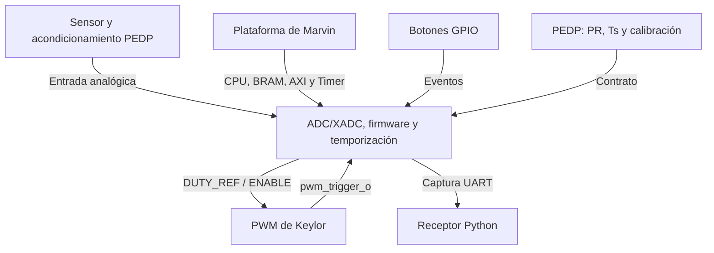
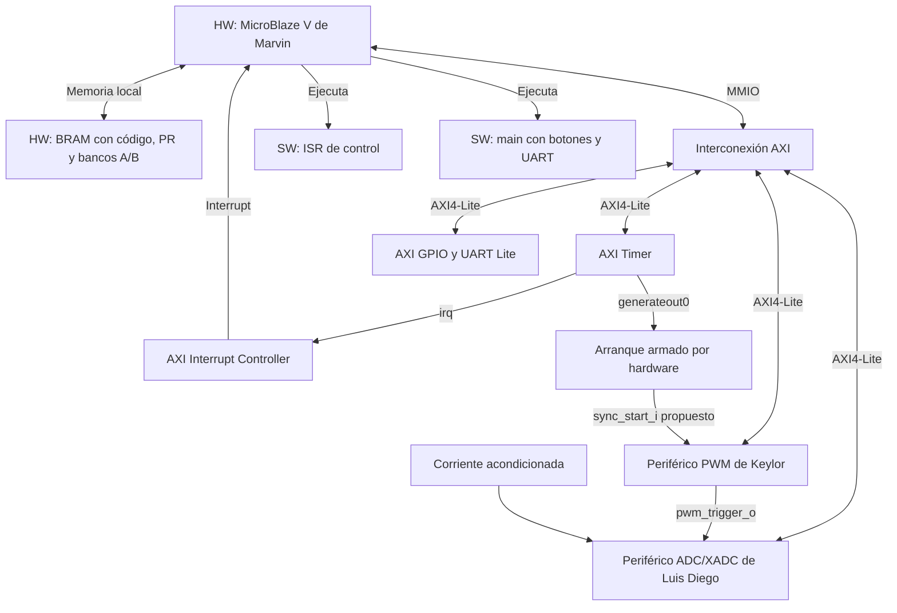
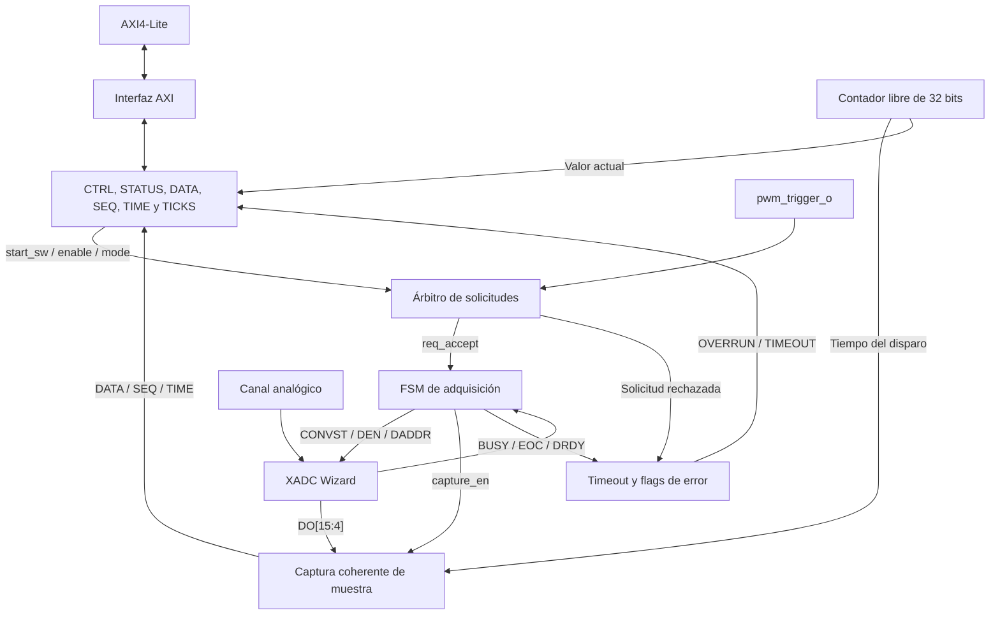
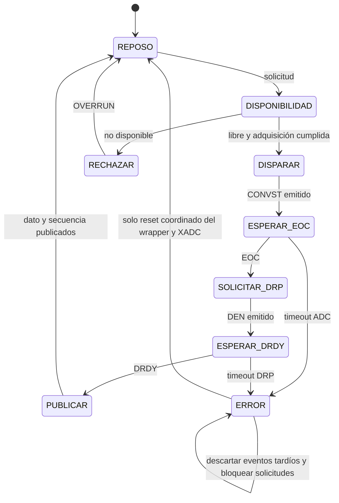
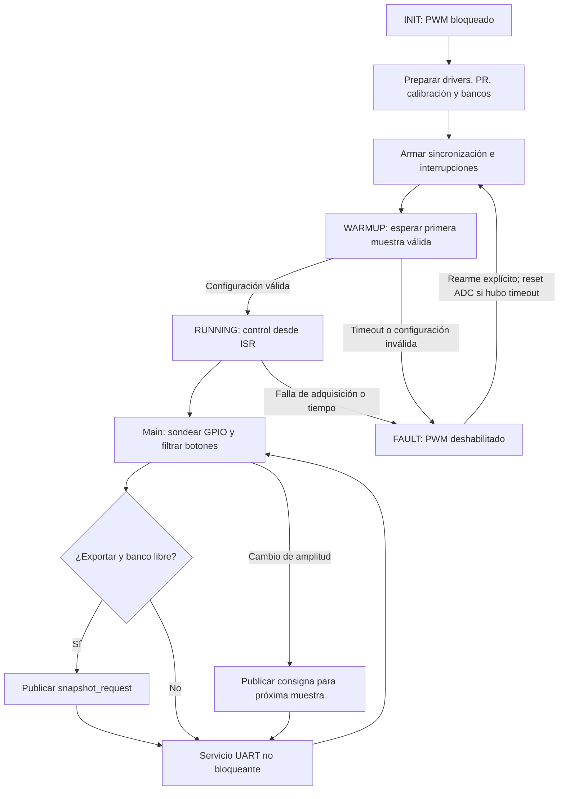
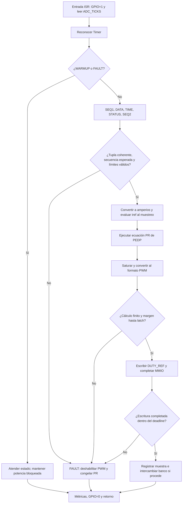
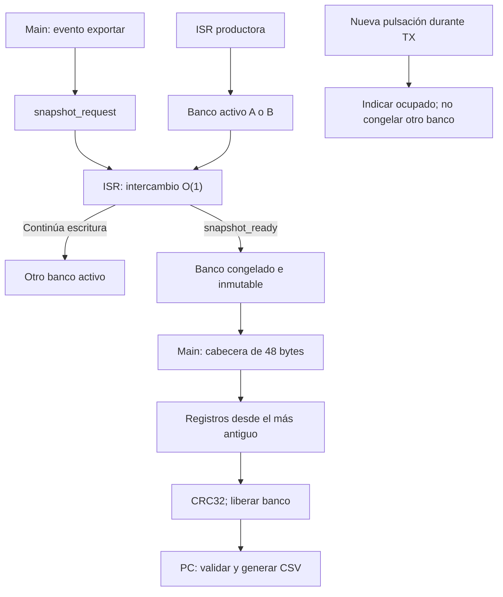
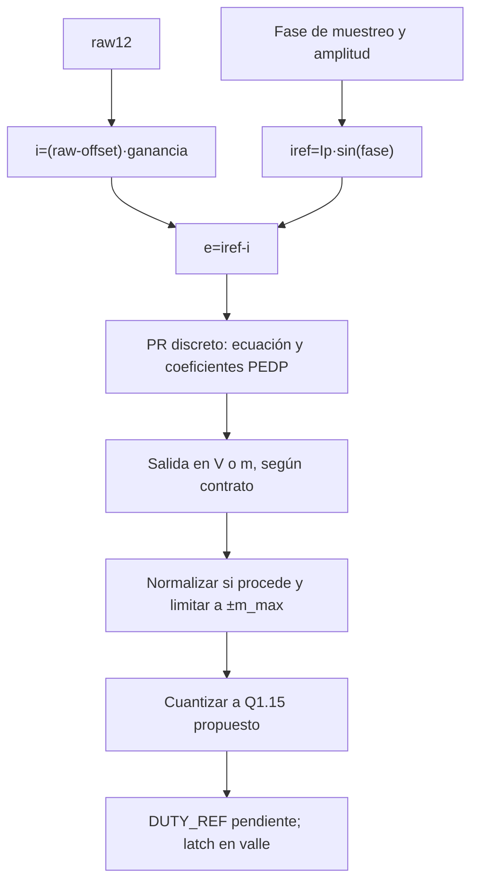
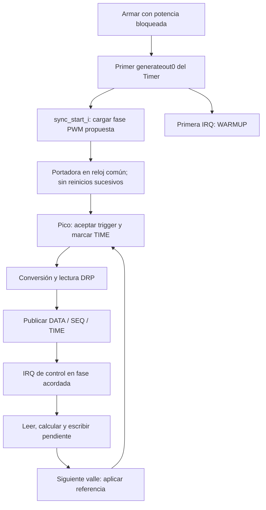
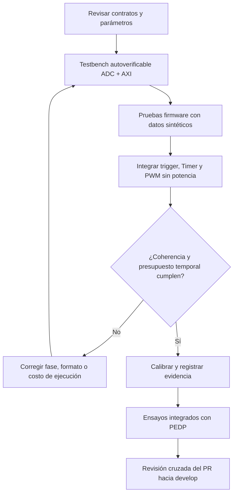

# Diagramas de adquisición, firmware y temporización

**Responsable:** Luis Diego Álvarez · **Issue:** #3

[Volver al diseño](../03_adquisicion_firmware_temporizacion.md) · [Plan de verificación](../03_verificacion_adc_firmware.md)

Los diagramas siguientes son fuente Mermaid editable y se visualizan dentro de GitHub. La versión en [Lucid](https://lucid.app/lucidchart/7cf6dd6b-5941-4a32-8457-00e8aec6a009/edit) conserva las diez páginas conceptuales iniciales. Este archivo amplía ese borrador con el contrato de arranque, ADC_TICKS y la verificación; para implementar prevalecen las tablas y semántica de la sección principal.

Los bloques grises/externos del borrador Lucid corresponden a Marvin, Keylor o PEDP. Los flujos de software describen ejecución en la CPU, no nuevos módulos de hardware. Los niveles 1–4 son una organización de esta propuesta; el profesor debe validar el criterio de jerarquía del documento.

## Relación con las páginas editables de Lucid

Se leyeron las diez páginas existentes con el plugin Lucid el 4 de noviembre de 2026. No se modificó el documento compartido. Esta tabla evita confundir la numeración conceptual con la documentación ampliada del repositorio.

| Página Lucid | Contenido consultado | Correspondencia vigente |
|---|---|---|
| [01 · Contexto](https://lucid.app/lucidchart/7cf6dd6b-5941-4a32-8457-00e8aec6a009/edit?page=n1) | Dependencias del subsistema | D1 |
| [02 · Arquitectura](https://lucid.app/lucidchart/7cf6dd6b-5941-4a32-8457-00e8aec6a009/edit?page=n2) | Plataforma, ADC y software | D2 añade el arranque armado |
| [03 · Módulos ADC](https://lucid.app/lucidchart/7cf6dd6b-5941-4a32-8457-00e8aec6a009/edit?page=n3adc) | Interfaz, FSM y captura | D3 explicita ADC_TICKS |
| [04 · FSM ADC](https://lucid.app/lucidchart/7cf6dd6b-5941-4a32-8457-00e8aec6a009/edit?page=n4adc) | Conversión y DRP | D4 conserva ERROR hasta reset y no fija CONVST a un ciclo |
| [05 · Main](https://lucid.app/lucidchart/7cf6dd6b-5941-4a32-8457-00e8aec6a009/edit?page=fwmain) | Inicialización y servicios de fondo | D5 explicita WARMUP/FAULT |
| [06 · ISR](https://lucid.app/lucidchart/7cf6dd6b-5941-4a32-8457-00e8aec6a009/edit?page=isr) | Flujo periódico de control | D6 incluye STATUS y reserva de tiempo MMIO |
| [07 · Exportación](https://lucid.app/lucidchart/7cf6dd6b-5941-4a32-8457-00e8aec6a009/edit?page=export) | Bancos A/B y UART | D7 y protocolo v1 del diseño §8 |
| [08 · Ruta numérica](https://lucid.app/lucidchart/7cf6dd6b-5941-4a32-8457-00e8aec6a009/edit?page=numeric) | Calibración, PR y cuantización | D8; Q1.15 pendiente de acuerdo |
| [09 · Temporización](https://lucid.app/lucidchart/7cf6dd6b-5941-4a32-8457-00e8aec6a009/edit?page=timing) | Orden de eventos y presupuestos | D9; se propone ADC_TICKS en lugar de depender de Timer 1 |
| [10 · Contratos](https://lucid.app/lucidchart/7cf6dd6b-5941-4a32-8457-00e8aec6a009/edit?page=contracts) | Registros hasta 0x14 y acuerdos | Diseño §4 añade 0x18 ADC_TICKS; §10 reúne C1–C8 |

**D10 es un diagrama adicional de verificación en el repositorio; no es la página 10 de Lucid.** Las diferencias anteriores necesitan revisión del equipo antes de actualizar el esquema compartido o implementar los puertos propuestos.

## D1. Nivel 1: contexto de la sección de Luis Diego

## D2. Nivel 2: arquitectura de hardware y software

## D3. Nivel 3: módulos de adquisición

## D4. Nivel 4: estados de adquisición

## D5. Nivel 3: estados del firmware y main

## D6. Nivel 4: ISR periódica

## D7. Nivel 4: almacenamiento y exportación

## D8. Nivel 4: ruta numérica

## D9. Arranque en fase y secuencia de actuación

## D10. Verificación incremental

## Convenciones y condiciones de las FSM

- Reset domina la FSM ADC y borra VALID. Las esperas EOC y DRDY permanecen en su estado hasta evento o timeout.
- ERROR mantiene bloqueo aunque se limpie el flag TIMEOUT. Solo reset coordinado permite nuevas solicitudes; DRDY/EOC tardíos se descartan.
- DEN dura un DCLK; CONVST dura N_convst ciclos conforme al dispositivo. Se espera asentamiento y DRDY bajo antes de admitir nuevas operaciones.
- Una solicitud extra durante adquisición activa OVERRUN y no reemplaza la solicitud aceptada.
- El retardo de CONVST respecto del trigger se mide. El timestamp conserva el tiempo del disparo aceptado; se documenta su relación con el muestreo físico del XADC.
- WARMUP establece secuencia y fase; FAULT no ejecuta el PR. El estado UART es independiente del estado de control.
- Las salidas PWM siguen bloqueadas hasta que existan muestra válida, sincronización y control habilitado.
- La decisión de presupuesto temporal incluye latencia de IRQ, cálculo, MMIO y margen de establecimiento.
- El reconocimiento temprano del Timer corresponde al adaptador ISR propio propuesto. El handler genérico AMD limpia después de su callback y requiere adaptar el flujo si se utiliza.
- El enlace de arranque sync_start_i es una interfaz propuesta que requiere aceptación de Keylor y Marvin.

## Secuencia temporal del caso propuesto a 20 kHz

| Evento | Fase relativa al valle | Cota o acción |
|---|---:|---|
| Valle de portadora | 0 ciclos | Aplicación de referencia previa |
| Pico y disparo | 2500 ciclos = 25 µs | Una muestra |
| Publicación ADC | Después del disparo | Antes de IRQ con margen |
| IRQ Timer | 3500 ciclos = 35 µs | Leer muestra ya publicada |
| Escritura pendiente | Antes del próximo valle | Validar deadline |
| Nuevo valle | 5000 ciclos = 50 µs | Aplicar la referencia calculada |

La separación muestra–IRQ es 10 µs; IRQ–latch es 15 µs. Ambos son presupuestos propuestos, no resultados experimentales. Si los ensayos no cumplen, se modifica la configuración y se coordina de nuevo con PEDP.

## Detalle de tiempo y coherencia

ADC_TIME representa la muestra publicada. ADC_TICKS es un registro adicional RO propuesto para leer el contador RTL vivo y medir entradas/salidas ISR con diferencias módulo 2^32. Son lecturas de 32 bits; DATA, TIME y SEQ se publican juntos. Las comprobaciones de SEQ1/SEQ2 detectan una publicación intercalada con la lectura del firmware.
