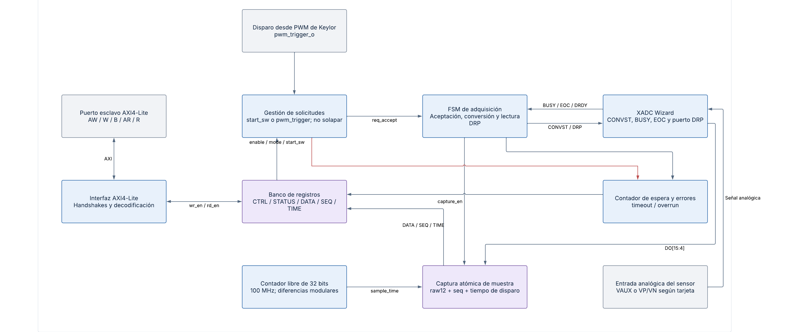
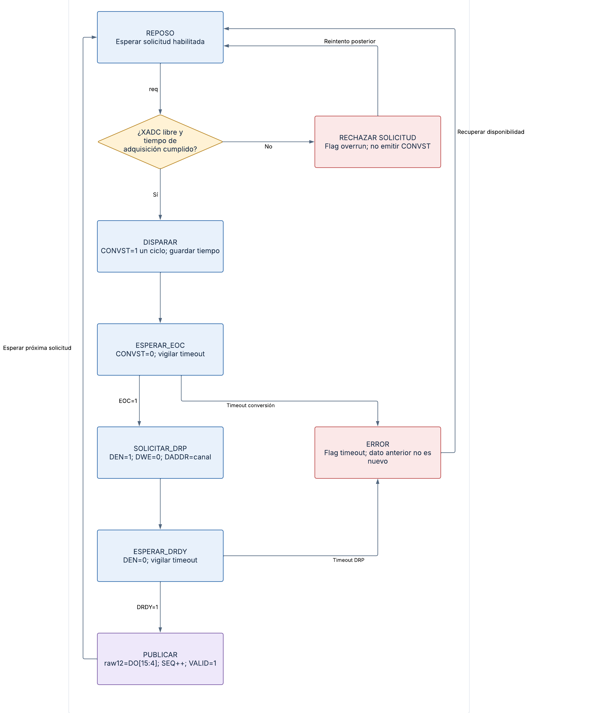
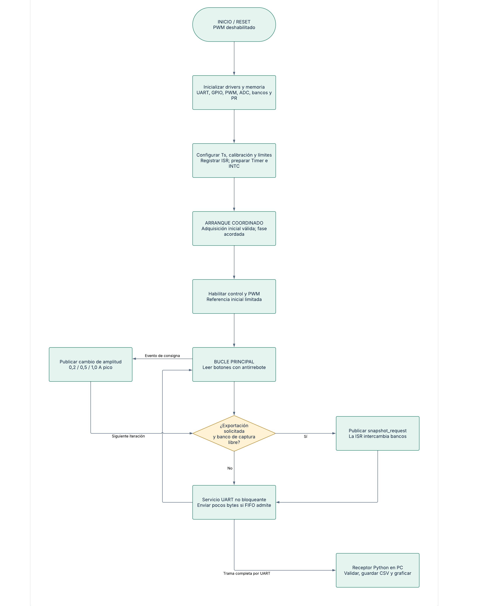
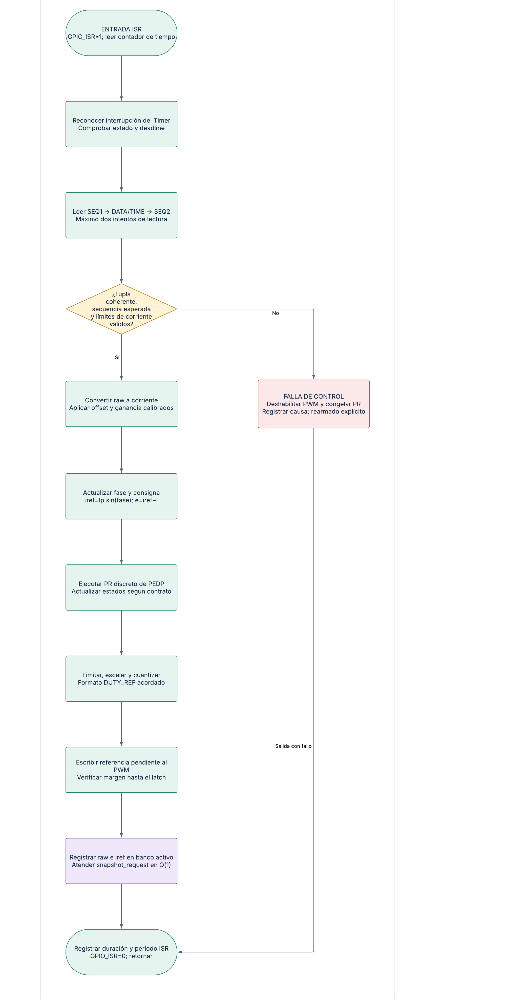
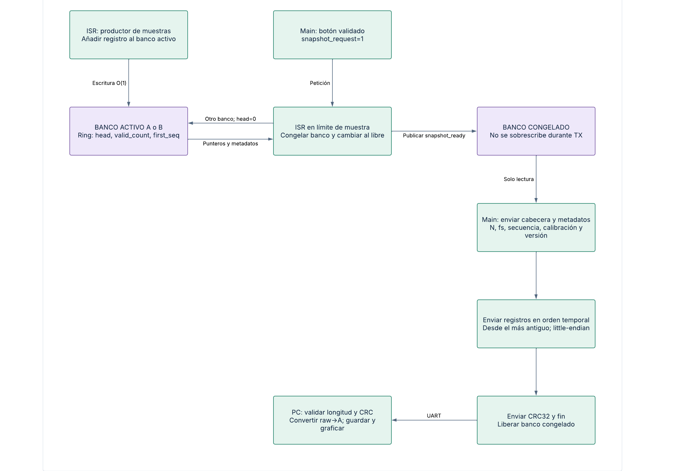
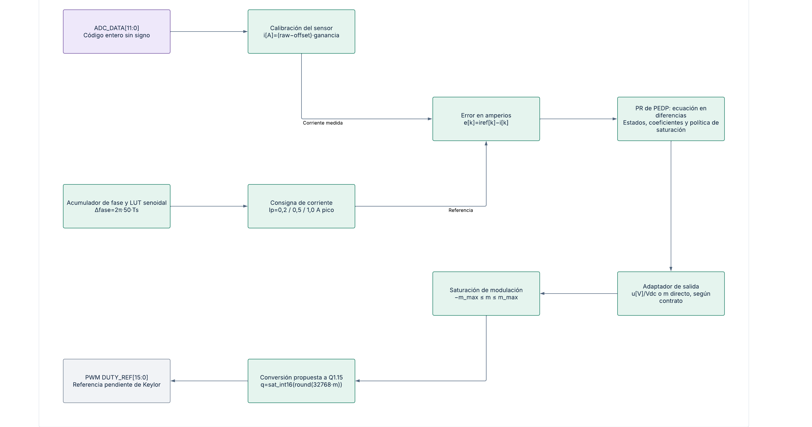
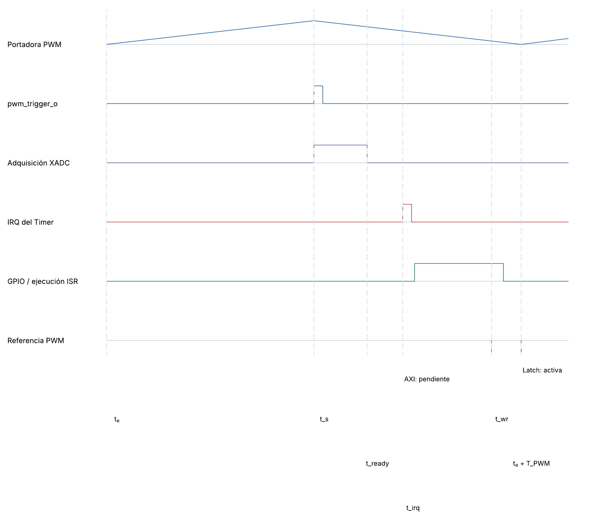

# Diagramas de adquisición, firmware y temporización

Las figuras muestran la arquitectura del periférico ADC/XADC y los flujos de control, procesamiento y exportación. Los diagramas de software representan tareas ejecutadas por MicroBlaze V.

## Arquitectura interna del periférico ADC/XADC

*Arquitectura interna del periférico ADC/XADC.*

[Diagrama editable en Lucid](https://lucid.app/lucidchart/7cf6dd6b-5941-4a32-8457-00e8aec6a009/edit?page=n3adc).

## FSM de adquisición y lectura DRP

*FSM de adquisición y lectura DRP.*

[Diagrama editable en Lucid](https://lucid.app/lucidchart/7cf6dd6b-5941-4a32-8457-00e8aec6a009/edit?page=n4adc).

La recuperación desde ERROR exige reset coordinado del wrapper y del XADC. El pulso CONVST se parametriza según los tiempos del dispositivo.

## Inicialización y bucle principal del firmware

*Inicialización y bucle principal del firmware.*

[Diagrama editable en Lucid](https://lucid.app/lucidchart/7cf6dd6b-5941-4a32-8457-00e8aec6a009/edit?page=fwmain).

## Rutina periódica de control

*Rutina periódica de control.*

[Diagrama editable en Lucid](https://lucid.app/lucidchart/7cf6dd6b-5941-4a32-8457-00e8aec6a009/edit?page=isr).

## Captura circular y exportación mediante UART

*Captura circular y exportación mediante UART.*

[Diagrama editable en Lucid](https://lucid.app/lucidchart/7cf6dd6b-5941-4a32-8457-00e8aec6a009/edit?page=export).

## Ruta numérica del regulador

*Ruta numérica del regulador.*

[Diagrama editable en Lucid](https://lucid.app/lucidchart/7cf6dd6b-5941-4a32-8457-00e8aec6a009/edit?page=numeric).

## Relación temporal entre PWM, adquisición, Timer e ISR

*Relación temporal entre PWM, adquisición, Timer e ISR.*

[Diagrama editable en Lucid](https://lucid.app/lucidchart/7cf6dd6b-5941-4a32-8457-00e8aec6a009/edit?page=timing).
