# Planteamiento del diseño
## Proyecto 4 – Control de corriente de un inversor monofásico con un sistema embebido MicroBlaze V y periférico PWM personalizado

---

## 1. Introducción y comprensión del problema

El presente proyecto tiene como propósito desarrollar un sistema digital embebido para el control de corriente de un inversor monofásico en configuración de puente H, encargado de alimentar una carga resistiva-inductiva (RL). El sistema debe regular la corriente de salida para que siga una referencia sinusoidal de 50 Hz, considerando amplitudes de 0,2 A, 0,5 A y 1,0 A pico. Para ello, se requiere integrar un sistema de adquisición de corriente, un algoritmo de control digital y un periférico de modulación por ancho de pulso (PWM), capaces de operar de manera coordinada y con una temporización definida.

La solución propuesta utiliza un procesador MicroBlaze V, basado en la arquitectura RISC-V e implementado sobre la FPGA de la tarjeta Nexys 4 Rev. B. Este procesador ejecutará un controlador proporcional-resonante (PR) discreto, encargado de calcular la acción de control a partir de la diferencia entre la corriente de referencia y la corriente medida. La arquitectura incorpora memoria local BRAM, una interconexión AXI y periféricos para temporización, comunicación, adquisición de señales y generación PWM. El periférico PWM será desarrollado específicamente para producir las cuatro señales de conmutación del puente H mediante modulación unipolar y tiempos muertos configurables.

El funcionamiento del sistema se basa en un lazo de control cerrado. La corriente de la carga se obtiene mediante un sensor y una etapa de acondicionamiento analógico, cuya salida es digitalizada mediante el XADC de la FPGA. Posteriormente, el MicroBlaze V procesa la medición, ejecuta el algoritmo PR y actualiza la referencia del periférico PWM. Este último genera las señales necesarias para controlar el inversor y proporciona un evento de sincronización para la adquisición de corriente. Adicionalmente, se contempla el almacenamiento de muestras en memoria y su transmisión hacia una computadora mediante UART, con el propósito de supervisar y analizar el comportamiento del sistema.

El desarrollo se realiza de manera coordinada entre Taller de Diseño Digital y el equipo responsable de la etapa de potencia (PEDP). Taller de Diseño Digital se encarga de diseñar e integrar la arquitectura embebida, los periféricos digitales, el firmware de control y los mecanismos de comunicación y validación. Por su parte, PEDP proporciona los parámetros eléctricos del inversor, las características del sensor y del acondicionamiento, así como el diseño y los coeficientes del controlador PR. Esta distribución permite establecer interfaces y requisitos de integración para verificar progresivamente el sistema antes de su operación conjunta con la etapa de potencia.
---

## 2. Objetivos del proyecto

### 2.1. Objetivo general

Diseñar, implementar y validar un sistema digital embebido basado en el procesador MicroBlaze V, sobre la FPGA de la tarjeta Nexys 4 Rev. B, para ejecutar el control de corriente de un inversor monofásico en puente H mediante un regulador proporcional-resonante (PR) discreto, integrando adquisición de corriente, generación de PWM unipolar, temporización y comunicación con una computadora.

### 2.2. Objetivos específicos

1. Diseñar la arquitectura del sistema embebido mediante la integración del procesador MicroBlaze V, memoria local BRAM, interconexión AXI y periféricos de adquisición, temporización, comunicación y control.

2. Desarrollar un periférico PWM personalizado en SystemVerilog, con interfaz AXI4-Lite, capaz de generar las cuatro señales de conmutación del puente H mediante modulación unipolar, incorporando tiempo muerto configurable y sincronización para la adquisición de corriente.

3. Implementar un subsistema de adquisición de corriente basado en el XADC de la FPGA, que permita digitalizar la señal proveniente del sensor y proporcionar las mediciones al procesador mediante registros mapeados en memoria.

4. Desarrollar el firmware en lenguaje C para ejecutar periódicamente el controlador PR discreto, utilizando las mediciones adquiridas y una referencia sinusoidal de 50 Hz con amplitudes de 0,2 A, 0,5 A y 1,0 A pico.

5. Establecer un mecanismo de temporización mediante AXI Timer e interrupciones, que permita coordinar la adquisición de corriente, la ejecución del algoritmo de control y la actualización del periférico PWM.

6. Implementar mecanismos de almacenamiento y comunicación mediante memoria local y UART, para transferir las muestras adquiridas hacia una computadora y facilitar su visualización y análisis.

7. Verificar el funcionamiento de los módulos digitales mediante simulaciones y pruebas de integración, evaluando la correcta operación de las interfaces AXI, la generación PWM, la adquisición de corriente y el cumplimiento de los requisitos temporales del sistema.

8. Integrar progresivamente el sistema digital con la etapa de potencia, en coordinación con PEDP, para evaluar el seguimiento de la corriente respecto a las referencias establecidas y comprobar el funcionamiento del lazo de control cerrado.

---

## 3. Arquitectura general y subsistemas

La arquitectura propuesta para el Proyecto 4 se basa en un sistema embebido implementado sobre la FPGA de la tarjeta Nexys 4 Rev. B, utilizando un procesador MicroBlaze V de arquitectura RISC-V. El sistema tiene como función principal ejecutar digitalmente el control de corriente de un inversor monofásico en configuración de puente H, mediante la integración de recursos de procesamiento, memoria, periféricos de comunicación, adquisición de señales y generación de PWM.

El procesador MicroBlaze V opera con una frecuencia de reloj de 100 MHz y constituye la unidad central de procesamiento del sistema. Se considera una memoria local BRAM de 32 KiB, accesible mediante los controladores ILMB y DLMB, así como una caché de instrucciones de 8 KiB, cuya configuración deberá verificarse durante la implementación en Vivado. La memoria local permite almacenar el programa, sus variables y los datos utilizados durante la ejecución del controlador, mientras que el procesador coordina las operaciones de adquisición, procesamiento y actualización de los periféricos.

La comunicación entre el procesador y los periféricos se organiza mediante una interconexión AXI. Los periféricos previstos son AXI Timer, AXI UART Lite, AXI GPIO, un controlador PWM personalizado con interfaz AXI4-Lite y un bloque de adquisición de corriente basado en XADC. Esta organización permite separar las funciones de procesamiento de las tareas específicas de temporización, comunicación, adquisición y generación de señales digitales.

El sistema trabaja mediante un lazo de control cerrado. La corriente que circula por la carga RL se mide mediante un sensor y una etapa de acondicionamiento analógico. La señal acondicionada se adquiere mediante el XADC y posteriormente es procesada por el MicroBlaze V, que ejecuta un controlador proporcional-resonante (PR) discreto. A partir de la acción de control calculada, el procesador actualiza el periférico PWM, encargado de generar las señales de conmutación del puente H.

La ejecución periódica del algoritmo de control se coordina mediante AXI Timer y un mecanismo de interrupción. Adicionalmente, el sistema contempla el almacenamiento de muestras en memoria local y su posterior transmisión hacia una computadora mediante UART, permitiendo observar el comportamiento de la corriente sin incorporar la comunicación externa dentro de la rutina crítica de control.

### 3.1. Principales bloques funcionales

Los principales bloques funcionales considerados son:

- **MicroBlaze V:** procesador RISC-V encargado de ejecutar el firmware, el controlador PR discreto y las rutinas de supervisión del sistema.
- **Memoria local BRAM:** recurso de almacenamiento de 32 KiB para instrucciones, variables y datos de ejecución, accesible mediante los controladores ILMB y DLMB.
- **Caché de instrucciones:** recurso de 8 KiB considerado para la configuración del procesador, sujeto a verificación de compatibilidad durante la implementación.
- **AXI Interconnect:** estructura de comunicación que permite al procesador acceder a los registros de los periféricos conectados mediante interfaces AXI.
- **AXI Timer:** periférico utilizado para establecer la temporización periódica del algoritmo de control.
- **AXI UART Lite:** interfaz de comunicación serie entre el sistema embebido y la computadora.
- **AXI GPIO:** periférico destinado a la lectura de entradas digitales y al control de indicadores.
- **PWM Controller:** periférico personalizado encargado de generar las cuatro señales PWM para el puente H, considerando modulación unipolar y tiempo muerto.
- **Interfaz ADC/XADC:** subsistema encargado de adquirir y presentar digitalmente las mediciones de corriente.
- **MDM/JTAG:** interfaz considerada para la depuración y el desarrollo del software embebido.

### 3.2. Distribución entre hardware y software

La arquitectura separa las funciones según sus requisitos de procesamiento, temporización y comunicación.

- **Hardware (FPGA):** integra el procesador MicroBlaze V, los recursos de memoria, la interconexión AXI y los periféricos digitales. Las funciones de generación PWM y adquisición se implementan mediante bloques especializados.
- **Software embebido (C):** realiza la inicialización de los periféricos, ejecuta el controlador PR discreto, administra el almacenamiento de muestras y atiende las operaciones de supervisión y comunicación.
- **Software externo (PC):** permite recibir los datos transmitidos por UART y visualizar las mediciones y variables de interés del sistema.
- **Etapa de potencia (PEDP):** comprende los drivers, el inversor monofásico en puente H, la carga RL y los elementos de medición y acondicionamiento necesarios para cerrar el lazo de corriente.

### 3.3. Diagrama de arquitectura general

La Figura siguiente presenta la organización general de los bloques del sistema, sus principales interconexiones y la relación entre el procesamiento digital, los periféricos y la etapa de potencia.

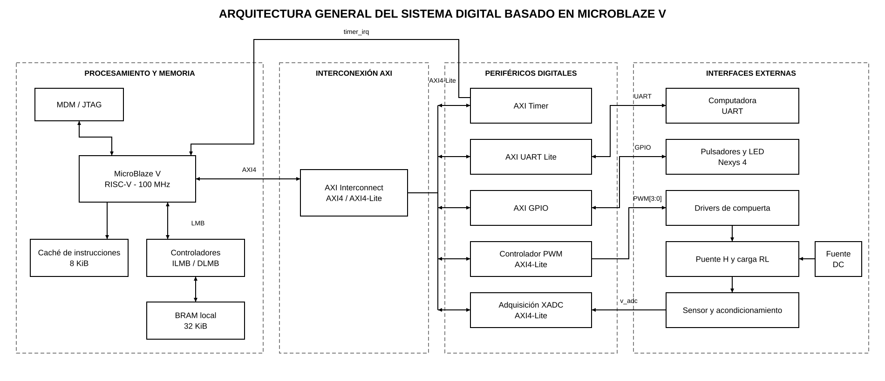

La arquitectura utiliza una organización modular en la que el MicroBlaze V coordina las operaciones mediante accesos a los periféricos, mientras que los bloques especializados realizan las tareas que requieren comportamiento temporal definido. Esta separación facilita la integración progresiva, la verificación individual de los módulos y el mantenimiento del sistema.

---


## 4. Diagrama de primer nivel

El diagrama de primer nivel representa el sistema de control de corriente como un único bloque funcional, sin mostrar su estructura interna. Su propósito es identificar las interfaces externas y establecer la relación entre el sistema digital, la etapa de potencia y el usuario.

El sistema recibe una referencia de corriente sinusoidal, la alimentación de corriente continua necesaria para el inversor y los comandos de operación provenientes de la computadora. A partir de estas entradas, regula la corriente que circula por la carga RL mediante el procesamiento digital y la generación de señales PWM.

La salida principal es la corriente regulada en la carga. Adicionalmente, el sistema proporciona información de monitoreo hacia la computadora, permitiendo observar las mediciones adquiridas durante la operación.

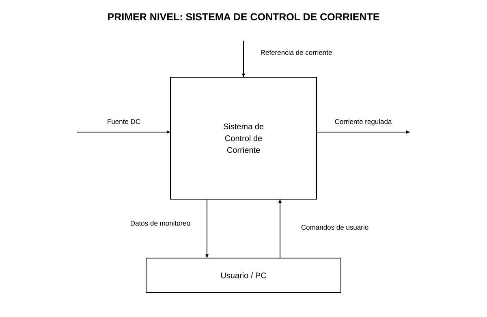

### 4.1. Entradas del sistema

| Entrada | Descripción |
|---|---|
| Alimentación DC | Fuente de corriente continua que suministra energía a la etapa de potencia del inversor. |
| Referencia de corriente | Consigna sinusoidal que establece la corriente deseada en la carga RL. |
| Comandos del usuario | Órdenes de operación y supervisión proporcionadas mediante las interfaces disponibles. |

### 4.2. Salidas del sistema

| Salida | Descripción |
|---|---|
| Corriente regulada | Corriente que circula por la carga RL como resultado de la acción de control del inversor. |
| Datos de monitoreo | Información de las mediciones y variables del sistema transmitida hacia la computadora. |

Este nivel permite delimitar las funciones del sistema sin depender de los detalles de implementación. La descomposición en subsistemas y sus interconexiones se presenta en el siguiente nivel de diseño.

---

## 5. Diagrama de segundo nivel

El diagrama de segundo nivel descompone el sistema de control de corriente en los principales subsistemas que intervienen en su funcionamiento. A diferencia del primer nivel, esta representación permite identificar el recorrido de las señales, la interacción entre los bloques y la estructura general del lazo de control cerrado.

La arquitectura se organiza en subsistemas de interfaz de usuario, procesamiento y control, generación PWM, accionamiento de compuertas, etapa de potencia y adquisición de corriente.

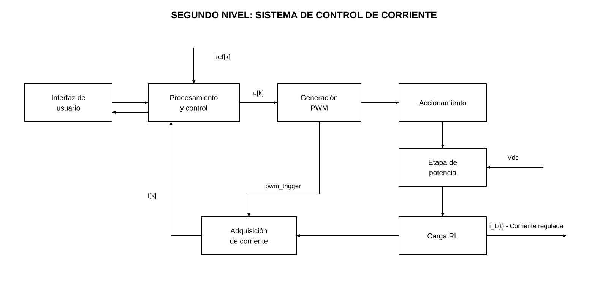

### 5.1. Subsistemas principales

| Subsistema | Función |
|---|---|
| Interfaz de usuario | Permite establecer condiciones de operación y consultar información del sistema. |
| Procesamiento y control | Ejecuta el algoritmo PR discreto y determina la acción de control a partir de la referencia y la corriente medida. |
| Generación PWM | Convierte la acción de control en señales digitales de modulación unipolar. |
| Accionamiento de compuertas | Adapta las señales PWM para controlar los dispositivos de conmutación del puente H. |
| Etapa de potencia | Utiliza la alimentación DC para aplicar a la carga RL el voltaje generado mediante la conmutación del puente H. |
| Adquisición de corriente | Obtiene la medición de corriente mediante el sensor, el acondicionamiento analógico y la conversión analógico-digital. |

### 5.2. Funcionamiento del lazo de control

El funcionamiento del sistema se desarrolla mediante una secuencia de operaciones coordinadas:

1. El subsistema de procesamiento dispone de la referencia de corriente \(i_{\mathrm{ref}}[k]\), correspondiente al valor deseado para el instante de muestreo.
2. La corriente que circula por la carga RL se mide mediante el sensor y el sistema de adquisición.
3. El valor digital de corriente \(i[k]\) se proporciona al procesador para su utilización en el algoritmo de control.
4. El controlador PR discreto calcula la acción de control \(u[k]\) a partir de la referencia y la medición.
5. El periférico PWM utiliza la acción de control para generar las señales de conmutación del puente H.
6. Los drivers accionan los dispositivos de potencia, modificando el voltaje aplicado a la carga.
7. La corriente resultante se mide nuevamente, cerrando el lazo de realimentación.

La ejecución periódica del control se coordina mediante un temporizador, mientras que el periférico PWM proporciona una señal de sincronización para la adquisición de corriente. Esta coordinación permite establecer una relación temporal definida entre la conmutación, el muestreo y la actualización de la acción de control.

### 5.3. Separación entre el sistema digital y la etapa de potencia

El sistema digital, implementado sobre la FPGA, realiza las funciones de procesamiento, control, temporización, comunicación y generación PWM.

Por su parte, la etapa de potencia comprende los drivers, el inversor en puente H, la alimentación DC y la carga RL. El sensor de corriente y su acondicionamiento analógico proporcionan la información necesaria para cerrar el lazo de control.

Esta separación permite desarrollar y verificar los módulos digitales de forma independiente antes de integrarlos con la etapa de potencia.

La arquitectura interna del sistema digital, incluyendo MicroBlaze V, memoria, interconexión AXI y periféricos, se desarrolla en los diagramas de tercer nivel.


---

## 6. Diagramas de tercer nivel

El tercer nivel de diseño describe la organización interna del sistema digital implementado sobre la FPGA. En este nivel se identifican los recursos de procesamiento, memoria, interconexión y periféricos necesarios para ejecutar el control de corriente del inversor monofásico.

La arquitectura utiliza un procesador MicroBlaze V como unidad central de procesamiento, acompañado de memoria local BRAM, una interconexión AXI y periféricos especializados. Esta organización permite separar las operaciones ejecutadas por software de aquellas realizadas directamente mediante hardware.

El diagrama presenta las conexiones principales entre el procesador, los controladores de memoria, el sistema de depuración, los periféricos AXI y las interfaces externas.

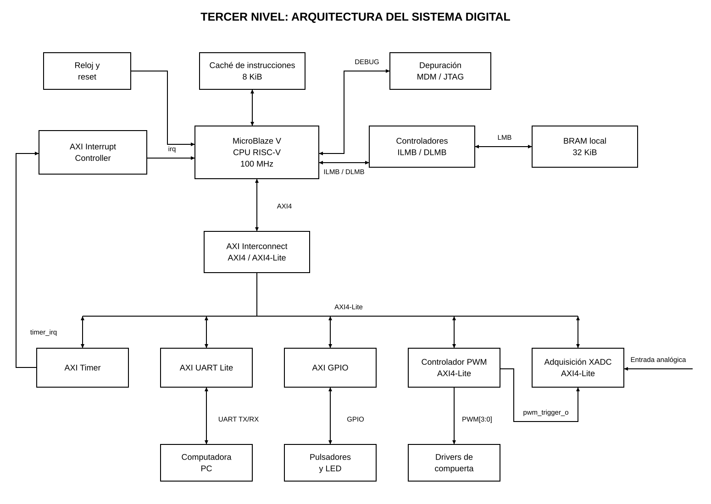

Los apartados siguientes desarrollan los componentes de la arquitectura, sus interfaces y su función dentro del sistema.

Cada apartado de este nivel incluye: tabla de **señales de entrada**, tabla de **señales de salida**, **señales internas relevantes**, el **diagrama** y la **explicación del bloque**.

### 6.1 Procesador MicroBlaze V, memoria e interconexión

El subsistema de procesamiento constituye el núcleo de la arquitectura digital. Está basado en un procesador MicroBlaze V de arquitectura RISC-V, configurado conceptualmente para operar a una frecuencia de 100 MHz.

El procesador ejecuta el firmware encargado de inicializar los periféricos, realizar el cálculo del controlador PR discreto, administrar las mediciones adquiridas y coordinar la comunicación con la computadora.

#### 6.1.1. Organización del subsistema de procesamiento

El subsistema está compuesto por los siguientes recursos:

| Componente | Especificación | Función |
|---|---|---|
| MicroBlaze V | Procesador RISC-V, 100 MHz | Ejecución del firmware y del controlador PR. |
| BRAM local | 32 KiB | Almacenamiento de instrucciones, variables y datos. |
| Caché de instrucciones | 8 KiB | Recurso previsto para mejorar el acceso a instrucciones, sujeto a verificación de configuración. |
| ILMB Controller | Interfaz de memoria local | Acceso a instrucciones almacenadas en BRAM. |
| DLMB Controller | Interfaz de memoria local | Acceso a datos almacenados en BRAM. |
| AXI Interconnect | Interconexión de memoria mapeada | Comunicación entre el procesador y los periféricos AXI. |
| MDM/JTAG | Interfaz de depuración | Programación, depuración y observación del procesador. |

La organización propuesta se presenta en el siguiente diagrama:

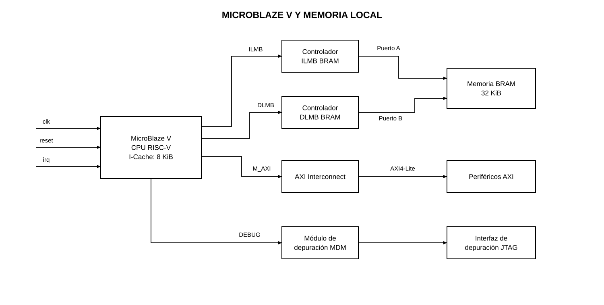

#### 6.1.2. Memoria local BRAM

La arquitectura contempla una memoria local de 32 KiB implementada mediante recursos Block RAM de la FPGA.

El procesador accede a esta memoria mediante dos interfaces diferenciadas:

- **ILMB (Instruction Local Memory Bus):** permite acceder a las instrucciones almacenadas en la memoria local.
- **DLMB (Data Local Memory Bus):** permite acceder a los datos utilizados durante la ejecución del programa.

Los controladores ILMB y DLMB proporcionan las interfaces necesarias entre el procesador y el recurso de memoria local.

La memoria se utiliza para almacenar el programa embebido, sus variables, los estados del controlador y las muestras adquiridas. La distribución exacta entre estas regiones dependerá del programa compilado y de la configuración del enlazador.

El uso de BRAM local permite disponer de memoria integrada en la FPGA y evita depender de una memoria externa para las operaciones básicas del firmware.

#### 6.1.3. Caché de instrucciones

Se considera una caché de instrucciones de 8 KiB como parte de la configuración prevista para MicroBlaze V.

Su función es reducir la necesidad de recuperar repetidamente instrucciones desde el sistema de memoria que respalda la caché.

La habilitación de este recurso, su conexión con la jerarquía de memoria y su compatibilidad con el esquema de BRAM local deberán comprobarse durante la configuración del procesador en Vivado.

Por tanto, la caché se identifica como un requisito de arquitectura y no como un recurso cuya implementación ya se encuentre verificada.

#### 6.1.4. Interconexión AXI

La comunicación entre MicroBlaze V y los periféricos se realiza mediante una arquitectura de interconexión AXI.

El procesador actúa como maestro de las transacciones de lectura y escritura, mientras que los periféricos exponen interfaces esclavas para acceder a sus registros de control, estado y datos.

Los periféricos previstos son:

1. AXI Timer.
2. AXI UART Lite.
3. AXI GPIO.
4. PWM Controller personalizado.
5. Interfaz de adquisición ADC/XADC.

La organización de estos periféricos se presenta en el siguiente diagrama:

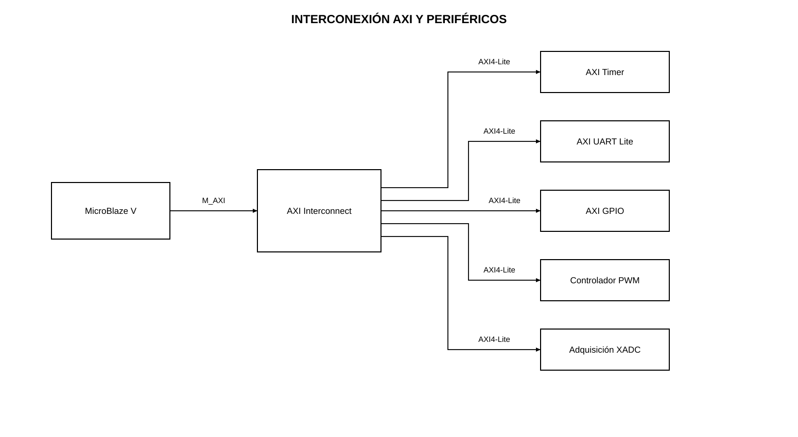

Las interfaces de control de los periféricos se consideran compatibles con AXI4-Lite, adecuado para operaciones de acceso a registros.

La interconexión permite que el firmware configure los periféricos, consulte su estado y transfiera información mediante direcciones de memoria asignadas durante la integración del Block Design.

Las direcciones base y los rangos definitivos se documentarán a partir del Address Editor de Vivado.

#### 6.1.5. Depuración mediante MDM/JTAG

La arquitectura contempla el uso de un módulo de depuración asociado al procesador MicroBlaze V y accesible mediante JTAG.

Este recurso permite realizar operaciones de desarrollo y diagnóstico, como la carga del programa, la ejecución controlada y la inspección de registros y memoria, de acuerdo con las capacidades disponibles en la configuración seleccionada.

La interfaz de depuración se mantiene separada de las interfaces funcionales utilizadas para el control de corriente y la comunicación UART.

#### 6.1.6. Justificación de la organización propuesta

La arquitectura combina procesamiento programable y periféricos especializados para distribuir las funciones del sistema según sus necesidades temporales.

El procesador MicroBlaze V ejecuta el algoritmo PR y las tareas de supervisión, mientras que los periféricos realizan funciones específicas de temporización, adquisición y generación PWM.

La memoria BRAM local proporciona almacenamiento integrado para el firmware y sus datos. Por su parte, la interconexión AXI permite incorporar periféricos mediante interfaces estandarizadas, facilitando la integración y la verificación modular.

Esta separación también permite modificar el algoritmo de control mediante software sin necesidad de rediseñar la lógica encargada de generar las señales PWM.

### 6.2 Periférico PWM personalizado (PWM Controller)

El PWM Controller es el periférico que nos toca diseñar desde cero, ya que Vivado no trae un IP que haga modulación unipolar con tiempo muerto para un puente H. Recibe desde el MicroBlaze V el ciclo de trabajo calculado por el regulador PR y genera las cuatro señales de compuerta del puente H. También genera `pwm_trigger_o`, que le indica al ADC cuándo tomar la muestra de corriente.

Todo el periférico trabaja con el reloj de 100 MHz del sistema (`s_axi_aclk`) y el reset activo en bajo (`s_axi_aresetn`), así que no hay cruces entre dominios de reloj.

#### Señales de entrada

| Señal | Ancho | Dirección | Descripción |
|---|---:|---|---|
| `s_axi_aclk` | 1 bit | Entrada | Reloj de 100 MHz. |
| `s_axi_aresetn` | 1 bit | Entrada | Reset activo en bajo. |
| Canales AW, W y AR | — | Entrada | Dirección y datos de escritura y lectura del bus AXI4-Lite. |
| `s_axi_bready`, `s_axi_rready` | 1 bit | Entrada | El MicroBlaze V acepta la respuesta de escritura o el dato leído. |

#### Señales de salida

| Señal | Ancho | Dirección | Descripción |
|---|---:|---|---|
| Canales B y R, `awready`, `wready`, `arready` | — | Salida | Respuestas del esclavo AXI4-Lite. |
| `gate_ah_o`, `gate_al_o` | 1 bit | Salida | Compuertas alta y baja de la pierna A. |
| `gate_bh_o`, `gate_bl_o` | 1 bit | Salida | Compuertas alta y baja de la pierna B. |
| `pwm_trigger_o` | 1 bit | Salida | Pulso de sincronización hacia el ADC. |

#### Señales internas relevantes

| Señal | Ancho | Descripción |
|---|---:|---|
| `enable`, `freq_sel` | 1 / 2 bits | Configuración escrita por software. |
| `duty_ref` | 16 bits | Referencia de modulación, ya saturada. |
| `dead_time` | 10 bits | Tiempo muerto en ciclos de reloj, ya saturado. |
| `c` | 14 bits | Valor de la portadora triangular. |
| `valley` | 1 bit | Indica que la portadora está en cero (inicio del período). |
| `s_a`, `s_b` | 1 bit | Señal de conmutación de cada pierna, antes del tiempo muerto. |
| `running` | 1 bit | Indica que el generador está activo. |

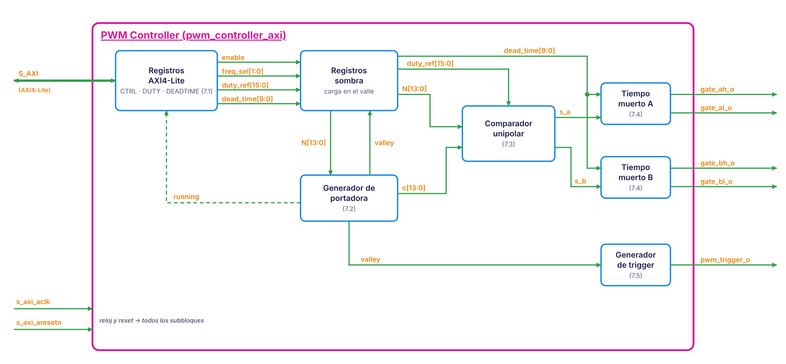

#### Explicación del bloque

El software escribe la configuración en los registros AXI4-Lite. Esos valores no pasan directo a la modulación: primero se copian a unos registros sombra, y esa copia solo se hace cuando la portadora llega a cero (el valle). Con esto evitamos que un cambio de ciclo de trabajo o de frecuencia a mitad del período deje un pulso cortado en las compuertas.

El generador de portadora es un contador que sube y baja, formando un triángulo. El comparador usa esa portadora y `duty_ref` para decidir cuándo conduce el transistor superior de cada pierna (`s_a` y `s_b`). Después, cada pierna pasa por un generador de tiempo muerto que produce el par de compuertas complementarias. Por último, en cada valle de la portadora se genera el pulso `pwm_trigger_o` para el ADC.

Los subbloques se detallan en las secciones 7.1 a 7.5.

### 6.3 Adquisición de corriente (interfaz ADC/XADC)

#### 6.3.1 Contexto del subsistema de adquisición, firmware y temporización

El subsistema adquiere la corriente de carga, ejecuta periódicamente el regulador PR discreto en MicroBlaze V y actualiza la referencia del PWM. Incluye interfaces, temporización, calibración, almacenamiento de muestras, botones y exportación UART. PEDP proporciona la ecuación del controlador, sus coeficientes y los parámetros de la etapa de potencia.

El repositorio declara Vivado 2026.1 y el enunciado indica Vivado/Vitis 2025.1. Se debe utilizar una combinación acordada de herramientas, IP y BSP, sin asumir compatibilidad binaria entre exportaciones XSA.

#### 6.3.2 Requisitos y parámetros de diseño

| Elemento | Definición | Estado |
|---|---|---|
| Procesador | MicroBlaze V a 100 MHz, caché de instrucciones de 8 KB y memoria local de 32 KB | Mínimos del enunciado §4.2.1 |
| Reloj AXI/PWM/ADC | Dominio común de 100 MHz y DCLK continuo | Propuesta de integración; por confirmar en la plataforma |
| Señal medida | Corriente alterna de la carga, representada con offset analógico | Contrato con PEDP |
| Referencia | 50 Hz; 0,2 / 0,5 / 1,0 A pico | Requisito |
| Adquisición | XADC Wizard mediante DRP, wrapper AXI4-Lite propio, un canal unipolar con offset, modo por evento | Propuesta |
| Muestreo y control | Una muestra y una ISR por período PWM | Propuesta base |
| Caso de dimensionamiento | fs = fPWM = 20 kHz; Ts = 50 µs | Por validar con PEDP y WCET |
| Control en C | float32 para calibración, referencia y PR | Decisión inicial sujeta a WCET |
| Referencia del PWM | Q1.15 con signo, límite hardware de ±31129 códigos; saturación previa en firmware | Definido en la especificación del PWM, sujeto a validación integrada |
| Histórico | Dos bancos circulares de 2048 registros de 4 bytes | Propuesta |
| UART | 115200 baudios, 8N1, trama binaria y CRC32 | Propuesta |
| Error de adquisición/tiempo | Deshabilitar PWM; PR congelado; rearme explícito | Política propuesta |

Los valores propuestos permiten evaluar recursos y contratos; no constituyen mediciones ni parámetros aprobados por Potencia. La selección final del canal, pinout y rango eléctrico requiere conocer la tarjeta y el sensor.

La versión de herramientas se debe acordar para toda la plataforma: el enunciado indica Vivado/Vitis 2025.1 y el README declara Vivado 2026.1. La selección final incluye las versiones de IP y BSP y la compatibilidad de la exportación XSA.

#### 6.3.3 Recorrido de la muestra

La corriente pasa por el sensor y su acondicionamiento antes de ingresar al canal analógico seleccionado del XADC. El PWM genera **pwm_trigger_o** en el valle de la portadora, con un ancho de cuatro ciclos del reloj de 100 MHz según su especificación. La interfaz acepta la solicitud, solicita conversión, lee el resultado por DRP y publica una tupla formada por dato, secuencia y tiempo del disparo.

El periférico contiene interfaz AXI4-Lite, registros, árbitro de solicitudes, FSM, contador de espera, captura y XADC Wizard. El firmware accede mediante registros MMIO de 32 bits; la dirección base se obtiene de la plataforma exportada desde Vivado.

El XADC trabaja en modo por evento: CONVST determina el inicio de la muestra; EOC señala resultado convertido; la lectura DRP concluye al recibir DRDY. Se mantiene DCLK continuo y se respeta el intervalo de adquisición entre conversiones [R1, R2]. El diseño base no activa promediado multiconversión, para conservar una relación directa entre disparo y muestra.

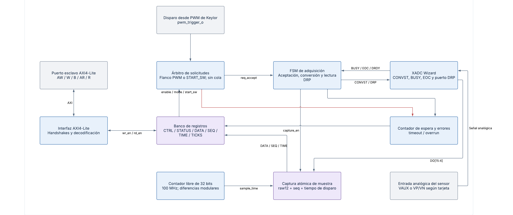

*Arquitectura interna del periférico ADC/XADC.*

El contador libre también se expone mediante ADC_TICKS en 0x18 para instrumentación; DATA, SEQ y TIME constituyen la tupla de muestra publicada.

#### 6.3.4 Señales del periférico

| Señal | Dirección respecto de la interfaz | Función |
|---|---|---|
| clk, rst_n | Entrada | Reloj de 100 MHz y reset de lógica |
| pwm_trigger_o | Entrada desde PWM | Pulso de cuatro ciclos en el valle; una solicitud por flanco ascendente |
| VAUXP/VAUXN o VP/VN | Entrada analógica al XADC | Canal externo; selección pendiente |
| convst | Salida al XADC | Pulso de inicio de N_convst ciclos; ancho por validar |
| reset_xadc | Salida al XADC | Reset coordinado con el wrapper; esperar disponibilidad antes del primer disparo |
| busy, eoc | Entrada desde XADC | Ocupación y conversión terminada |
| den, dwe, daddr[6:0] | Salida al XADC | Solicitud DRP; lectura con DWE=0 |
| do[15:0], drdy | Entrada desde XADC | Dato y confirmación DRP |
| sample_data[11:0] | Interna | Resultado publicado, alineado a la derecha |
| sample_seq[31:0] | Interna/MMIO | Identificador de muestra |
| sample_time[31:0] | Interna/MMIO | Tiempo del disparo, en ciclos |
| adc_ticks[31:0] | Interna/MMIO | Contador vivo; continúa aunque ENABLE=0 |
| S_AXI | Bidireccional | Configuración y lectura desde MicroBlaze V |

Se supone un dominio síncrono para AXI, PWM e interfaz, con DCLK compatible. Si la integración usa otro dominio, se debe diseñar el cruce de reloj de pulsos y datos; un sincronizador de dos registros por bit no garantiza coherencia de un bus.

### 6.4 Periféricos de Xilinx: AXI Timer, UART Lite y GPIO

Los periféricos de Xilinx complementan las capacidades del procesador MicroBlaze V mediante módulos especializados que permiten realizar operaciones de temporización, comunicación y manejo de entradas y salidas digitales.

Estos periféricos se conectan al sistema mediante interfaces AXI y son controlados por el firmware a través de registros mapeados en memoria. Su utilización permite delegar funciones específicas al hardware, evitando que el procesador deba implementarlas exclusivamente mediante software.

#### 6.4.1. AXI Timer

El AXI Timer proporciona una base temporal para la ejecución periódica del algoritmo de control de corriente.

Su función principal consiste en generar eventos de interrupción que permitan al procesador ejecutar la rutina de control con un período de muestreo definido.

El periférico dispone de registros de configuración y estado, mecanismos de carga y conteo, y lógica para generar solicitudes de interrupción.

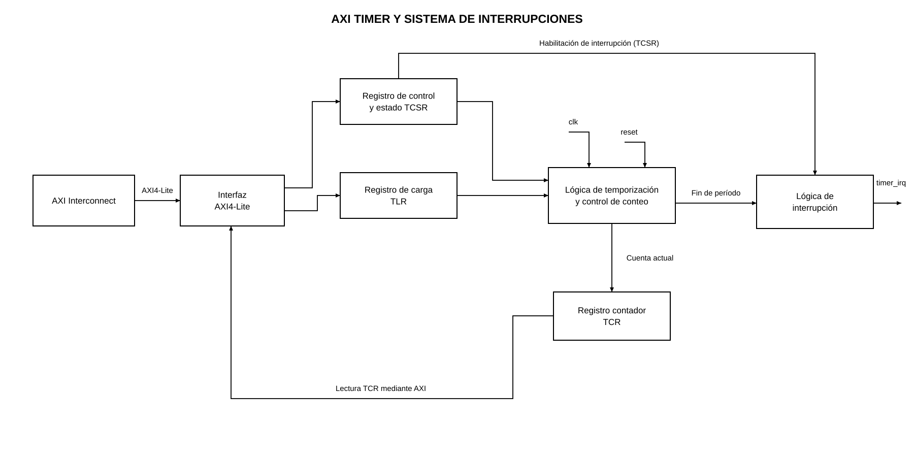

**Principales funciones:**

- Configurar el período de ejecución del control.
- Mantener una base temporal mediante un contador de hardware.
- Generar solicitudes periódicas de interrupción.
- Permitir al firmware consultar y administrar el estado del temporizador.

La señal `timer_irq` informa al sistema de interrupciones que se ha producido un evento de temporización.

La arquitectura propuesta contempla un AXI Interrupt Controller para centralizar las solicitudes de interrupción generadas por los periféricos y transmitirlas al MicroBlaze V. En particular, la señal `timer_irq` del AXI Timer se conectará a una de sus entradas, permitiendo que el procesador atienda periódicamente la rutina de control. La configuración definitiva de las fuentes de interrupción, sus conexiones y prioridades se verificará durante la integración del Block Design en Vivado.

La frecuencia definitiva de interrupción deberá seleccionarse considerando el período de muestreo requerido y el tiempo de ejecución del algoritmo PR.

#### 6.4.2. AXI UART Lite

El periférico AXI UART Lite proporciona una interfaz de comunicación serie entre el sistema embebido y una computadora.

Su función principal es permitir la transmisión de información de monitoreo y la recepción de comandos, según las funciones definidas para la aplicación.

La comunicación se realiza mediante las señales UART de transmisión y recepción, mientras que el procesador accede a los registros internos del periférico a través de AXI.

**Principales funciones:**

- Transmitir hacia la computadora las muestras almacenadas en memoria.
- Permitir la supervisión del comportamiento del sistema.
- Recibir información o comandos de operación cuando sean requeridos.
- Proporcionar una interfaz de comunicación independiente del algoritmo de control.

La transmisión de datos se administra desde el firmware, procurando que las operaciones de comunicación no interfieran con la ejecución periódica del controlador PR.

#### 6.4.3. AXI GPIO

El periférico AXI GPIO permite integrar las entradas y salidas digitales de la tarjeta FPGA con el sistema embebido.

En la arquitectura propuesta se utiliza para consultar el estado de los botones y controlar indicadores LED.

**Principales funciones:**

- Leer entradas digitales provenientes de los botones.
- Detectar solicitudes de operación o transferencia de datos.
- Controlar indicadores visuales mediante los LED.
- Proporcionar una interfaz sencilla entre los elementos físicos de la tarjeta y el firmware.

El procesador realiza las operaciones de lectura y escritura mediante los registros del periférico AXI GPIO.

La asignación definitiva de los pines y la configuración de los canales se establecerán durante la integración del diseño en Vivado.

#### 6.4.4. Integración de las interfaces de usuario

La organización conjunta de AXI UART Lite y AXI GPIO se presenta en el siguiente diagrama:

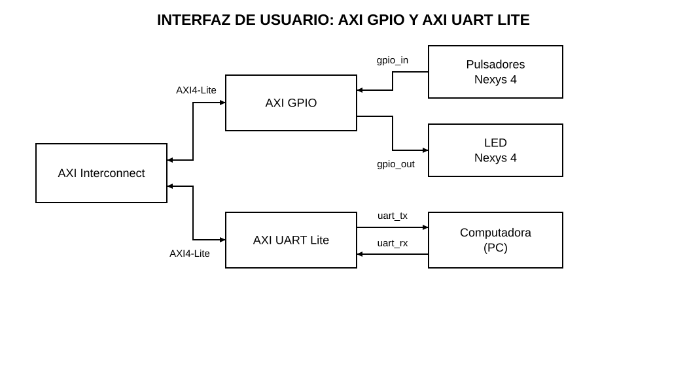

Ambos periféricos cumplen funciones complementarias. AXI GPIO permite interactuar directamente con los botones e indicadores de la tarjeta, mientras que AXI UART Lite proporciona un canal de comunicación con la computadora.

Esta separación permite mantener independientes las operaciones de interacción local y transmisión de datos.

#### 6.4.5. Integración mediante AXI

Los periféricos se incorporan al sistema mediante la interconexión AXI, que permite al MicroBlaze V acceder a sus registros de configuración, estado y datos.

Durante la implementación se deberán definir:

1. Las interfaces AXI correspondientes a cada periférico.
2. Las direcciones base y los rangos de memoria.
3. Las conexiones de reloj y reinicio.
4. Las señales de interrupción requeridas.
5. Las conexiones externas hacia los dispositivos físicos de la tarjeta.

La configuración final deberá verificarse mediante el Block Design y el Address Editor de Vivado.

---

## 7. Diagramas de cuarto nivel

Los diagramas de cuarto nivel presentan la descomposición funcional de los módulos personalizados del sistema, detallando los bloques internos responsables de implementar sus operaciones principales. Este nivel permite identificar las señales de entrada y salida, las relaciones entre subbloques y los mecanismos necesarios para garantizar su funcionamiento.

En particular, se desarrolla la organización interna del periférico PWM y del subsistema de adquisición ADC/XADC. Para cada subbloque se describen su propósito, interfaces, funcionamiento, decisiones de diseño, comportamiento durante el reinicio y estrategia de validación.

Esta descomposición proporciona una base para la implementación en SystemVerilog, la elaboración de bancos de prueba y la posterior integración de los módulos con el procesador MicroBlaze V mediante las interfaces definidas en la arquitectura general.

### 7.1 Registros AXI4-Lite del PWM

#### Objetivo

Permitir que el MicroBlaze V configure el PWM y lea su estado por medio del bus AXI4-Lite.

#### Entradas y salidas

| Señal | Dirección | Descripción |
|---|---|---|
| Canales AW, W, AR, `bready`, `rready` | Entrada | Transacciones de escritura y lectura del MicroBlaze V. |
| `running` | Entrada | Estado del generador, para el bit de solo lectura. |
| Canales B, R, `awready`, `wready`, `arready` | Salida | Respuestas AXI4-Lite. |
| `enable`, `freq_sel`, `duty_ref`, `dead_time` | Salida | Configuración hacia los registros sombra. |

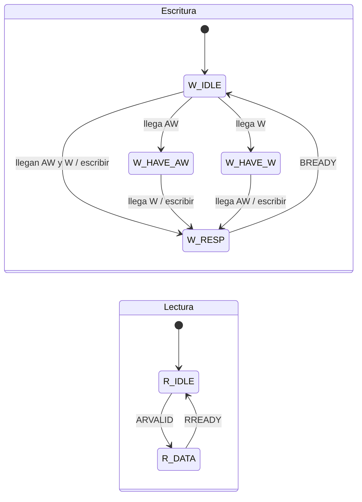

| Estado | `AWREADY` | `WREADY` | `BVALID` |
|---|:---:|:---:|:---:|
| `W_IDLE` | 1 | 1 | 0 |
| `W_HAVE_AW` | 0 | 1 | 0 |
| `W_HAVE_W` | 1 | 0 | 0 |
| `W_RESP` | 0 | 0 | 1 (con `BRESP = OKAY`) |

| Estado | `ARREADY` | `RVALID` |
|---|:---:|:---:|
| `R_IDLE` | 1 | 0 |
| `R_DATA` | 0 | 1 |

#### Funcionamiento

La escritura y la lectura se manejan con dos máquinas de estados separadas. En la escritura, la dirección (AW) y el dato (W) pueden llegar en cualquier orden, así que la máquina guarda el que llegue primero y espera al otro. Cuando tiene los dos, escribe el registro y responde con `BVALID`. En la lectura, al recibir la dirección se carga el dato en `RDATA` y se activa `RVALID` hasta que el procesador lo recibe.

El registro se selecciona con los bits `[3:2]` de la dirección: 0 es CTRL_STATUS, 1 es DUTY_REF y 2 es DEADTIME (el mapa completo está en la sección 8.2).

Al escribir `duty_ref` o `dead_time`, el valor se satura antes de guardarse:

$$
duty\_ref = \min(\max(d,\ -\text{DUTY\_MAX}),\ +\text{DUTY\_MAX}), \qquad dead\_time = \min(\max(t,\ 20),\ 1023)
$$

#### Diseño y justificación técnica

Aceptamos AW y W en cualquier orden porque el estándar AXI no garantiza cuál llega primero. Un esclavo que espere siempre a AW primero podría quedarse trabado.

La saturación se hace al momento de escribir, y lo que se lee de vuelta es el valor ya saturado. Así cumplimos lo que pide el enunciado, y desde software se puede saber si hubo saturación comparando lo escrito con lo leído.

El enunciado pide tiempo muerto configurable, pero los registros 0x00 y 0x04 no tienen un campo para eso. Por eso agregamos el registro DEADTIME en 0x08, sin cambiar los otros dos.

#### Comportamiento durante el reset

Todos los registros vuelven a 0, excepto DEADTIME, que arranca en 100 ciclos (1 µs). Las salidas `VALID` del bus quedan en 0.

#### Casos especiales y condiciones de borde

Si se escribe en una dirección que no existe, se responde normalmente (`OKAY`), no se guarda nada y la lectura devuelve 0. Escribir en el bit `running` no tiene efecto porque es de solo lectura.

#### Estrategia de validación

En el testbench se escriben y leen todos los registros, incluyendo valores fuera de rango y los dos órdenes posibles de AW y W.

---

### 7.2 Generador de portadora y selección de frecuencia

#### Objetivo

Generar la portadora triangular que usan las dos piernas, con la frecuencia que indique `freq_sel`.

#### Entradas y salidas

| Señal | Dirección | Descripción |
|---|---|---|
| `enable` | Entrada | Habilita el generador. |
| `N` | Entrada | Valor máximo de la portadora, según `freq_sel`. |
| `c` | Salida | Valor actual de la portadora (14 bits). |
| `valley` | Salida | Pulso cuando `c = 0`. |
| `running` | Salida | 1 mientras el generador está activo. |

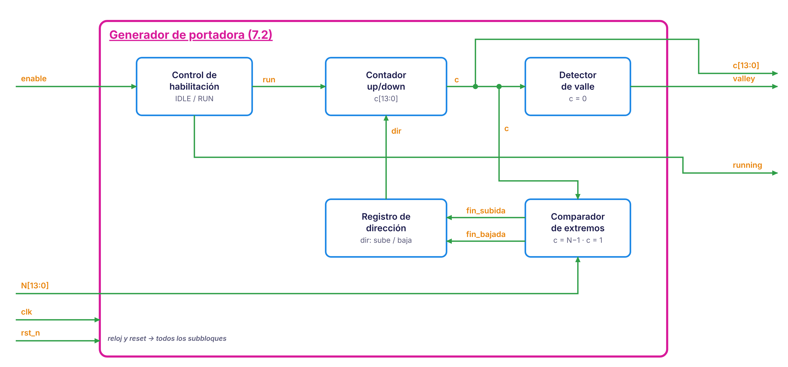

#### Funcionamiento

La portadora es un contador que sube de 0 a N y luego baja de N a 0. Un período completo dura 2N ciclos de reloj, entonces la frecuencia de conmutación es:

$$
f_{sw} = \frac{f_{clk}}{2N} = \frac{100\ \text{MHz}}{2N}
$$

| `freq_sel` | N | $f_{sw}$ |
|---|---:|---:|
| `00` | 10000 | 5 kHz |
| `01` | 5000 | 10 kHz |
| `10` | 2500 | 20 kHz |
| `11` | 1250 | 40 kHz |

Como la modulación es unipolar, cada transistor conmuta a $f_{sw}$, pero la tensión en la carga tiene su componente principal en $2 f_{sw}$.

Cuando `enable` pasa a 1, el contador arranca desde 0 y `running` se pone en 1. Cuando `enable` pasa a 0, el contador se detiene, `running` vuelve a 0 y las compuertas se apagan de inmediato.

#### Diseño y justificación técnica

Usamos una portadora triangular y no diente de sierra porque los pulsos quedan centrados en el período y el valle sirve como instante de muestreo (ver 7.5). Elegimos valores de N que dan frecuencias exactas con el reloj de 100 MHz, y usamos los cuatro códigos de `freq_sel` para que no haya ninguno inválido. Las frecuencias son una propuesta inicial: si el equipo de potencia escoge otra, solo se cambia la tabla de N.

Al deshabilitar, las compuertas se apagan sin esperar a que termine el período, porque en el puente H es más seguro apagar todo de una vez.

#### Comportamiento durante el reset

El contador queda en 0, `running` en 0 y no hay pulsos de `valley`.

#### Casos especiales y condiciones de borde

Si se cambia `freq_sel` con el PWM funcionando, el nuevo valor de N se aplica en el siguiente valle, nunca a mitad de un período.

#### Estrategia de validación

Para cada `freq_sel` se mide en simulación el número de ciclos entre dos valles, que debe ser 2N. También se prueba cambiar la frecuencia con el generador activo.

---

### 7.3 Comparador unipolar y formato de `duty_ref`

#### Objetivo

Convertir `duty_ref` en las señales de conmutación de cada pierna, `s_a` y `s_b`.

#### Entradas y salidas

| Señal | Dirección | Descripción |
|---|---|---|
| `c` | Entrada | Portadora. |
| `duty_ref` | Entrada | Referencia de modulación (registro sombra). |
| `N` | Entrada | Valor máximo de la portadora. |
| `s_a`, `s_b` | Salida | 1 = conduce el transistor superior de esa pierna. |

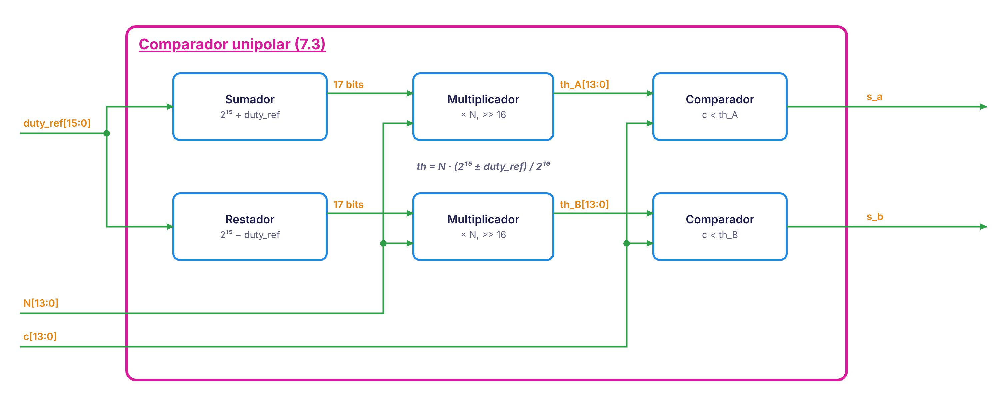

#### Funcionamiento

`duty_ref` es un número de 16 bits con signo en formato Q1.15, que representa el índice de modulación $m$ entre −1 y 1:

$$
m = \frac{duty\_ref}{2^{15}}
$$

En la modulación unipolar, la pierna A se compara con $+m$ y la pierna B con $-m$. Como nuestra portadora va de 0 a N, cada referencia se pasa a un umbral en esa misma escala:

$$
th_A = \frac{N(1+m)}{2}, \qquad th_B = \frac{N(1-m)}{2}
$$

$$
s_A = (c < th_A), \qquad s_B = (c < th_B)
$$

Con esto la pierna A conduce una fracción $(1+m)/2$ del período y la pierna B una fracción $(1-m)/2$. El voltaje promedio en la carga queda:

$$
\bar{v}_{AB} = m\,V_{dc}
$$

Por ejemplo, a 20 kHz (N = 2500) con $m = 0{,}5$, los umbrales son $th_A = 1875$ y $th_B = 625$: la pierna A conduce el 75 % del período, la B el 25 %, y en la carga queda $0{,}5\,V_{dc}$.

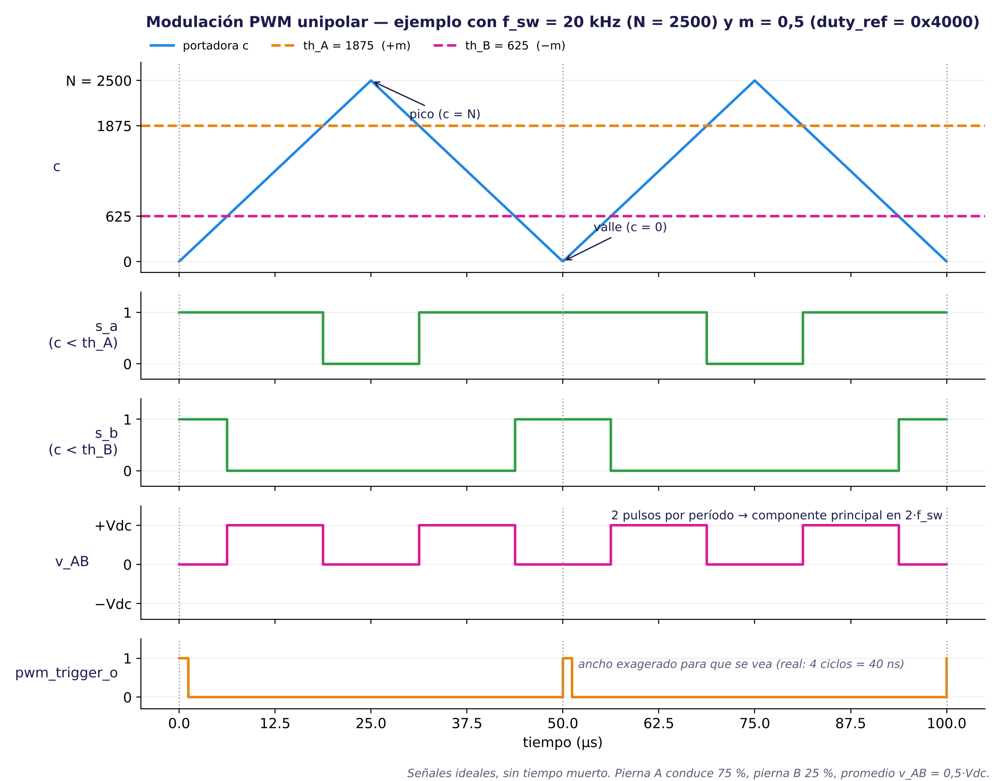

En la figura se ve que en el valle de la portadora las dos piernas conducen por arriba y en el pico ninguna, así que en ambos instantes $v_{AB} = 0$. Entre esos puntos aparecen los pulsos de $+V_{dc}$: dos por período, por eso la componente principal del voltaje en la carga está en $2 f_{sw}$.

#### Diseño y justificación técnica

Escogimos Q1.15 porque la referencia que sale del PR es una senoidal con valores positivos y negativos, y este formato la representa directamente con la máxima resolución que permiten 16 bits. Además, como la relación entre `duty_ref` y el voltaje es lineal, para el diseño del PR el modulador es solo una ganancia de $V_{dc}$.

`duty_ref` se limita a ±0,95 (`DUTY_MAX` = `0x7999`). Si $m$ se acerca a 1, una de las piernas queda con pulsos tan cortos que el tiempo muerto se los come, y el voltaje deja de seguir a la referencia. Para que eso no pase, el pulso más corto tiene que durar más que el tiempo muerto:

$$
|m| \leq 1 - 2\, t_{dt}\, f_{sw}
$$

Con 1 µs de tiempo muerto a 20 kHz, esto da $|m| \leq 0{,}96$, así que 0,95 deja un poco de margen.

#### Comportamiento durante el reset

`duty_ref` = 0, que corresponde a $m = 0$. Como el generador está detenido, las compuertas están apagadas.

#### Casos especiales y condiciones de borde

Con $m = 0$ las dos piernas conmutan iguales, al 50 %, y el voltaje en la carga es 0 todo el tiempo.

#### Estrategia de validación

El testbench calcula el ancho de pulso esperado para varios valores de $m$ (−0,95, −0,5, 0, 0,5 y 0,95) y lo compara con el medido, aceptando una diferencia de un ciclo.

---

### 7.4 Generador de tiempo muerto

#### Objetivo

Producir las dos compuertas complementarias de cada pierna, asegurando que nunca estén encendidas a la vez. Hay una instancia por pierna.

#### Entradas y salidas

| Señal | Dirección | Descripción |
|---|---|---|
| `s` | Entrada | `s_a` o `s_b`, desde el comparador. |
| `dead_time` | Entrada | Tiempo muerto en ciclos de reloj. |
| `running` | Entrada | Si es 0, las compuertas se apagan. |
| `gate_h`, `gate_l` | Salida | Compuertas del transistor superior e inferior. |

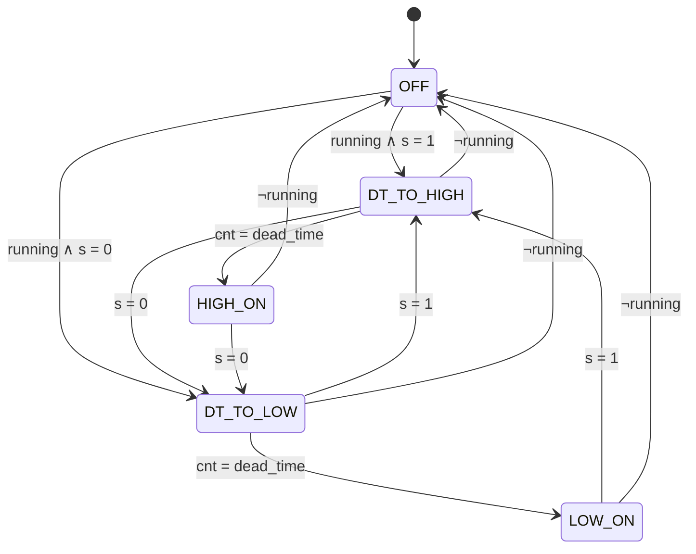

| Estado | `gate_h` | `gate_l` |
|---|:---:|:---:|
| `OFF`, `DT_TO_HIGH`, `DT_TO_LOW` | 0 | 0 |
| `HIGH_ON` | 1 | 0 |
| `LOW_ON` | 0 | 1 |

#### Funcionamiento

Cada vez que `s` cambia, la máquina apaga el transistor que estaba conduciendo y pasa a un estado de espera en el que ambas compuertas están en 0. Ahí un contador cuenta `dead_time` ciclos, y cuando termina, enciende el transistor complementario.

```
s       ________|‾‾‾‾‾‾‾‾‾‾‾‾‾‾‾‾‾‾‾‾‾|_____________
gate_h  ____________|‾‾‾‾‾‾‾‾‾‾‾‾‾‾‾‾‾|_______________
gate_l  ‾‾‾‾‾‾‾‾|_______________________|‾‾‾‾‾‾‾‾‾‾‾‾‾
                |<-t_dt->|              |<-t_dt->|
```

Cada ciclo de reloj son 10 ns, así que el tiempo muerto es:

$$
t_{dt} = dead\_time \times 10\ \text{ns}
$$

con `dead_time` entre 20 y 1023 ciclos, es decir, de 0,2 µs a 10,23 µs.

#### Diseño y justificación técnica

Lo hicimos con una máquina de estados porque así es imposible, por cómo está construida, que las dos compuertas de una pierna estén en 1 al mismo tiempo. Si eso pasara, la pierna quedaría en cortocircuito con la fuente. Las salidas salen directamente de flip-flops para que no lleguen glitches a los drivers.

El tiempo muerto es configurable desde software porque el valor final depende de los MOSFET y drivers que elija el equipo de potencia. Así se puede ajustar en las pruebas sin volver a sintetizar. El mínimo de 20 ciclos evita que por un error del software quede en cero.

#### Comportamiento durante el reset

La máquina queda en `OFF`, con las dos compuertas en 0.

#### Casos especiales y condiciones de borde

Si `s` cambia otra vez antes de que termine el tiempo muerto, la máquina pasa directo al otro estado de espera sin encender ningún transistor. Ese pulso se pierde, pero nunca hay cortocircuito. Si `running` cae a 0, se va a `OFF` desde cualquier estado.

#### Estrategia de validación

Durante toda la simulación, el testbench revisa en cada ciclo que nunca estén `gate_h` y `gate_l` en 1 a la vez, y mide el intervalo muerto para varios valores de `dead_time`. En la placa se mide con el osciloscopio, con la etapa de potencia apagada.

---

### 7.5 Generador de `pwm_trigger_o`

#### Objetivo

Avisarle al ADC cuándo tomar la muestra de corriente.

#### Entradas y salidas

| Señal | Dirección | Descripción |
|---|---|---|
| `valley` | Entrada | Pulso de inicio de período, desde la portadora. |
| `pwm_trigger_o` | Salida | Pulso de 4 ciclos (40 ns) hacia el ADC. |

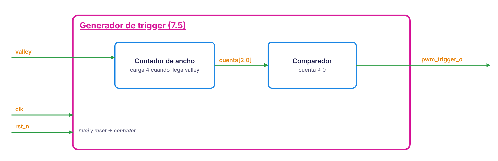

#### Funcionamiento

Cuando llega `valley`, un contador pequeño mantiene `pwm_trigger_o` en 1 durante 4 ciclos de reloj. Se genera un pulso por cada período de conmutación.

#### Diseño y justificación técnica

Elegimos muestrear en el valle porque ahí las dos piernas están en el mismo estado y la corriente pasa justo por la mitad de su rizado. Así la muestra corresponde al valor promedio de la corriente en ese período. Además, en el valle no hay conmutaciones cerca, entonces la medición tiene menos ruido.

Los registros sombra también se actualizan en el valle. La secuencia queda así: se toma la muestra, la rutina de interrupción calcula el PR y escribe el nuevo `duty_ref`, y ese valor se aplica en el siguiente valle. El retardo entre medir y actuar nunca pasa de un período de conmutación.

El pulso dura 4 ciclos en vez de 1 para que el ADC lo detecte sin problemas. El ancho final se ajustará con la interfaz del ADC.

#### Comportamiento durante el reset

`pwm_trigger_o` = 0.

#### Casos especiales y condiciones de borde

Si el PWM está deshabilitado no hay valles, entonces tampoco hay pulsos de trigger.

#### Estrategia de validación

En simulación se verifica que haya un pulso por período, de 4 ciclos y alineado con `c = 0`. En la placa se observa junto con una compuerta en el osciloscopio.

### 7.6 FSM de adquisición ADC/XADC

La FSM recorre REPOSO → DISPARAR → ESPERAR_EOC → SOLICITAR_DRP → ESPERAR_DRDY → PUBLICAR. Cada espera tiene timeout configurable por parámetro de síntesis. El ancho alto/bajo de CONVST se selecciona conforme al dispositivo y al XADC Wizard; la etapa DISPARAR dura N_convst ciclos y no supone sin verificación que un pulso de 10 ns sea suficiente. Ante vencimiento se activa TIMEOUT y no se incrementa SEQ. Una solicitud con adquisición ocupada o sin disponibilidad del XADC se descarta y activa OVERRUN.

El árbitro detecta el flanco ascendente de pwm_trigger_o, de modo que sus cuatro ciclos en alto generan una sola solicitud. El historial del detector se actualiza incluso con ENABLE=0. Después de reset se exige observar el trigger bajo antes de armar la detección, para evitar interpretar un nivel alto residual como un evento nuevo.

START_SW se utiliza en diagnóstico, con SYNC_MODE=0. Durante el control, SYNC_MODE=1 selecciona exclusivamente el trigger PWM. Una escritura START_SW en modo sincronizado se ignora y registra OVERRUN. ENABLE=0 bloquea nuevas solicitudes; una operación ya aceptada puede terminar. Un reset interrumpe la operación, limpia VALID/errores y devuelve la FSM a REPOSO.

Las solicitudes con ENABLE=0 se ignoran sin error. SYNC_MODE solo se cambia cuando el ENABLE previo a la escritura es 0 y BUSY=0. Primero se deshabilitan nuevas solicitudes y se espera el fin de la operación aceptada, y después se cambia el modo. Un cambio de modo con ENABLE previo=1 o BUSY=1 devuelve SLVERR y conserva CTRL. ENABLE y START_SW pueden escribirse juntos en diagnóstico: la aceptación usa el ENABLE resultante. No hay cola de solicitudes.

Tras timeout, la FSM queda en ERROR bloqueado: no emite CONVST/DEN ni acepta disparos y descarta EOC/DRDY tardíos. Borrar TIMEOUT por W1C no rearma la FSM; BUSY permanece en 1 en ERROR. Se exige reset coordinado del wrapper y XADC, con potencia bloqueada, para volver a WARMUP. Esto evita asociar una respuesta vieja a una solicitud nueva. La integración de plataforma debe definir cómo aplicar ese reset; el mapa actual no propone un bit de reset software.

Reset domina todos los estados, cancela la publicación pendiente y limpia CTRL/VALID/errores/DATA/SEQ/TIME/TICKS. La admisión permanece bloqueada hasta terminar la inicialización del XADC y el asentamiento analógico. El tiempo tras reset y el divisor ADCCLK se justifican con la hoja de datos del FPGA seleccionado; BUSY=0 inmediatamente tras reset no basta para admitir una conversión.

Al recibir DRDY se conserva DO[15:4] en un registro interno. En PUBLICAR se transfiere ese valor a DATA, se incrementa SEQ y se publica TIME en el mismo flanco. El instante TIME se conserva desde la aceptación del disparo; no se toma al finalizar DRP. Las lecturas no borran la muestra ni VALID. Los errores permanecen hasta limpieza explícita; un error nuevo domina una limpieza coincidente.

Con un canal sin promediado se espera BUSY bajo y se concede el asentamiento recomendado de cuatro ADCCLK antes de la próxima conversión [R1]. DEN se activa un DCLK con DWE=0 y DADDR estable; se captura DO en un registro interno únicamente cuando DRDY=1 y no se inicia otra lectura hasta que DRDY baje [R9]. El retardo entre aceptar el trigger y el flanco CONVST se mide como parte de la fase real: ADC_TIME no es por sí solo el instante analógico exacto.

El acondicionamiento debe ubicar todo el rango de corriente dentro del rango analógico permitido por el XADC y por la tarjeta [R3]. Una corriente negativa se representa mediante el offset del sensor; no se conecta directamente una tensión negativa al canal unipolar.

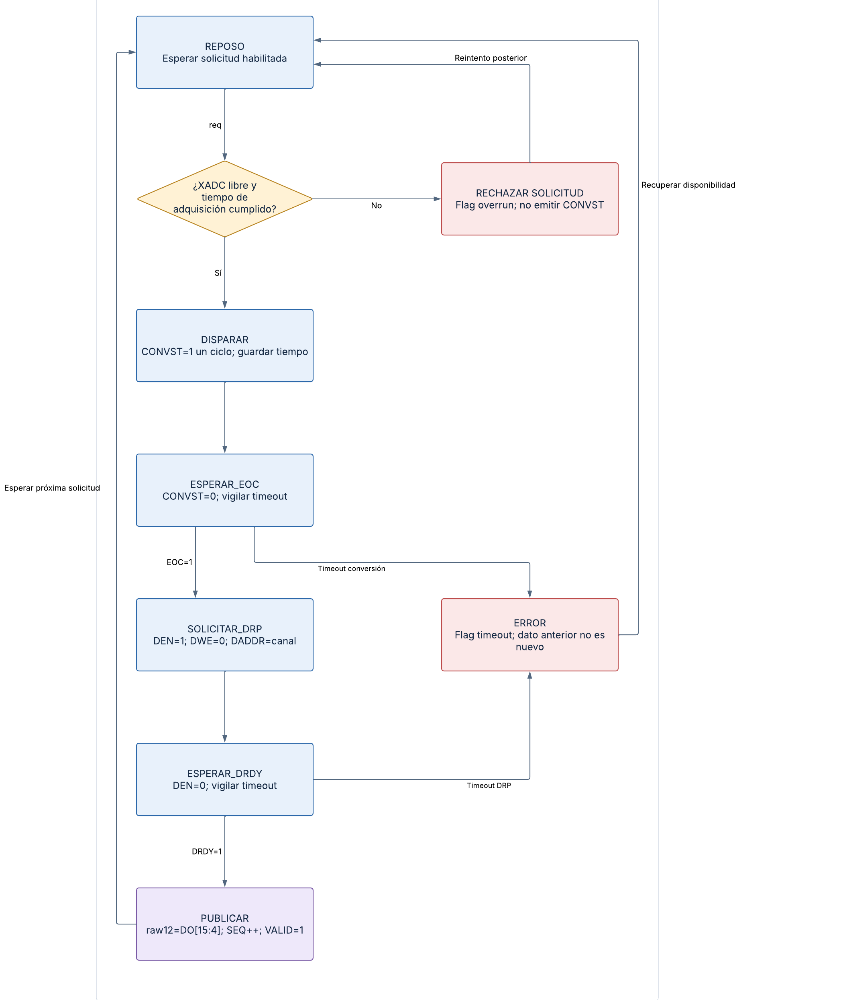

*FSM de adquisición y lectura DRP.*

La recuperación desde ERROR exige reset coordinado del wrapper y del XADC. La etapa DISPARAR utiliza N_convst ciclos según los tiempos del dispositivo.

### 7.7 Interfaces y comportamiento de los subbloques ADC/XADC

| Subbloque y objetivo | Entradas | Salidas | Reset y casos especiales | Validación prevista |
|---|---|---|---|---|
| Interfaz AXI: separar bus y adquisición | AW/W/AR, BREADY/RREADY | B/R y operaciones de registros | Vaciar pendientes; AW/W independientes y backpressure | A12–A14 |
| Registros: exponer configuración y tupla | Escrituras, captura, errores | CTRL, STATUS, DATA/SEQ/TIME/TICKS | Reset a cero; W1C con set dominante | A01, A09–A11, A16 |
| Árbitro: admitir una solicitud | ENABLE, modo, START_SW, flanco de trigger, disponibilidad | req_accept, overrun | Sin cola; rechazar ocupado; ignorar deshabilitado | A02–A05, A15 |
| FSM/DRP: obtener conversión válida | req_accept, BUSY, EOC, DRDY, DO | CONVST, DEN/DWE/DADDR, capture_en | Timeout bloquea hasta reset; sin publicación residual | A06–A08, A17–A19 |
| Contador/watchdog: acotar tiempo | clk, reset, inicio/fin | ticks, timestamp, TIMEOUT | TICKS solo reinicia con reset; diferencias modulares | A16–A19, T09 |
| Captura: publicar indivisiblemente | DO[15:4], tiempo del disparo, capture_en | DATA/SEQ/TIME, VALID | Un incremento por éxito; VALID persiste hasta reset | A06–A11 |

Esta separación permite simular protocolo y conversión por separado. Las figuras de adquisición y FSM muestran las relaciones; §7.6 define funcionamiento, reset y condiciones de borde.

---

## 8. Mapa de memoria, registros e interfaces

### 8.1 Mapa de memoria

La arquitectura del sistema utiliza un esquema de memoria mapeada para permitir que el procesador MicroBlaze V acceda a los periféricos mediante operaciones de lectura y escritura.

La memoria local BRAM se conecta al procesador mediante los controladores ILMB y DLMB, mientras que los periféricos se comunican a través de la interconexión AXI.

Cada periférico dispone de una región de direcciones que permite acceder a sus registros de configuración, control, estado y datos. Las direcciones base y los rangos definitivos serán asignados y verificados mediante el Address Editor de Vivado durante la integración del Block Design.

La siguiente tabla identifica los recursos que deberán incorporarse al mapa de memoria.

| Recurso | Dirección base | Rango | Interfaz |
|---|---|---|---|
| BRAM local | Por asignar | 32 KiB | ILMB / DLMB |
| AXI Timer | Por asignar | Según configuración del IP | AXI4-Lite |
| AXI UART Lite | Por asignar | Según configuración del IP | AXI4-Lite |
| AXI GPIO | Por asignar | Según configuración del IP | AXI4-Lite |
| AXI Interrupt Controller | Por asignar | Según configuración del IP | AXI4-Lite |
| PWM Controller | Por asignar | Según decodificación del periférico | AXI4-Lite |
| Interfaz ADC/XADC | Por asignar | Según decodificación del periférico | AXI4-Lite |

El AXI Interrupt Controller se contempla como parte de la arquitectura propuesta para centralizar las solicitudes de interrupción de los periféricos y comunicarlas al MicroBlaze V. Su región de direcciones permitirá configurar y consultar el estado de las interrupciones. La conexión definitiva de las fuentes y la asignación de direcciones se verificarán durante la integración del Block Design en Vivado.

#### 8.1.1. Organización de los accesos

El procesador utiliza dos mecanismos principales de acceso:

- **Acceso a memoria local:** mediante ILMB y DLMB para recuperar instrucciones y acceder a variables y estructuras de datos.
- **Acceso a periféricos:** mediante transacciones AXI para configurar los módulos, consultar estados y transferir datos.

Esta separación permite utilizar la memoria local para las operaciones del firmware y reservar el espacio AXI para la interacción con los periféricos.

#### 8.1.2. Asignación de direcciones

Durante la implementación del Block Design se deberán verificar los siguientes aspectos:

1. Que todos los periféricos tengan regiones de direcciones válidas.
2. Que no existan solapamientos entre las regiones asignadas.
3. Que el procesador pueda acceder a los registros de cada periférico.
4. Que las direcciones utilizadas por el firmware coincidan con las asignadas en Vivado.
5. Que los rangos reservados sean compatibles con la decodificación de direcciones de cada módulo.

Una vez completada la integración, esta tabla deberá actualizarse con los valores definitivos obtenidos del Address Editor.

### 8.2 Registros del periférico PWM

Los offsets son relativos a la dirección base que asigne Vivado. Los registros 0x00 y 0x04 son los que define el enunciado. El 0x08 lo agregamos para el tiempo muerto.

**0x00 — CTRL_STATUS** (reset `0x0000_0000`)

| Bits | Campo | Acceso | Descripción |
|---|---|---|---|
| 0 | `enable` | R/W | 1 habilita el PWM. 0 apaga las cuatro compuertas. |
| 2:1 | `freq_sel` | R/W | `00` = 5 kHz, `01` = 10 kHz, `10` = 20 kHz, `11` = 40 kHz. |
| 3 | `running` | Solo lectura | 1 si el generador está activo. |
| 31:4 | — | Reservado | Se leen como 0. |

**0x04 — DUTY_REF** (reset `0x0000_0000`)

| Bits | Campo | Acceso | Descripción |
|---|---|---|---|
| 15:0 | `duty_ref` | R/W | Índice de modulación en Q1.15 con signo. Se satura a ±0,95 (`0x7999` / `0x8667`). |
| 31:16 | — | Reservado | Se leen como 0. |

**0x08 — DEADTIME** (reset `0x0000_0064`)

| Bits | Campo | Acceso | Descripción |
|---|---|---|---|
| 9:0 | `dead_time` | R/W | Tiempo muerto en ciclos de 10 ns. Se satura entre 20 y 1023. |
| 31:10 | — | Reservado | Se leen como 0. |

Los cambios en `freq_sel`, `duty_ref` y `dead_time` se aplican en el siguiente valle de la portadora.

### 8.3 Registros de la interfaz ADC/XADC

#### 8.3.1 Mapa y semántica de registros

Todos los offsets son relativos a ADC_BASE. Los bits reservados se leen como cero. Tras reset, ENABLE=0, SYNC_MODE=0, VALID=0, SEQ=0 y errores=0. DATA/TIME no se consideran válidos hasta VALID=1.

Todos los registros y bits definidos reinician a cero. ADC_TICKS incrementa desde el ciclo posterior a retirar reset, independientemente de ENABLE. START_SW y ERR_CLEAR se leen siempre como cero; leer STATUS no limpia flags.

| Offset | Registro | Acceso | Bits y semántica |
|---|---|---|---|
| 0x00 | ADC_CTRL | R/W | bit0 ENABLE; bit1 SYNC_MODE; bit2 START_SW, escritura de pulso y lectura cero |
| 0x04 | ADC_STATUS | RO | bit0 VALID; bit1 BUSY de la interfaz; bit2 OVERRUN; bit3 TIMEOUT |
| 0x08 | ADC_DATA | RO | bits[11:0] raw12; bits[31:12]=0 |
| 0x0C | ADC_SEQ | RO | Contador que incrementa al publicar una muestra |
| 0x10 | ADC_TIME | RO | Tiempo del disparo de la muestra publicada, módulo 2^32 |
| 0x14 | ADC_ERR_CLEAR | WO | Escribir 1 en bit2/3 borra OVERRUN/TIMEOUT; leer devuelve cero |
| 0x18 | ADC_TICKS | RO | Contador RTL vivo de 32 bits a 100 MHz; lectura sin efectos laterales |

DATA se obtiene del campo de conversión de 12 bits del resultado XADC; el wrapper lo entrega alineado a la derecha. Canal, dirección DRP y reloj ADC se parametrizan en hardware y se registran en el contrato de integración.

Se usa `raw12=DO[15:4]` para el canal unipolar propuesto [R10]. OVERRUN significa solicitud rechazada por ocupación, indisponibilidad o START_SW en modo sincronizado; no significa «muestra no leída». El wrapper no conoce los consumos de software: una muestra sobrescrita antes de la ISR se detecta por SEQ.

La interfaz propia acepta AW y W independientemente, respeta WSTRB y solo escribe cuando dispone de ambas transferencias. Mantiene BVALID y RVALID, junto con sus respuestas y datos, hasta su aceptación. Escrituras en registros RO no los modifican; accesos desalineados o a offsets no implementados devuelven SLVERR. Esta política corresponde al IP propio, no redefine el comportamiento de las IP de AMD.

Se propone SLVERR también al escribir RO. WSTRB selecciona bytes en CTRL y ERR_CLEAR; strobe nulo no tiene efectos. Bits reservados escritos se ignoran. MMIO usa accesos ordenados de 32 bits sin caché. RDATA se fija al aceptar AR y no cambia mientras RREADY esté bajo aunque se publique una nueva muestra.

#### 8.3.2 Lectura coherente

La ISR lee SEQ1, DATA, TIME, STATUS y SEQ2. Acepta la tupla si SEQ1=SEQ2, VALID=1, no hay errores y SEQ2 es el siguiente identificador esperado, usando aritmética uint32. Se admite como máximo un reintento adicional. La ISR no espera indefinidamente una conversión.

En WARMUP se establece last_seq a partir de una primera tupla válida y se inicia la fase de referencia. Desde RUNNING se exige el incremento de uno. Un salto de secuencia, dato repetido o tiempo excesivamente antiguo genera falla. El desbordamiento de 0xFFFFFFFF a 0 es válido.

La guardia SEQ1/SEQ2 requiere publicación simultánea en hardware y lecturas MMIO en el orden indicado, sin caché. Se valida la antigüedad modular `now-ADC_TIME` contra la ventana de fase acordada. Un reset durante RUNNING causa FAULT y nueva línea de base en WARMUP; no se interpreta como wrap normal.

#### 8.3.3 Interfaz de actualización del PWM

La interfaz adopta los registros de la especificación del PWM. CTRL_STATUS ocupa el offset 0x00, con enable en bit0, freq_sel en bits[2:1] y running de solo lectura en bit3. DUTY_REF ocupa 0x04, con el valor Q1.15 con signo en bits[15:0] y bits altos reservados a cero. DEADTIME ocupa 0x08, con bits[9:0] en ciclos de 10 ns, reset de 100 ciclos y saturación entre 20 y 1023 ciclos. El driver escribe solo campos R/W y conserva los demás campos de configuración.

DUTY_REF, freq_sel y DEADTIME se aplican en el siguiente valle mediante registros sombra. Los códigos freq_sel 00, 01, 10 y 11 corresponden a 5, 10, 20 y 40 kHz. El límite hardware de DUTY_REF es ±31129 códigos, equivalente a ±31129/32768 ≈ ±0,9499829. El firmware debe aplicar además el límite de modulación compatible con la frecuencia, el tiempo muerto y PEDP.

El PWM documentado actualmente vincula enable con portadora, trigger y compuertas. El arranque en fase mediante sync_start_i y el bloqueo independiente de compuertas requerido por WARMUP son ampliaciones pendientes del contrato C4. Se deben acordar sus señales y prioridades antes de habilitar el lazo integrado.

### 8.4. Protocolo AXI4-Lite

El protocolo AXI4-Lite permite la comunicación entre el procesador MicroBlaze V y los periféricos mapeados en memoria mediante transacciones de lectura y escritura. En la arquitectura propuesta, este protocolo se utiliza para acceder a los registros de configuración, control, estado y datos de los periféricos personalizados, particularmente el generador PWM y el subsistema de adquisición ADC.

AXI4-Lite utiliza una interfaz de tipo maestro-esclavo, donde el MicroBlaze V inicia las transacciones a través de la interconexión AXI y cada periférico responde a las solicitudes dirigidas a su espacio de direcciones. A diferencia de AXI4 completo, AXI4-Lite no admite transferencias en ráfaga y está orientado a operaciones individuales de acceso a registros.

#### 8.4.1. Canales de comunicación

El protocolo dispone de cinco canales independientes:

| Canal | Señales principales | Función |
|---|---|---|
| Dirección de escritura (AW) | `AWADDR`, `AWVALID`, `AWREADY` | Transmite la dirección del registro que se desea escribir. |
| Datos de escritura (W) | `WDATA`, `WSTRB`, `WVALID`, `WREADY` | Transmite el dato y los bytes habilitados para escritura. |
| Respuesta de escritura (B) | `BRESP`, `BVALID`, `BREADY` | Informa el resultado de la operación de escritura. |
| Dirección de lectura (AR) | `ARADDR`, `ARVALID`, `ARREADY` | Transmite la dirección del registro que se desea leer. |
| Datos y respuesta de lectura (R) | `RDATA`, `RRESP`, `RVALID`, `RREADY` | Devuelve el dato solicitado y el estado de la operación. |

Los canales de lectura y escritura funcionan de manera independiente, permitiendo que cada operación utilice sus propias señales de control y respuesta.

#### 8.4.2. Mecanismo de transferencia VALID/READY

La transferencia de información en AXI4-Lite se realiza mediante un mecanismo de sincronización basado en las señales `VALID` y `READY`.

La señal `VALID` indica que el emisor presenta información válida en el canal correspondiente, mientras que `READY` indica que el receptor está preparado para aceptarla.

Una transferencia se completa únicamente cuando ambas señales se encuentran activas durante el mismo flanco ascendente del reloj:

`VALID = 1` y `READY = 1`.

Si el receptor no está preparado, el emisor debe mantener la información y la señal `VALID` estables hasta que se complete la transferencia.

Este mecanismo permite coordinar la comunicación entre el procesador y los periféricos sin asumir que todas las operaciones se completan en un único ciclo de reloj.

#### 8.4.3. Operación de escritura

Para escribir un registro de un periférico, el procesador inicia una transacción mediante los canales de dirección y datos de escritura.

El procedimiento general es el siguiente:

1. El maestro presenta la dirección del registro mediante `AWADDR` y activa `AWVALID`.
2. El maestro presenta el dato mediante `WDATA`, indica los bytes habilitados con `WSTRB` y activa `WVALID`.
3. El periférico acepta la dirección y los datos cuando se completan los respectivos intercambios `VALID/READY`.
4. Una vez recibida la información necesaria, el periférico ejecuta la escritura y genera una respuesta mediante `BRESP` y `BVALID`.
5. La transacción finaliza cuando el maestro acepta la respuesta mediante `BREADY`.

Los canales AW y W son independientes, por lo que sus transferencias no necesariamente ocurren durante el mismo ciclo de reloj.

En el proyecto, este mecanismo permite configurar registros como la habilitación del PWM, los valores de modulación, los tiempos muertos y los parámetros de funcionamiento de los periféricos.

#### 8.4.4. Operación de lectura

La lectura de un registro se realiza mediante los canales AR y R.

El procedimiento general es el siguiente:

1. El maestro presenta la dirección del registro mediante `ARADDR` y activa `ARVALID`.
2. El periférico acepta la dirección cuando se completa el intercambio `ARVALID/ARREADY`.
3. El periférico obtiene el contenido del registro solicitado y lo presenta mediante `RDATA`.
4. El periférico activa `RVALID` e informa el resultado de la operación mediante `RRESP`.
5. La transferencia finaliza cuando el maestro acepta los datos mediante `RREADY`.

Este mecanismo permite que el MicroBlaze V consulte los registros de estado, las banderas de operación y los datos adquiridos por los periféricos.

#### 8.4.5. Respuestas y manejo de errores

Los canales de respuesta utilizan señales de dos bits para indicar el resultado de una transacción.

| Código | Respuesta | Descripción |
|---|---|---|
| `00` | `OKAY` | La operación se completó correctamente. |
| `10` | `SLVERR` | El periférico detectó un error durante la operación. |
| `11` | `DECERR` | La dirección solicitada no pudo ser decodificada. |

El código `01`, correspondiente a `EXOKAY` en AXI4, no se utiliza en AXI4-Lite.

Las respuestas permiten identificar accesos incorrectos o condiciones de error, de acuerdo con la implementación del periférico y la interconexión.

#### 8.4.6. Aplicación en la arquitectura propuesta

En el sistema desarrollado, AXI4-Lite constituye el mecanismo principal de acceso a los registros de los periféricos personalizados.

El MicroBlaze V actúa como iniciador de las operaciones de lectura y escritura, mientras que la interconexión AXI dirige cada solicitud hacia el periférico correspondiente según la dirección asignada.

En el periférico PWM, las escrituras permiten actualizar los parámetros de modulación y control, mientras que las lecturas permiten consultar su estado.

En el subsistema ADC, las operaciones de lectura permiten recuperar las muestras digitalizadas y consultar los indicadores de disponibilidad o estado definidos en su mapa de registros.

La comunicación mediante AXI4-Lite permite separar el procesamiento realizado por el firmware de las funciones implementadas en hardware, facilitando la integración, verificación y reutilización de los periféricos.

Las direcciones base y los rangos definitivos de cada periférico se establecerán durante la configuración del Block Design mediante el Address Editor de Vivado.
---

## 9. Software embebido y aplicación de PC

### 9.1 Arquitectura y flujo de la aplicación

| Componente previsto | Ubicación | Responsabilidad |
|---|---|---|
| Aplicación y estados | vitis/app/ | Inicialización, main, WARMUP/RUNNING/FAULT |
| ISR y control | vitis/app/ | Lectura periódica, PR, actualización y registro |
| Drivers propios ADC/PWM | vitis/drivers/ | Accesos MMIO y semántica de registros |
| Drivers AMD | BSP generado | Timer, INTC, GPIO y UART Lite |
| Receptor Python | scripts/ | Decodificar trama, convertir, graficar y guardar CSV |

Se mantienen INIT, WARMUP, RUNNING y FAULT como estados de control. El estado de transmisión es independiente: IDLE, WAIT_SNAPSHOT, HEADER, RECORDS y CRC. Por tanto, RUNNING puede coexistir con una exportación.

#### 9.1.1 Inicialización y main

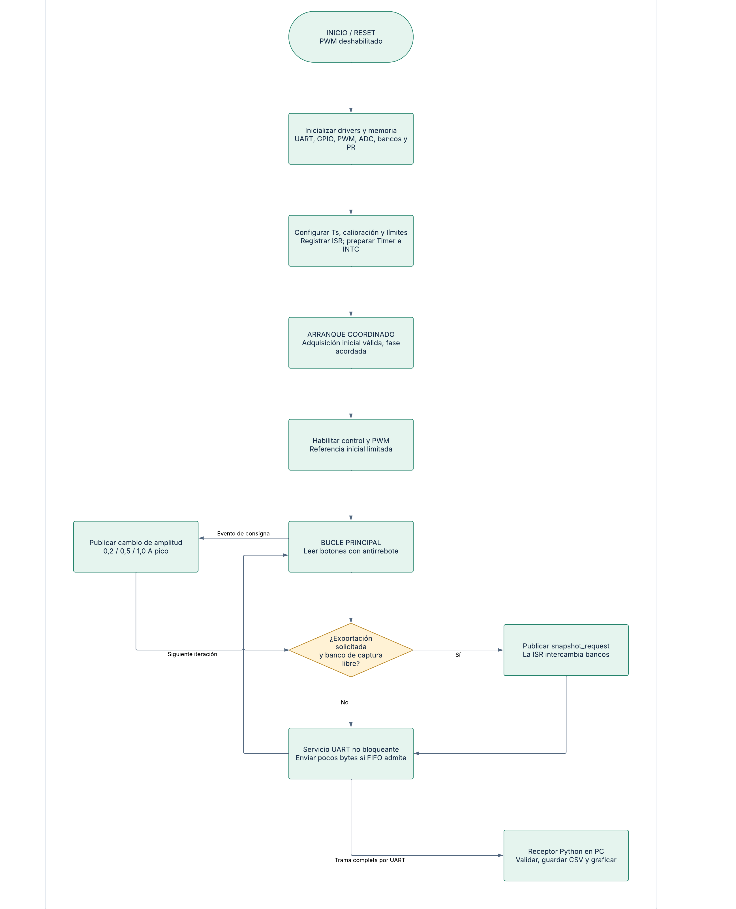

*Inicialización y bucle principal del firmware.*

La inicialización mantiene las salidas bloqueadas, comprueba configuración y calibra a partir de valores suministrados. Después prepara coeficientes, memoria, drivers y sincronización. WARMUP establece la primera secuencia válida; RUNNING habilita el control cuando los contratos están satisfechos. Si falta calibración o PR válido, se permite diagnóstico con potencia deshabilitada.

WARMUP mantiene portadora y disparos activos con compuertas bloqueadas; la primera IRQ del arranque no exige una muestra previa. La espera de una primera tupla válida tiene límite de períodos y diagnóstico de fallo. La liberación del bloqueo se solicita para un valle, con referencia limitada y PR inicializado; no por una escritura asíncrona que recorte un pulso. El contrato debe distinguir ENABLE de potencia, portadora activa y running. La interfaz PWM actual detiene la portadora y los disparos con enable=0, por lo que este arranque requiere la ampliación C4 antes de su implementación integrada.

Main filtra botones, publica cambios de amplitud, solicita snapshots y transmite un número acotado de bytes si la FIFO UART dispone de espacio. No transmite bloques completos dentro de una sección crítica ni deshabilita interrupciones durante el envío.

#### 9.1.2 Atención periódica

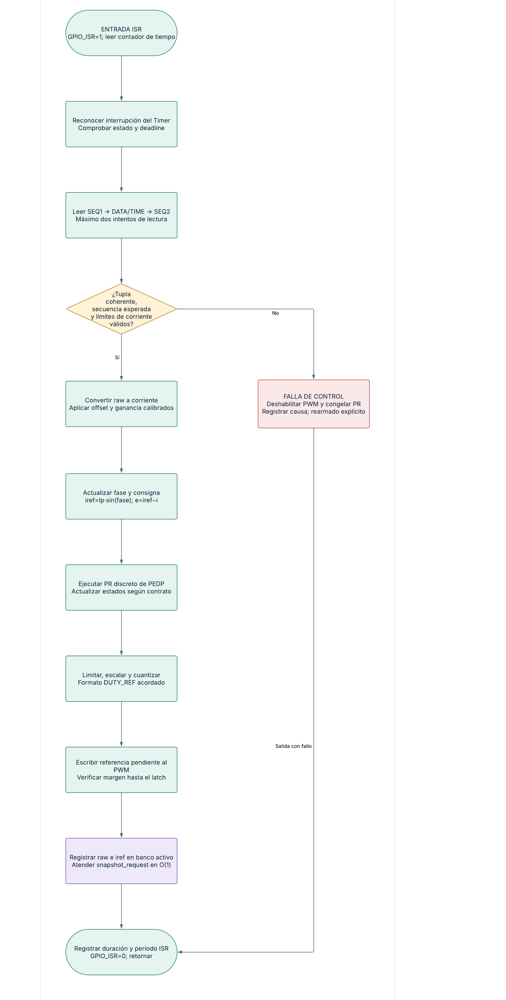

*Ruta nominal de control en RUNNING. El pseudocódigo detalla WARMUP, FAULT y las salidas por fallo numérico o temporal.*

La lectura incluye STATUS además de DATA/TIME y las dos lecturas de SEQ; las validaciones de tiempo y error descritas a continuación forman parte de la atención periódica.

1. Elevar GPIO_ISR y capturar el tiempo de entrada.
2. Reconocer el Timer; distinguir WARMUP, RUNNING o FAULT.
3. Leer una tupla ADC coherente con hasta dos intentos.
4. Comprobar secuencia, antigüedad, errores y umbrales raw calibrados.
5. Convertir la muestra y evaluar la referencia en el instante de muestreo.
6. Calcular error y PR.
7. Saturar, cuantizar y comprobar tiempo restante hasta el latch.
8. Escribir DUTY_REF pendiente y confirmar la finalización MMIO.
9. Registrar raw e iref; atender intercambio de bancos en O(1).
10. Actualizar métricas; bajar GPIO_ISR y retornar.

Cada rama tiene tiempo acotado. Un fallo de dato, cálculo no finito, sobrecorriente o deadline conduce a FAULT, deshabilita PWM y congela estados del PR. No se reutiliza un dato anterior fingiendo que se adquirió una muestra nueva. FAULT sigue atendiendo las interrupciones necesarias para exportar diagnóstico; el rearme es explícito con potencia bloqueada.

#### 9.1.3 Pseudocódigo de contrato

```text
timer_isr():
    entrada = ADC_TICKS; GPIO_ISR = 1
    reconocer_fuente_timer_sin_recargar()
    si FAULT: atender_snapshot_de_diagnostico(); ir a salida
    tupla = leer_SEQ_DATA_TIME_STATUS_SEQ(max_intentos=2)
    si WARMUP:
        si errores_ADC_o_limite_de_espera_excedido(tupla):
            bloquear_compuertas_y_entrar_FAULT(); ir a salida
        si primera_tupla_valida_dentro_de_umbrales_y_fase_verificada(tupla):
            fijar_last_seq_y_fase(); inicializar_PR_segun_PEDP()
            preparar_referencia_segura_y_solicitar_liberacion_en_valle()
            estado = RUNNING
        ir a salida
    si tupla invalida, vieja, con errores o seq != last_seq+1:
        bloquear_compuertas_y_entrar_FAULT(); ir a salida
    si raw_fuera_de_umbrales_calibrados(tupla.raw):
        bloquear_compuertas_y_entrar_FAULT(); ir a salida
    aplicar_consigna_pendiente_en_limite_de_muestra()
    i = calibrar(tupla.raw); iref = referencia(tiempo_de_muestreo)
    si no_finitos(i, iref) o parametros_de_control_invalidos():
        bloquear_compuertas_y_entrar_FAULT(); ir a salida
    u = PR_PEDP(iref-i)
    si no_finito(u):
        bloquear_compuertas_y_entrar_FAULT(); ir a salida
    m = adaptar_salida_a_modulacion(u)
    si no_finito(m):
        bloquear_compuertas_y_entrar_FAULT(); ir a salida
    q = limitar_y_cuantizar_Q1_15(m)
    si no_hay_margen_para_MMIO_y_latch():
        bloquear_compuertas_y_entrar_FAULT(); ir a salida
    escribir_referencia_pendiente_y_completar_MMIO(q)
    si plazo_de_escritura_incumplido():
        bloquear_compuertas_y_entrar_FAULT(); ir a salida
    registrar_muestra_y_referencia_del_intervalo_continuo()
    atender_snapshot_en_O(1); last_seq = tupla.seq
salida:
    actualizar_metricas_acotadas(); GPIO_ISR = 0; retornar
```

Las funciones representan requisitos y no código compilable. El servicio de main usa solicitudes y metadatos publicados atómicamente, mantiene las interrupciones habilitadas y limita cada llamada UART. Los estados del PR se reinician con el contrato PEDP durante el rearme; no se reanuda una historia antigua después de cambiar Ts.

### 9.2 Temporización e interrupciones

#### 9.2.1 AXI Timer

Se propone AXI Timer con dos contadores independientes de 32 bits, sin cascada ni modo PWM del Timer. El contador 0 produce la interrupción de control y generateout0. El contador 1 queda disponible como instrumento auxiliar, con interrupción deshabilitada; las métricas ISR usan ADC_TICKS. Los dos usan s_axi_aclk=100 MHz [R4].

Offsets respecto de TIMER_BASE [R5]:

| Offset | Registro | Uso |
|---|---|---|
| 0x00 / 0x04 / 0x08 | TCSR0 / TLR0 / TCR0 | Configuración, recarga y cuenta de control |
| 0x10 / 0x14 / 0x18 | TCSR1 / TLR1 / TCR1 | Canal auxiliar opcional; interrupción deshabilitada |

Para cuenta descendente en Generate, PG079 especifica [R6]:

$$T_s=(TLR0+2)T_{clk}$$

```math
TLR0=\mathrm{round}(f_{clk}T_s)-2
```

La función round redondea al entero más cercano.

| fs propuesta | Ts | Ciclos de período | TLR0 |
|---|---:|---:|---:|
| 5 kHz | 200 µs | 20000 | 19998 |
| 10 kHz | 100 µs | 10000 | 9998 |
| 20 kHz | 50 µs | 5000 | 4998 |
| 40 kHz | 25 µs | 2500 | 2498 |

Los casos de cálculo corresponden a los cuatro códigos de frecuencia del diseño PWM. La selección de la frecuencia de operación requiere validación con PEDP. Si se utiliza un driver que recibe ciclos en lugar del valor crudo TLR, se revisa su implementación para no aplicar dos veces la compensación.

El código oficial de `XTmrCtr_SetResetValue` consultado escribe ResetValue directamente en TLR [R11]: para ese contrato se pasa 4998, sin una segunda resta. Aún se debe comprobar la revisión incluida en el BSP real y medir el intervalo; no hay XSA/BSP en esta base.

Configuración de TCSR0 [R7]:

| Campo | Valor de operación |
|---|---|
| MDT0 | 0: Generate |
| UDT0 | 1: descendente |
| GENT0 | 1: salida de evento |
| ARHT0 | 1: recarga automática |
| ENIT0 | 1: interrupción habilitada |
| ENT0 | 1 después de preparar el sistema |
| LOAD0 | Pulso de carga; 0 durante operación |
| CASC / PWMA0 | 0 |
| T0INT | Reconocimiento mediante escritura de 1 |

Orden de configuración: detener; programar TLR0; activar LOAD; retirar LOAD; limpiar interrupción pendiente; registrar y habilitar el handler; armar el arranque PWM; habilitar el Timer. La ISR reconoce T0INT y el controlador de interrupciones según los drivers del BSP, sin borrar accidentalmente los campos de control [R6, R7].

La medición principal usa ADC_TICKS, contador RTL que incrementa cada ciclo módulo 2^32, sin recarga programada. Se calculan diferencias uint32 entre lecturas separadas menos de un wrap (42,95 s). Así, una ejecución de 50 s sigue midiendo correctamente sus intervalos de 50 µs aunque el contador se desborde. ADC_TIME conserva el valor de ese mismo contador asociado a la muestra; no es un reloj vivo. Timer 1 puede configurarse para diagnóstico separado, sin asumir que una recarga del Timer tiene el mismo comportamiento que un contador RTL libre.

#### 9.2.2 Camino de interrupción

Timer interrupt → AXI Interrupt Controller → entrada Interrupt de MicroBlaze V → despachador del BSP → ISR de control. Se configura el tipo de interrupción coherente con la fuente; la condición del Timer se reconoce antes de retornar. MicroBlaze V requiere habilitar las interrupciones externas y globales correspondientes [R8].

Para seguir el reconocimiento temprano de §9.1.2 se propone conectar a INTC un adaptador ISR propio del Timer: comprueba T0INT/ENIT0 y escribe el W1C conservando los bits R/W antes del cálculo. No debe encadenar además `XTmrCtr_InterruptHandler`, cuyo código oficial invoca el callback antes de limpiar el flag [R12]. Si se elige ese handler AMD, se adapta y documenta el orden del flujo. INTC y el prólogo/epílogo del BSP conservan sus responsabilidades; no se duplican reconocimientos ni se recarga el Timer en cada ISR.

El control tiene prioridad sobre UART y botones. En el diseño base, main consulta GPIO/UART sin interrupciones de transmisión y la ISR de control no se anida. Las secciones críticas de main se limitan al intercambio de metadatos y su duración se incorpora al presupuesto temporal. ADC_TICKS forma parte del mapa de registros del wrapper y proporciona la base temporal de la instrumentación.

#### 9.2.3 Sincronización propuesta y presupuesto

La misma frecuencia no establece fase. Como contrato propuesto entre los subsistemas PWM y plataforma se define un arranque en hardware: con el PWM de potencia bloqueado, un circuito armado emite **sync_start_i** al primer generateout0. El PWM carga una posición inicial de su portadora que representa la fase de IRQ acordada. Este puerto y su lógica todavía requieren aceptación e implementación por los responsables; no existen por defecto en AXI Timer ni se suponen presentes en el PWM.

Caso de diseño a 20 kHz:

- Portadora triangular de 5000 ciclos, N=2500, sin repetir extremos.
- Disparo de adquisición en el valle, fase 0. El trigger permanece alto cuatro ciclos y el wrapper acepta solo su flanco ascendente.
- IRQ en fase 1000, equivalente a 10 µs desde el valle.
- Latch de referencia en fase 5000: siguiente valle, a 50 µs.
- Al primer generateout0, cargar carrier=1000 y dirección ascendente; a continuación la portadora evoluciona normalmente. El primer servicio es WARMUP y no ejecuta el PR. La base de tiempo debe operar durante WARMUP aunque las cuatro salidas de potencia estén bloqueadas; este bloqueo es independiente del arranque de la portadora.
- Con reloj común y períodos de 5000 ciclos, las IRQ posteriores conservan esa fase. Cualquier latencia de registros de sincronización se mide y compensa en la carga de fase.

El presupuesto trigger→IRQ es 10 µs. El presupuesto IRQ→latch es 40 µs e incluye latencia de interrupción, lectura, cálculo, escritura y margen de establecimiento. El retardo nominal trigger→aplicación de referencia es un período de 50 µs. El retardo desde la muestra física se obtiene descontando el tiempo trigger→CONVST, y PEDP debe incorporar ambos instantes al modelo.

$$T_{trigger\to CONVST,max}+T_{adc\to EOC,max}+T_{drp\to publicacion,max}+M_{adc}<10\,\mu s$$

$$L_{irq,max}+C_{hasta\ escritura,max}+T_{AXI,max}+M_{act}<40\,\mu s$$

$$L_{irq,max}+C_{ISR,total,max}<50\,\mu s$$

Los términos no son tiempos medidos. C_hasta escritura excluye la transferencia final; C_ISR,total incluye registro de muestras, instrumentación y retorno. Si float32 no cumple, se optimiza o se cambia Ts y se recalculan PR, fase y registros antes de energizar. El primer PWM habilitado utiliza referencia segura; RUNNING requiere muestra válida y sincronización verificada.

En ciclos, los presupuestos del ejemplo son 1000 desde trigger hasta IRQ, 4000 desde IRQ hasta latch y 5000 hasta la siguiente IRQ. Los márgenes M_adc/M_act, el timeout de conversión/DRP y la cota máxima de antigüedad se fijan después de conocer ADCCLK y medir la plataforma; el plazo de escritura se cuenta desde la IRQ hasta el siguiente valle, descontando latencia y margen. Una comprobación previa a MMIO reserva T_AXI,max y el margen, y una posterior detecta cualquier incumplimiento. Detectar una escritura tardía no deshace un latch: el bloqueo independiente de compuertas y su prioridad sobre DUTY_REF se definen en el contrato de protección del PWM. La seguridad no depende de que el software siempre alcance ese límite.

Un cambio de frecuencia del sistema cerrado se realiza con PWM bloqueado: detener, reconfigurar Timer/PWM/PR, rearmar fase y reiniciar WARMUP. La prueba de cambio de frecuencia en caliente del IP PWM corresponde a la validación del periférico PWM y no implica que el controlador integrado pueda cambiar Ts sin rediseño.

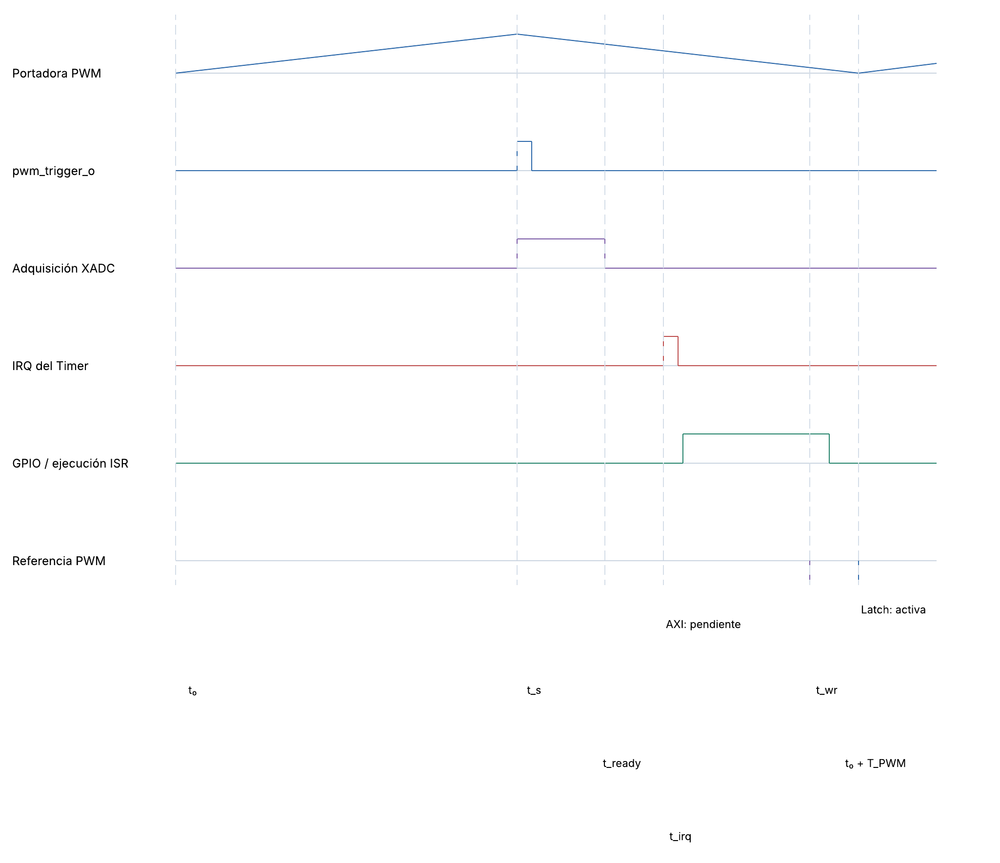

*Relación temporal entre PWM, adquisición, Timer e ISR.*

La figura representa el orden de eventos, sin escala experimental. La instrumentación del diseño utiliza ADC_TICKS como contador vivo; ADC_TIME permanece asociado a la muestra publicada.

#### 9.2.4 Secuencia temporal del caso propuesto a 20 kHz

| Evento | Fase relativa al valle | Cota o acción |
|---|---:|---|
| Valle y disparo ADC | 0 ciclos | Aplicar referencia previa; aceptar un flanco del trigger de cuatro ciclos |
| Publicación ADC | Después del disparo | Antes de IRQ con margen |
| IRQ Timer | 1000 ciclos = 10 µs | Leer muestra ya publicada |
| Pico de portadora | 2500 ciclos = 25 µs | Sin disparo ADC adicional |
| Escritura pendiente | Antes del próximo valle | Validar deadline |
| Nuevo valle | 5000 ciclos = 50 µs | Aplicar la referencia calculada |

La separación trigger–IRQ es 10 µs y la separación IRQ–latch es 40 µs. Ambos son presupuestos propuestos, no resultados experimentales. Si los ensayos no cumplen, se modifica la configuración y se coordina de nuevo con PEDP.

#### 9.2.5 Tiempo de muestra y contador vivo

ADC_TIME representa la muestra publicada. ADC_TICKS es un registro adicional RO propuesto para leer el contador RTL vivo y medir entradas/salidas ISR con diferencias módulo 2^32. Son lecturas de 32 bits; DATA, TIME y SEQ se publican juntos. Las comprobaciones de SEQ1/SEQ2 detectan una publicación intercalada con la lectura del firmware.

### 9.3 Procesamiento y formato numérico del PR

#### 9.3.1 Calibración y referencia

La conversión es:

$$i[k]=(raw[k]-offset_{code})\,gain_{A/code}$$

Offset, ganancia y signo provienen del sensor/acondicionamiento real. Se verifican al menos cero y dos puntos de corriente conocidos; se conservan unidades en amperios.

La referencia se obtiene mediante tabla senoidal y acumulador de fase:

$$i_{ref}[k]=I_p\sin(\theta_k),\qquad \theta_{k+1}=\theta_k+2\pi50T_s$$

El origen de fase se relaciona con ADC_TIME. Un cambio de amplitud mantiene continuidad de fase y se aplica en un límite de muestra. El valor exportado es la referencia efectivamente utilizada en esa muestra.

#### 9.3.2 PR y adaptación al PWM

Se selecciona float32 como implementación inicial por claridad de unidades y ajuste de coeficientes. No se supone FPU: se mide WCET sobre la configuración real del MicroBlaze V y se usan constantes del tipo adecuado. Punto fijo queda como alternativa si las pruebas de tiempo o memoria lo requieren, con análisis propio de rangos.

Si PEDP entrega un PR de segundo orden normalizado, el contrato se puede expresar como:

$$u[k]=b_0e[k]+b_1e[k-1]+b_2e[k-2]-a_1u[k-1]-a_2u[k-2]$$

La ecuación es una forma de interfaz, no una sintonización. Se registran a1, a2, b0, b1, b2, Ts, inicialización, unidades, límites y política de anti-windup de PEDP. Si la estructura entregada es diferente se adapta esta sección. Los estados internos siguen la política de anti-windup especificada por PEDP.

Para salida de control en voltios, m=u/Vdc; si PEDP entrega modulación normalizada, no se divide otra vez. Vdc debe estar medido o justificado como parámetro fijo de la fuente. Se limita m a ±m_max y se convierte al formato acordado:

```math
q=\mathrm{sat}_{\mathrm{int16}}\left(\mathrm{round}(32768m)\right)
```

La función round redondea al entero más cercano y sat_int16 limita el resultado al rango de enteros con signo de 16 bits, de −32768 a 32767.

Q1.15 representa [-1, 1−2^-15]. El hardware PWM limita el código a ±31129. El firmware selecciona un m_max que respete ese límite y deje margen frente al pulso mínimo y al tiempo muerto, con la condición `|m| < 1−2·t_dt·fsw`. A 20 kHz y 1 µs, el límite geométrico es 0,96. A 40 kHz y 1 µs baja a 0,92, por lo que la saturación hardware cercana a 0,95 requiere una restricción adicional en firmware. Se rechazan combinaciones sin margen positivo. Se registra saturación sostenida y se aplica la política de anti-windup aprobada por PEDP.

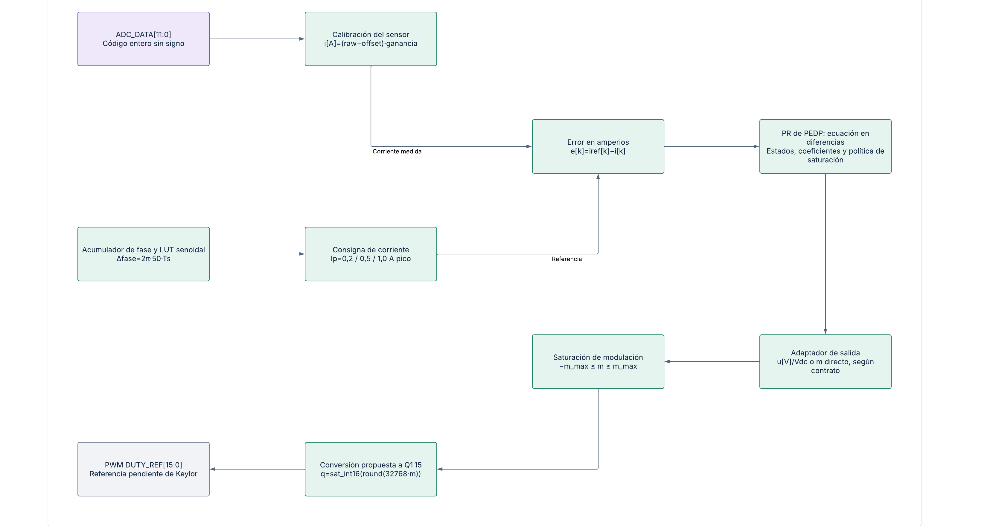

*Ruta numérica del regulador.*

### 9.4 Memoria y exportación UART

#### 9.4.1 Bancos circulares

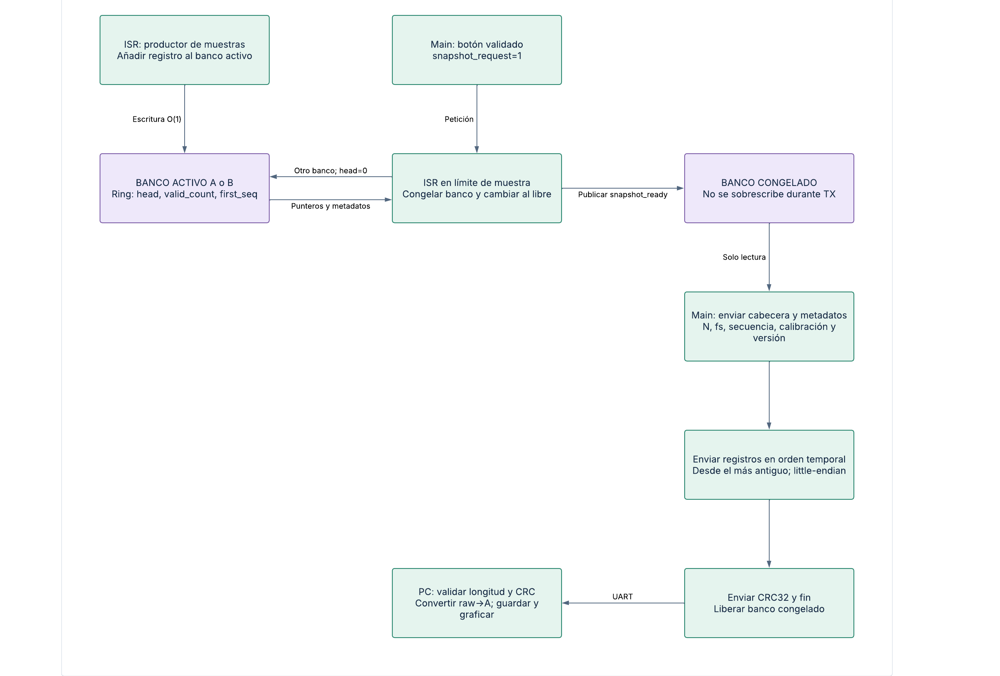

*Captura circular y exportación mediante UART.*

Cada registro contiene raw_adc:uint16 e iref_mA:int16, serializados campo por campo. No se transmite una estructura C cruda con padding. El error de redondeo de iref_mA es como máximo 0,5 mA.

Dos bancos de N=2048 ocupan 16384 bytes. A 20 kHz, cada banco cubre 102,4 ms, equivalentes a 5,12 períodos de 50 Hz. Se revisa el mapa del linker para código, stack y metadatos; el mínimo de 32 KB de BRAM no garantiza que toda la aplicación quepa. Se amplía memoria si hace falta.

102,4 ms es la capacidad N/fs; el intervalo entre la primera y última muestra es (N−1)/fs = 102,35 ms. Para cubrir cinco períodos completos de 50 Hz con ambos extremos se requieren al menos `ceil(5·fs/50)+1` muestras: 2001 a 20 kHz. El receptor verifica esa duración y selecciona una ventana de cinco períodos para el análisis de fundamental. A 40 kHz se requieren al menos 4001 muestras entre ambos extremos. La capacidad fija de 2048 registros solo cubre 51,175 ms entre extremos a esa frecuencia, por lo que se debe redimensionar la memoria y revisar el protocolo antes de exigir el mismo criterio de captura.

La ISR escribe el banco activo. Ante solicitud de exportación y banco libre, después de registrar la muestra congela sus punteros y cambia al otro banco en O(1). Main espera snapshot_ready y transmite el banco congelado desde el más antiguo. La ISR no lo modifica hasta su liberación. Se usa intercambio coherente de metadatos y barreras apropiadas; volatile por sí solo no constituye sincronización.

Propiedad de los bancos: solo la ISR modifica el activo y hace FREE→ACTIVE→FROZEN; main solo lee FROZEN y publica su liberación como FREE después de encolar el último byte y dejar de usar sus datos. Las solicitudes se consumen en ISR; main no cambia punteros. La publicación de snapshot_ready incluye head, valid_count, first_seq, first_time, calibración y flags del mismo intervalo. Puede usarse una sección crítica corta en main para entregar/recibir metadatos, contabilizada en L_irq,max. El índice del registro más antiguo es `(head-valid_count+N)%N` si head apunta a la siguiente escritura. El intercambio deja el nuevo activo con head=0 y valid_count=0.

Una exportación durante otra transmisión responde mediante indicador ocupado. Se exportan valid_count registros, no posiciones sin inicializar. Si aún no existen cinco ciclos, se identifica la captura como corta y no se usa para evaluar el criterio estacionario del enunciado.

#### 9.4.2 Protocolo binario v1 propuesto

Todos los enteros son little-endian; float32 usa IEEE-754 y se serializa explícitamente. Cabecera fija de 48 bytes:

| Byte | Campo | Tipo |
|---:|---|---|
| 0–3 | Magic ASCII TDD4 | 4 bytes |
| 4 | Versión = 1 | uint8 |
| 5 | Tipo = 1, captura | uint8 |
| 6–7 | header_bytes = 48 | uint16 |
| 8–11 | capture_id | uint32 |
| 12–15 | sample_count | uint32 |
| 16–19 | fs_hz | uint32 |
| 20–23 | first_seq | uint32 |
| 24–27 | first_sample_time_ticks | uint32 |
| 28–31 | offset_code | float32 |
| 32–35 | gain_A_per_code | float32 |
| 36–37 | record_bytes = 4 | uint16 |
| 38–39 | flags | uint16 |
| 40–43 | sample_period_ticks | uint32 |
| 44–47 | payload_bytes = 4·sample_count | uint32 |

Flags: bit0 captura corta; bit1 falla de control registrada; bit2 error de adquisición en el intervalo; resto reservado. Tras la cabecera se envían N registros de 4 bytes y un uint32 CRC32/ISO-HDLC sobre cabecera y payload. Parámetros CRC: polinomio reflejado 0xEDB88320, init=0xFFFFFFFF, xorout=0xFFFFFFFF; vector de comprobación ASCII 123456789 → 0xCBF43926. No se añade un terminador ambiguo: longitud y CRC delimitan la captura.

En la trama, N es sample_count y puede ser menor que la capacidad 2048. Debe cumplir 1≤N≤2048, payload_bytes=4N, record_bytes=4, fs_hz>0, calibración finita y 0≤raw≤4095. El bit0 indica que `(N−1)/fs < 0,1 s`; una captura vacía no se transmite como medición válida. El formato v1 supone reloj de ticks de 100 MHz y período entero en ciclos. Se exige sample_period_ticks>0 y fs_hz·sample_period_ticks=100000000. Si cambia ese reloj o la frecuencia deja de ser representable con estos campos, se revisa el protocolo. Un wrap de first_seq/first_sample_time_ticks se interpreta módulo 2^32.

Para N=2048, la trama mide 8244 bytes. Su tiempo mínimo a 115200 y 8N1 es 8244·10/115200=0,715625 s; pausas de servicio pueden aumentarlo. El control sigue activo durante ese tiempo.

El receptor busca magic, valida versión y longitudes contra un máximo configurado, recibe con timeout y verifica CRC. Nunca acepta una captura truncada como completa. Al detectar error descarta la trama y busca una cabecera nueva; el flujo puede contener el magic dentro del payload, por lo que no se reinicia una trama válida solo por reconocer esos bytes.

CSV mínimo: capture_id, sample_index, seq, time_s, raw_adc, i_meas_A e i_ref_A. Se reconstruye el tiempo relativo como time_s=k·sample_period_ticks/100000000 y se conservan los metadatos originales. La calibración y fs permanecen constantes dentro de una captura; si cambian se inicia una adquisición nueva. Un fallo que rompa continuidad termina el banco antes de incorporar datos discontinuos y se indica en flags.

Los flags pertenecen a la captura, no al momento posterior de transmisión: una captura FROZEN no cambia aunque falle después el control. En FAULT se conserva el último intervalo continuo del activo para exportarlo cuando haya banco libre; no se sobrescribe el congelado ni se agregan datos repetidos para llenar N. La trama permite reconstruir tiempos uniformes porque prohíbe mezclar intervalos discontinuos.

La adquisición sincronizada sirve para seguimiento de la componente de 50 Hz; no demuestra por sí sola el rizado de conmutación. La medición del rizado requiere osciloscopio o adquisición de mayor ancho de banda, coordinada con PEDP.

### 9.5 Botones y medición temporal

Se proponen eventos de GPIO para EXPORTAR, CAMBIAR_AMPLITUD y REARMAR; su asignación física se define durante la integración de GPIO. El antirrebote de firmware exige estado estable durante 20 ms medidos con base temporal, no mediante espera bloqueante. El evento se produce una sola vez por pulsación.

GPIO_ISR alto mide la ventana instrumentada. Período efectivo: Δt entre entradas sucesivas. Jitter de intervalo: Δt−Ts; reportar mínimo, máximo, media y desviación. Latencia: entrada ISR menos evento Timer; no confundirla con el período. Se compara una ejecución sin UART y otra exportando, durante al menos un millón de períodos (50 s a 20 kHz). Las métricas usan diferencias modulares de ADC_TICKS entre eventos consecutivos; se contabilizan secuencias perdidas y deadlines.

GPIO y dos lecturas MMIO no cubren automáticamente todo el prólogo/epílogo del BSP. La medición de C_ISR,total incluye ese costo y el despachador mediante traza/ILA o cota justificada. La latencia se contrasta con generateout0 y sync_start_i; se mide además el retardo trigger→CONVST para fechar la referencia en el instante físico de muestreo. Los 10 ns de TICKS son resolución del contador, no exactitud total de la instrumentación.

El límite de aceptación temporal es satisfacer todas las desigualdades de la sección 9.2.3 con márgenes documentados, cero pérdidas y cero deadlines en la prueba definida. Cualquier objetivo adicional de jitter debe acordarse con PEDP; no se presenta un valor no medido como resultado.

---

## 10. Estrategia de integración con la etapa de potencia

| ID | Acuerdo | Participantes | Condición de cierre |
|---|---|---|---|
| C1 | Tarjeta, canal, pinout y rango analógico | Plataforma, adquisición y PEDP | Esquema y constraints verificados |
| C2 | Offset, ganancia, signo y umbrales raw | Adquisición y PEDP | Calibración registrada |
| C3 | Ts y fPWM compatibles con trigger en valle y ancho de cuatro ciclos | Equipo digital y PEDP | Presupuesto temporal y PR coherentes |
| C4 | Ampliación del PWM para sync_start_i, carga de fase y bloqueo de compuertas independiente de la portadora | Plataforma, PWM y firmware | Simulación conjunta sin deriva, prioridad de bloqueo y liberación en valle |
| C5 | Validación de CTRL_STATUS/DUTY_REF/DEADTIME, Q1.15 y límites por frecuencia/tiempo muerto | PWM y firmware | Tabla y driver compatibles |
| C6 | Ecuación PR, coeficientes y anti-windup | PEDP y firmware | Vectores de referencia aprobados |
| C7 | WCET float32, memoria, reloj de bus y combinación Vivado/Vitis/BSP | Plataforma y firmware | Tiempo/linker map aceptables y versiones registradas |
| C8 | Reset de recuperación del wrapper/XADC y cotas CONVST/ADCCLK/watchdog | Plataforma y firmware | Sin respuesta tardía publicada; tiempos validados con dispositivo/IP |

La habilitación del lazo integrado requiere cerrar estos contratos. Las pruebas de adquisición, temporización y firmware permanecen pendientes hasta disponer de evidencia de implementación y ensayo.

### 10.1 Parámetros de la etapa de potencia

| Tema | Propuesta actual | Responsable / con quién se acuerda | Estado |
|---|---|---|---|
| Frecuencia de conmutación | 5 / 10 / 20 / 40 kHz | Keylor – PEDP | Pendiente |
| Tiempo muerto | 1 µs inicial, ajustable de 0,2 a 10,23 µs | Keylor – PEDP | Pendiente |
| Nivel lógico y polaridad de las compuertas | 3,3 V, activo en alto | Keylor – PEDP | Pendiente |
| Formato de `duty_ref` | Q1.15 con signo, saturado a ±0,95 | PWM – firmware | Pendiente |
| Instante del trigger del ADC | Valle de la portadora, pulso de 4 ciclos | PWM – firmware | Pendiente |

---

## 11. Decisiones de diseño y justificación

- **Arquitectura del sistema:** se seleccionó una arquitectura basada en MicroBlaze V para disponer de un procesador RISC-V integrado en la FPGA, capaz de ejecutar el controlador PR discreto y coordinar los periféricos mediante software embebido. Se estableció una frecuencia de operación de 100 MHz como base para el procesamiento y la temporización del sistema.

  La utilización de una memoria local BRAM de 32 KiB permite almacenar el programa y sus datos dentro de la FPGA, mientras que las interfaces ILMB y DLMB proporcionan caminos de acceso diferenciados para instrucciones y datos. Se contempla una caché de instrucciones de 8 KiB, cuya configuración y compatibilidad con la organización de memoria deberán verificarse durante la implementación.

  La interconexión AXI permite integrar periféricos de Xilinx y módulos personalizados mediante interfaces estandarizadas. Esta organización facilita la incorporación de AXI Timer, AXI UART Lite, AXI GPIO, PWM Controller e interfaz ADC/XADC, manteniendo separadas las funciones de procesamiento, comunicación, temporización, adquisición y generación PWM.

  Se utiliza AXI Timer para establecer una base temporal independiente de los retardos de ejecución del software. La atención periódica mediante interrupciones permite organizar el cálculo del controlador PR y la actualización del PWM, mientras que las operaciones de comunicación UART se administran fuera de la rutina crítica.

  La separación entre hardware y software permite ejecutar el algoritmo de control en MicroBlaze V y delegar las funciones que requieren temporización precisa a los periféricos especializados. Esta distribución favorece la modularidad, la integración progresiva y la verificación independiente de los componentes del sistema.


- **Periférico PWM:** todo el periférico trabaja con el mismo reloj de 100 MHz del procesador, lo que simplifica el diseño y el timing. Se usó una portadora triangular para tener pulsos centrados y un buen punto de muestreo en el valle. `duty_ref` va en Q1.15 porque la referencia del PR es senoidal (positiva y negativa) y así el voltaje promedio queda lineal con el valor escrito. Los cambios se aplican en el valle mediante registros sombra para no cortar pulsos, y al deshabilitar se apagan las compuertas de inmediato por seguridad. Se agregó el registro DEADTIME porque el enunciado pide tiempo muerto configurable y los dos registros sugeridos no tienen un campo para eso.
- **Adquisición:** XADC Wizard con wrapper propio separa conversión y bus; DATA/SEQ/TIME se publican juntos y SEQ detecta muestras perdidas. ADC_TICKS permite medir tiempo sin confundirlo con un timestamp congelado. El timeout bloquea hasta reset para descartar respuestas tardías.
- **Software:** ISR acotada para el control y main para UART/botones. Dos bancos evitan copiar el histórico dentro de la ISR. El procesamiento float32 y el caso base de 20 kHz están sujetos a medición y acuerdos C1–C8 de la sección 10. Q1.15 corresponde al formato del diseño PWM.

---

## 12. Estrategia de validación y plan de implementación

### 12.1 Validación por bloque

Los casos siguientes definen el plan de validación. Su ejecución y los resultados de simulación, compilación y pruebas en FPGA corresponden a la etapa de implementación.

#### Validación del periférico PWM

**Periférico PWM.** El testbench (`tb/pwm_controller/`) escribe y lee los registros por AXI4-Lite, mide los pulsos generados y los compara con los valores esperados. Cada prueba imprime PASS o FAIL, y al final se muestra un resumen, para no depender de revisar las formas de onda a mano.

| # | Prueba | Resultado esperado |
|---|---|---|
| T1 | Reset | Registros en su valor inicial y compuertas apagadas. |
| T2 | Escritura y lectura de registros | Lo leído coincide con lo escrito. `running` no se puede escribir. |
| T3 | Saturación | `duty_ref` fuera de rango se lee como ±0,95. `dead_time` se limita entre 20 y 1023. |
| T4 | Frecuencias | El período medido es 2N ciclos para cada `freq_sel`. |
| T5 | Cambio de frecuencia en funcionamiento | El cambio ocurre en el valle, sin períodos raros. |
| T6 | Modulación unipolar | Los anchos de pulso de A y B coinciden con los esperados para varios valores de $m$. |
| T7 | Tiempo muerto | Las compuertas de una pierna nunca están en 1 al mismo tiempo, y el intervalo muerto dura lo configurado. |
| T8 | Trigger | Un pulso por período, alineado con el valle. Ninguno si el PWM está deshabilitado. |
| T9 | Enable | Al deshabilitar, las compuertas se apagan de inmediato y `running` pasa a 0. |

La misma simulación se corre después sobre el diseño ya implementado (simulación post-implementación temporizada).

#### 12.1.1 Objetivo y registro de evidencia

La verificación se realiza por subsistema antes de integrar potencia. Cada caso produce entrada reproducible, resultado esperado, observación real y PASS/FAIL. No se marca un caso aprobado por inspección de este documento. Cada evidencia conserva commit, versión Vivado/Vitis, configuración y parámetros aplicados.

Se proponen tb/xadc_if/ para el banco del wrapper ADC, scripts/ para modelos y recepción, y resultados/adc_firmware/ para evidencias. Las rutas se fijan durante la integración de los bancos de pruebas y las herramientas de adquisición.

#### 12.1.2 Adquisición y AXI4-Lite

| ID | Estímulo | Resultado esperado / criterio de aprobación | Evidencia prevista |
|---|---|---|---|
| A01 | Reset en reposo y durante conversión | ENABLE/VALID/errores=0, SEQ=0; sin publicación residual | Log autoverificable y waveform |
| A02 | START_SW con modo diagnóstico | Un CONVST por solicitud aceptada; DATA correcto | Scoreboard solicitud–dato |
| A03 | Trigger PWM de cuatro ciclos en modo sincronizado, también alto durante reset/habilitación | Un disparo por flanco válido, sin duplicados; esperar nivel bajo tras reset | Captura trigger/CONVST |
| A04 | START_SW durante SYNC_MODE | Sin segunda conversión; OVERRUN registrado | Aserciones |
| A05 | Trigger con FSM ocupada o XADC no disponible | Solicitud rechazada; no publicar dato duplicado | Conteo de aceptaciones |
| A06 | EOC sin DRDY inmediato | DATA/SEQ no cambian hasta finalizar lectura | Scoreboard de publicación |
| A07 | Resultado XADC conocido | raw12 alineado a la derecha, bits altos=0 | Vectores 0, medio y máximo |
| A08 | Timeout EOC y timeout DRDY | TIMEOUT=1, SEQ no incrementa por fallo | Casos de falla separados |
| A09 | Limpieza de errores y error simultáneo | Escritura de 1 limpia; set nuevo domina clear | Aserciones de registros |
| A10 | Publicación entre lecturas CPU | SEQ1/SEQ2 rechazan la tupla inconsistente | Modelo MMIO intercalado |
| A11 | SEQ pasa de máximo a cero | Incremento modular válido; no falso fallo | Prueba dirigida |
| A12 | AW antes de W, W antes de AW, ambos juntos | Una sola escritura por transacción | Driver AXI aleatorio |
| A13 | BREADY/RREADY retenidos | VALID y respuesta/dato estables hasta handshake | Aserciones de protocolo |
| A14 | WSTRB parcial, RO, offset inválido y desalineado | Máscara respetada; RO inmutable; SLVERR donde se especifica | Scoreboard de banco |
| A15 | ENABLE=0 con conversión aceptada | No aceptar nuevas; la aceptada termina según diseño | Prueba de deshabilitación |
| A16 | Lecturas DATA/TIME y ADC_TICKS | Lectura no borra VALID; TIME capturado y TICKS vivo | Lectura repetida |
| A17 | EOC/DRDY después de timeout; limpiar TIMEOUT sin reset | ERROR sigue bloqueado; no DATA/SEQ nuevos; reset coordinado permite WARMUP | Inyección de eventos tardíos |
| A18 | DRDY sostenido alto, tiempo tras reset y asentamiento incompleto | Sin nueva operación DRP hasta DRDY bajo; ningún disparo antes de disponibilidad; CONVST y ADCCLK cumplen hoja de datos | Aserciones y modelo AMD |
| A19 | Cambio de modo con ENABLE previo=1 o BUSY=1; START_SW con ENABLE=0/1; strobe nulo | Cambio de modo rechazado con SLVERR y CTRL conservado; START_SW deshabilitado ignorado y habilitado aceptado una vez; strobe nulo sin efectos | Scoreboard de control |

Se verifican por separado el wrapper con modelo de respuestas XADC y la integración con el modelo de simulación suministrado por AMD. En este último se utiliza el mecanismo de estímulos analógicos documentado por UG480; no se confunden valores digitales ficticios con una medición del sensor real.

#### 12.1.3 Timer, sincronización y ejecución temporal

| ID | Prueba | Criterio |
|---|---|---|
| T01 | TLR0=4998, reloj 100 MHz | Eventos separados exactamente 5000 ciclos en simulación; verificar también en placa |
| T02 | Configurar 19998, 9998 y 2498 como casos alternativos | Períodos 20000, 10000 y 2500 ciclos; PR/PWM reconfigurados con salidas bloqueadas |
| T03 | Arranque armado por generateout0 | Un sync_start_i por armado; fase inicial y latencia de registros conocidas |
| T04 | Trigger en valle e IRQ en fase 1000 a 20 kHz | Publicación en menos de 1000 ciclos con margen; escritura completada antes del siguiente valle |
| T05 | Simulación de un millón de períodos | Sin deriva entre trigger, Timer y portadora |
| T06 | ISR sin UART y exportando | Todas las cotas de la sección 9.2.3; cero pérdidas de secuencia y deadlines |
| T07 | Retener servicios de fondo y pulsar botones | No modificar período de hardware ni exceder presupuesto ISR |
| T08 | Forzar lectura tardía y ejecución excesiva | Detectar incumplimiento y entrar en FAULT; no continuar con dato viejo |
| T09 | Wrap del contador RTL de 32 bits | Diferencias modulares correctas, sin falso jitter ni antigüedad negativa |
| T10 | Reconocimiento Timer/INTC | Una atención por período, sin tormenta de interrupciones por flag pendiente |
| T11 | WARMUP con potencia bloqueada y liberación posterior | Portadora/trigger activos sin pulsos de compuerta; primera IRQ sin falso error de SEQ; liberación en valle; fallo de arranque acotado |

Mediciones a registrar:

- Período de muestra y período entre entradas a la ISR.
- Latencia IRQ→entrada ISR y duración GPIO_ISR.
- Tiempo de publicación ADC y escritura AXI completada.
- Margen mínimo escritura→latch PWM.
- Mínimo, máximo, media, desviación estándar y jitter pico a pico.
- Pérdidas de secuencia, overrun, timeout y deadlines.
- Herramienta, resolución, conexión de sondas y carga de software.

Ensayo propuesto: un millón de períodos (50 s a 20 kHz). ADC_TICKS es el reloj de medición base; su wrap se maneja con diferencias uint32 entre lecturas cercanas. No se atribuye continuidad exacta a un AXI Timer que recargue con ciclos adicionales. Si se usa como instrumento auxiliar se documenta esa diferencia.

#### 12.1.4 Firmware, control y formato numérico

| ID | Prueba | Criterio |
|---|---|---|
| F01 | Inicialización sin parámetros PR/calibración | PWM bloqueado; diagnóstico disponible |
| F02 | Códigos ADC de calibración | Corriente calculada coherente con offset, ganancia y signo |
| F03 | Referencias de 0,2 / 0,5 / 1,0 A pico a 50 Hz | Frecuencia y amplitud digitales correctas; conservar fase en el cambio |
| F04 | Vectores de error y coeficientes suministrados por PEDP | Salida y estados reproducen modelo de referencia con tolerancia acordada |
| F05 | Límites Q1.15 y combinaciones de frecuencia/tiempo muerto | Redondeo y signo correctos; código dentro de ±31129 y margen de pulso mínimo; rechazar configuración sin margen |
| F06 | NaN, infinito, Vdc no positivo o configuración inválida | FAULT antes de cuantizar o escribir; PWM deshabilitado |
| F07 | Datos repetidos, saltos de SEQ y exceso de antigüedad | No ejecutar el PR con Ts ficticio |
| F08 | Saturación sostenida y rearme | Política coherente con PEDP; reinicio controlado de estados |
| F09 | Compilación para CPU/BSP reales | WCET y memoria dentro de límites; warnings revisados |

La comparación del PR usa los mismos Ts, orden de operaciones y unidades del modelo de PEDP. Las tolerancias de punto flotante se fijan antes del ensayo, según rango y acumulación; no se elige una tolerancia después de observar el error. Se conserva como referencia una implementación de mayor precisión.

#### 12.1.5 Histórico, UART y receptor PC

| ID | Prueba | Criterio |
|---|---|---|
| U01 | Llenar y envolver cada ring | Orden temporal correcto y valid_count limitado a N |
| U02 | Solicitar captura mientras escribe la ISR | Intercambio coherente de punteros; sin copia de N registros en ISR |
| U03 | Transmisión lenta o pausada | Banco congelado inmutable; ISR continúa usando el otro |
| U04 | Segunda pulsación durante TX | Estado ocupado; no destruir la captura activa |
| U05 | Captura con menos de cinco ciclos | Exportar solo datos inicializados y flag de captura corta |
| U06 | Cabecera y payload conocidos, y fs_hz/TICKS incompatibles | Tamaños, endianness y signo correctos; rechazar fs_hz·sample_period_ticks distinto de 100000000 |
| U07 | Vector CRC ASCII 123456789 | CRC32 = 0xCBF43926 |
| U08 | Cambiar un byte, truncar o declarar longitud excesiva | Receptor rechaza trama y se resincroniza con límite de memoria |
| U09 | Payload que contiene bytes TDD4 | No abortar una trama válida por el magic interno |
| U10 | Desconectar y reconectar PC | Timeout; nueva trama aceptable; control independiente de la PC |
| U11 | Exportar N=2048 | 8244 bytes; mínimo teórico 0,715625 s a 115200, 8N1 |
| U12 | Error que rompe continuidad | Captura cerrada antes de la discontinuidad y flags identificados |
| U13 | Capturas de 0, 2000, 2001 y 2048 registros a 20 kHz; fallo después de congelar | Cero no se exporta; 2000 corta, 2001/2048 cubren cinco períodos entre extremos; metadatos FROZEN inmutables |

El CSV se confronta con la captura binaria y sus metadatos; la conversión no debe incorporar una calibración distinta de la exportada. El análisis de rizado de conmutación se realiza con instrumentación apropiada de PEDP, no se deduce de una muestra sincronizada por período.

#### 12.1.6 Integración gradual

1. Aprobar registros, canal, parámetros y enlace de sincronización.
2. Verificar wrapper ADC y AXI mediante simulación.
3. Probar firmware con secuencias sintéticas y PWM bloqueado.
4. Validar Timer, fase, lectura y escritura en FPGA sin etapa energizada.
5. Confirmar calibración y tiempos efectivos.
6. Comprobar compuertas y tiempo muerto del PWM con potencia desenergizada.
7. Ejecutar ensayos integrados con PEDP y límites de operación.
8. Consolidar los resultados y comprobar los criterios de aceptación.

### 12.2 Plan de implementación

| Hito | Contenido | Fecha |
|---|---|---|
| M1 — Diseño del sistema | Documento de diseño (issues #1–#3) | 05/11 (G1) · 06/11 (G2) |
| M2 — Implementación de hardware | Issues #4–#9 | *(Completar)* |
| M3 — Integración y validación | Issues #10–#15 | *(Completar)* |
| M4 — Entrega final | Issues #16–#18, informe y repositorio | 19/11 (G1) · 20/11 (G2) |

### 12.3 Riesgos y mitigaciones

| Riesgo | Mitigación |
|---|---|
| Cortocircuito en una pierna del puente H por un error en el PWM | Máquina de estados de tiempo muerto, revisión en simulación y medición con osciloscopio con la potencia apagada antes de energizar. |
| El equipo de potencia define tarde la frecuencia o el tiempo muerto | Ambos se pueden cambiar sin rediseñar: la frecuencia es un parámetro y el tiempo muerto un registro. |
| Muestra incoherente, perdida o antigua | Guardas SEQ1/SEQ2, secuencia esperada, antigüedad y transición a FAULT |
| Incumplimiento del deadline de escritura | Medir latencia/WCET y margen hasta el latch con y sin UART; bloquear compuertas ante fallo |
| Memoria insuficiente o captura sobrescrita | Comprobar linker map y propiedad de bancos ACTIVE/FROZEN/FREE |
| Respuesta XADC tardía tras timeout | Bloqueo de solicitudes hasta reset coordinado |
| Confusión entre seguimiento y rizado | Extraer la fundamental sobre cinco períodos y medir rizado con instrumentación apropiada |

---

## 13. Distribución del trabajo

La distribución de responsabilidades se establece de acuerdo con los subsistemas principales de la arquitectura. Cada integrante desarrolla y documenta los módulos asignados, mientras que la integración del sistema y la revisión de las interfaces se realizan de manera coordinada.

| Integrante / área | Área principal | Issues |
|---|---|---|
| Marvin | Arquitectura del sistema embebido basada en MicroBlaze V, diseño e integración del Block Design, organización de memoria BRAM, interconexión AXI, configuración de periféricos de Xilinx y documentación de los diagramas de arquitectura de primer, segundo y tercer nivel. | #1 (diseño); implementación en issues posteriores |
| Keylor | Periférico PWM: diseño en SystemVerilog, interfaz AXI4-Lite, testbench y documentación. | #2, #5, #8, #11, #14, #17 |
| Adquisición y firmware | ADC/XADC, temporización y exportación UART. | #3 (diseño); implementación en issues posteriores |
| Todos | Integración del sistema, revisión cruzada de pull requests y verificación de las interfaces entre subsistemas. | — |
---

## 14. Referencias

1. AMD, *MicroBlaze V Processor*, [En línea]. Disponible en: https://www.amd.com/en/products/software/adaptive-socs-and-fpgas/microblaze-v.html
2. AMD, *MicroBlaze V Embedded Design Tutorial (UG1711)*, [En línea]. Disponible en: https://docs.amd.com/r/en-US/ug1711-microblaze-v-embedded-design
3. AMD, *MicroBlaze Processor Reference Guide (UG984)*, [En línea]. Disponible en: https://docs.amd.com/r/en-US/ug984-vivado-microblaze-ref
4. AMD, *Vivado Design Suite User Guide: Creating and Packaging Custom IP (UG1118)*, [En línea]. Disponible en: https://docs.amd.com/r/en-US/ug1118-vivado-creating-packaging-custom-ip
5. AMD, *AXI Reference Guide (UG1037)*, [En línea]. Disponible en: https://docs.amd.com/v/u/en-US/ug1037-vivado-axi-reference-guide
6. AMD, *Vitis Unified Software Platform Documentation (UG1416)*, [En línea]. Disponible en: https://docs.amd.com/v/u/en-US/ug1416-vitis-documentation

### 14.1 Adquisición, firmware y temporización

- Enunciado oficial EL3313_proyecto4_2S2026.pdf, secciones 4.2–4.3, 6 y 7; documento suministrado por el curso.
- [R1 — AMD UG480: Event-Driven Sampling](https://docs.amd.com/r/en-US/ug480_7Series_XADC/Event-Driven-Sampling).
- [R2 — AMD UG480: Instantiating the XADC](https://docs.amd.com/r/en-US/ug480_7Series_XADC/Instantiating-the-XADC).
- [R3 — AMD UG480: Analog Inputs](https://docs.amd.com/r/en-US/ug480_7Series_XADC/Analog-Inputs).
- [R4 — AMD PG079: Functional Description](https://docs.amd.com/r/en-US/pg079-axi-timer/Functional-Description).
- [R5 — AMD PG079: Register Space](https://docs.amd.com/r/en-US/pg079-axi-timer/Register-Space).
- [R6 — AMD PG079: Generate Mode](https://docs.amd.com/r/en-US/pg079-axi-timer/Generate-Mode).
- [R7 — AMD PG079: Control/Status Register 0](https://docs.amd.com/r/en-US/pg079-axi-timer/Control/Status-Register-0-TCSR0).
- [R8 — AMD UG1629: External Interrupt](https://docs.amd.com/r/en-US/ug1629-microblaze-v-user-guide/External-Interrupt).
- [R9 — AMD UG480: DRP Timing](https://docs.amd.com/r/en-US/ug480_7Series_XADC/Dynamic-Reconfiguration-Port-DRP-Timing).
- [R10 — AMD UG480: ADC Transfer Functions](https://docs.amd.com/r/en-US/ug480_7Series_XADC/ADC-Transfer-Functions).
- [R11 — AMD embeddedsw: xtmrctr.c](https://github.com/Xilinx/embeddedsw/blob/master/XilinxProcessorIPLib/drivers/tmrctr/src/xtmrctr.c).
- [R12 — AMD embeddedsw: xtmrctr_intr.c](https://github.com/Xilinx/embeddedsw/blob/master/XilinxProcessorIPLib/drivers/tmrctr/src/xtmrctr_intr.c).

La configuración del driver y las IP se verifica contra la versión efectiva del proyecto.
