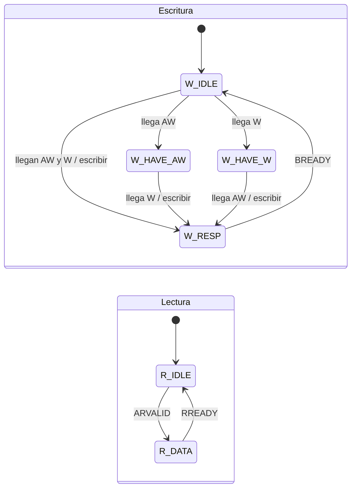
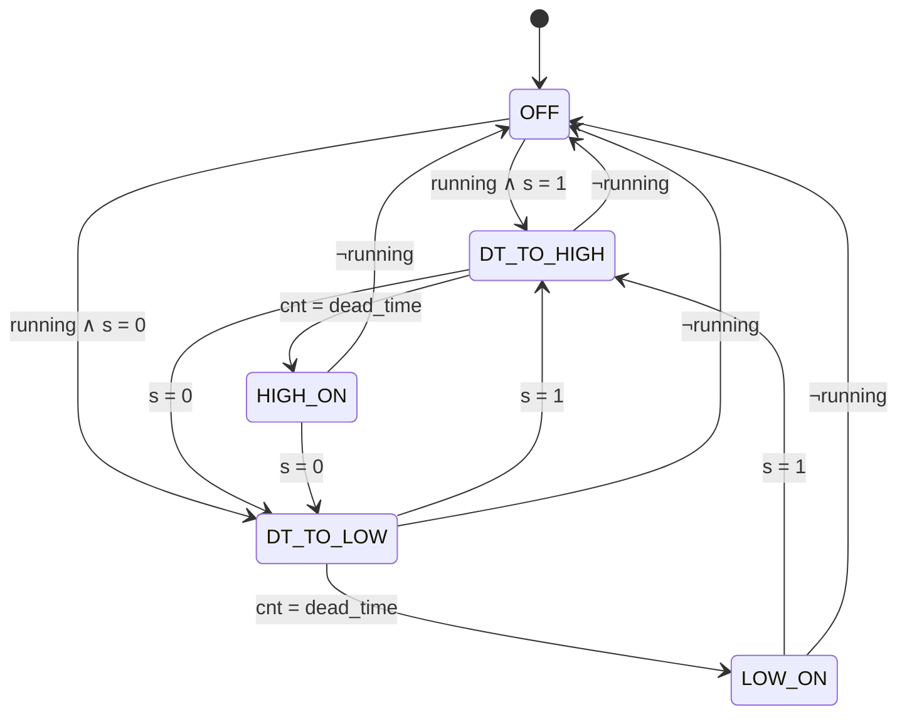

# Planteamiento del diseño
## Proyecto 4 – Control de corriente de un inversor monofásico con un sistema embebido MicroBlaze V y periférico PWM personalizado

<!--
PLANTILLA DEL EQUIPO
- Cada integrante edita solo sus secciones, desde su propia rama creada a partir de develop.
- Responsables: Marvin = MicroBlaze V / Block Design / IP de Xilinx (issue #1)
                Keylor = periférico PWM y registros AXI4-Lite (issue #2)
                Luis Diego = ADC/XADC, firmware y temporización (issue #3)
- Las figuras van en docs/diseno/figuras/ con nombres descriptivos (ej. tercer_nivel_pwm.png).
- Reemplazar cada *(Redactar: ...)* por el contenido correspondiente.
-->

---

## 1. Introducción y comprensión del problema

*(Redactar — todos: el problema en 2–4 párrafos. Inversor monofásico en puente H que regula la corriente de una carga RL, con referencia sinusoidal de 50 Hz y amplitudes de 0,2, 0,5 y 1,0 A pico. Regulador PR discreto ejecutado en un MicroBlaze V. Ciclo del lazo: muestreo ADC → PR → actualización del PWM → buffer. Qué le corresponde a Taller y qué a PEDP.)*

---

## 2. Objetivos del proyecto

**Objetivo general:** *(Redactar)*

**Objetivos específicos:**

1. *(Redactar)*

---

## 3. Arquitectura general y subsistemas

*(Redactar: descripción general de la plataforma.)*

Los principales bloques funcionales considerados son:

- *(Completar)*

**Distribución hardware / software:**

- **Hardware (FPGA):** *(Completar)*
- **Software embebido (C):** *(Completar)*
- **Software externo (PC):** *(Completar)*
- **Etapa de potencia (PEDP):** *(Completar)*

---

## 4. Diagrama de primer nivel

*(Redactar: el sistema digital de la FPGA como un único bloque, con sus interfaces físicas.)*

**Entradas:**

| Señal | Descripción |
|---|---|
| | |

**Salidas:**

| Señal | Descripción |
|---|---|
| | |


---

## 5. Diagrama de segundo nivel

*(Redactar: división del sistema en sus bloques principales: MicroBlaze V y memoria, interconexión AXI, AXI Timer, controlador de interrupciones, PWM Controller, interfaz ADC/XADC, UART Lite y GPIO. Bloques externos: etapa de potencia, sensor y PC.)*


---

## 6. Diagramas de tercer nivel

*(Redactar: introducción breve al tercer nivel.)*

Cada apartado de este nivel incluye: tabla de **señales de entrada**, tabla de **señales de salida**, **señales internas relevantes**, el **diagrama** y la **explicación del bloque**.

### 6.1 Procesador MicroBlaze V, memoria e interconexión

*(Redactar — Marvin, issue #1)*

### 6.2 Periférico PWM personalizado (PWM Controller)

El PWM Controller es el periférico que nos toca diseñar desde cero, ya que Vivado no trae un IP que haga modulación unipolar con tiempo muerto para un puente H. Recibe desde el MicroBlaze V el ciclo de trabajo calculado por el regulador PR y genera las cuatro señales de compuerta del puente H. También genera `pwm_trigger_o`, que le indica al ADC cuándo tomar la muestra de corriente.

Todo el periférico trabaja con el reloj de 100 MHz del sistema (`s_axi_aclk`) y el reset activo en bajo (`s_axi_aresetn`), así que no hay cruces entre dominios de reloj.

#### Señales de entrada

| Señal | Ancho | Dirección | Descripción |
|---|---:|---|---|
| `s_axi_aclk` | 1 bit | Entrada | Reloj de 100 MHz. |
| `s_axi_aresetn` | 1 bit | Entrada | Reset activo en bajo. |
| Canales AW, W y AR | — | Entrada | Dirección y datos de escritura y lectura del bus AXI4-Lite. |
| `s_axi_bready`, `s_axi_rready` | 1 bit | Entrada | El MicroBlaze V acepta la respuesta de escritura o el dato leído. |

#### Señales de salida

| Señal | Ancho | Dirección | Descripción |
|---|---:|---|---|
| Canales B y R, `awready`, `wready`, `arready` | — | Salida | Respuestas del esclavo AXI4-Lite. |
| `gate_ah_o`, `gate_al_o` | 1 bit | Salida | Compuertas alta y baja de la pierna A. |
| `gate_bh_o`, `gate_bl_o` | 1 bit | Salida | Compuertas alta y baja de la pierna B. |
| `pwm_trigger_o` | 1 bit | Salida | Pulso de sincronización hacia el ADC. |

#### Señales internas relevantes

| Señal | Ancho | Descripción |
|---|---:|---|
| `enable`, `freq_sel` | 1 / 2 bits | Configuración escrita por software. |
| `duty_ref` | 16 bits | Referencia de modulación, ya saturada. |
| `dead_time` | 10 bits | Tiempo muerto en ciclos de reloj, ya saturado. |
| `c` | 14 bits | Valor de la portadora triangular. |
| `valley` | 1 bit | Indica que la portadora está en cero (inicio del período). |
| `s_a`, `s_b` | 1 bit | Señal de conmutación de cada pierna, antes del tiempo muerto. |
| `running` | 1 bit | Indica que el generador está activo. |


#### Explicación del bloque

El software escribe la configuración en los registros AXI4-Lite. Esos valores no pasan directo a la modulación: primero se copian a unos registros sombra, y esa copia solo se hace cuando la portadora llega a cero (el valle). Con esto evitamos que un cambio de ciclo de trabajo o de frecuencia a mitad del período deje un pulso cortado en las compuertas.

El generador de portadora es un contador que sube y baja, formando un triángulo. El comparador usa esa portadora y `duty_ref` para decidir cuándo conduce el transistor superior de cada pierna (`s_a` y `s_b`). Después, cada pierna pasa por un generador de tiempo muerto que produce el par de compuertas complementarias. Por último, en cada valle de la portadora se genera el pulso `pwm_trigger_o` para el ADC.

Los subbloques se detallan en las secciones 7.1 a 7.5.

### 6.3 Adquisición de corriente (interfaz ADC/XADC)

*(Redactar — Luis Diego, issue #3)*

### 6.4 Periféricos de Xilinx: AXI Timer, UART Lite y GPIO

*(Redactar — Marvin, issue #1)*

---

## 7. Diagramas de cuarto nivel

*(Redactar: introducción breve al cuarto nivel.)*

Cada subbloque de este nivel sigue el mismo formato:

> **Objetivo** · **Entradas** (tabla) · **Salidas** (tabla) · **Diagrama** · **Relación con los demás módulos** · **Funcionamiento** · **Diseño y justificación técnica** · **Comportamiento durante el reset** · **Casos especiales y condiciones de borde** · **Estrategia de validación**

### 7.1 Registros AXI4-Lite del PWM

#### Objetivo

Permitir que el MicroBlaze V configure el PWM y lea su estado por medio del bus AXI4-Lite.

#### Entradas y salidas

| Señal | Dirección | Descripción |
|---|---|---|
| Canales AW, W, AR, `bready`, `rready` | Entrada | Transacciones de escritura y lectura del MicroBlaze V. |
| `running` | Entrada | Estado del generador, para el bit de solo lectura. |
| Canales B, R, `awready`, `wready`, `arready` | Salida | Respuestas AXI4-Lite. |
| `enable`, `freq_sel`, `duty_ref`, `dead_time` | Salida | Configuración hacia los registros sombra. |



| Estado | `AWREADY` | `WREADY` | `BVALID` |
|---|:---:|:---:|:---:|
| `W_IDLE` | 1 | 1 | 0 |
| `W_HAVE_AW` | 0 | 1 | 0 |
| `W_HAVE_W` | 1 | 0 | 0 |
| `W_RESP` | 0 | 0 | 1 (con `BRESP = OKAY`) |

| Estado | `ARREADY` | `RVALID` |
|---|:---:|:---:|
| `R_IDLE` | 1 | 0 |
| `R_DATA` | 0 | 1 |

#### Funcionamiento

La escritura y la lectura se manejan con dos máquinas de estados separadas. En la escritura, la dirección (AW) y el dato (W) pueden llegar en cualquier orden, así que la máquina guarda el que llegue primero y espera al otro. Cuando tiene los dos, escribe el registro y responde con `BVALID`. En la lectura, al recibir la dirección se carga el dato en `RDATA` y se activa `RVALID` hasta que el procesador lo recibe.

El registro se selecciona con los bits `[3:2]` de la dirección: 0 es CTRL_STATUS, 1 es DUTY_REF y 2 es DEADTIME (el mapa completo está en la sección 8.2).

Al escribir `duty_ref` o `dead_time`, el valor se satura antes de guardarse:

$$
duty\_ref = \min(\max(d,\ -\text{DUTY\_MAX}),\ +\text{DUTY\_MAX}), \qquad dead\_time = \min(\max(t,\ 20),\ 1023)
$$

#### Diseño y justificación técnica

Aceptamos AW y W en cualquier orden porque el estándar AXI no garantiza cuál llega primero. Un esclavo que espere siempre a AW primero podría quedarse trabado.

La saturación se hace al momento de escribir, y lo que se lee de vuelta es el valor ya saturado. Así cumplimos lo que pide el enunciado, y desde software se puede saber si hubo saturación comparando lo escrito con lo leído.

El enunciado pide tiempo muerto configurable, pero los registros 0x00 y 0x04 no tienen un campo para eso. Por eso agregamos el registro DEADTIME en 0x08, sin cambiar los otros dos.

#### Comportamiento durante el reset

Todos los registros vuelven a 0, excepto DEADTIME, que arranca en 100 ciclos (1 µs). Las salidas `VALID` del bus quedan en 0.

#### Casos especiales y condiciones de borde

Si se escribe en una dirección que no existe, se responde normalmente (`OKAY`), no se guarda nada y la lectura devuelve 0. Escribir en el bit `running` no tiene efecto porque es de solo lectura.

#### Estrategia de validación

En el testbench se escriben y leen todos los registros, incluyendo valores fuera de rango y los dos órdenes posibles de AW y W.

---

### 7.2 Generador de portadora y selección de frecuencia

#### Objetivo

Generar la portadora triangular que usan las dos piernas, con la frecuencia que indique `freq_sel`.

#### Entradas y salidas

| Señal | Dirección | Descripción |
|---|---|---|
| `enable` | Entrada | Habilita el generador. |
| `N` | Entrada | Valor máximo de la portadora, según `freq_sel`. |
| `c` | Salida | Valor actual de la portadora (14 bits). |
| `valley` | Salida | Pulso cuando `c = 0`. |
| `running` | Salida | 1 mientras el generador está activo. |


#### Funcionamiento

La portadora es un contador que sube de 0 a N y luego baja de N a 0. Un período completo dura 2N ciclos de reloj, entonces la frecuencia de conmutación es:

$$
f_{sw} = \frac{f_{clk}}{2N} = \frac{100\ \text{MHz}}{2N}
$$

| `freq_sel` | N | $f_{sw}$ |
|---|---:|---:|
| `00` | 10000 | 5 kHz |
| `01` | 5000 | 10 kHz |
| `10` | 2500 | 20 kHz |
| `11` | 1250 | 40 kHz |

Como la modulación es unipolar, cada transistor conmuta a $f_{sw}$, pero la tensión en la carga tiene su componente principal en $2 f_{sw}$.

Cuando `enable` pasa a 1, el contador arranca desde 0 y `running` se pone en 1. Cuando `enable` pasa a 0, el contador se detiene, `running` vuelve a 0 y las compuertas se apagan de inmediato.

#### Diseño y justificación técnica

Usamos una portadora triangular y no diente de sierra porque los pulsos quedan centrados en el período y el valle sirve como instante de muestreo (ver 7.5). Elegimos valores de N que dan frecuencias exactas con el reloj de 100 MHz, y usamos los cuatro códigos de `freq_sel` para que no haya ninguno inválido. Las frecuencias son una propuesta inicial: si el equipo de potencia escoge otra, solo se cambia la tabla de N.

Al deshabilitar, las compuertas se apagan sin esperar a que termine el período, porque en el puente H es más seguro apagar todo de una vez.

#### Comportamiento durante el reset

El contador queda en 0, `running` en 0 y no hay pulsos de `valley`.

#### Casos especiales y condiciones de borde

Si se cambia `freq_sel` con el PWM funcionando, el nuevo valor de N se aplica en el siguiente valle, nunca a mitad de un período.

#### Estrategia de validación

Para cada `freq_sel` se mide en simulación el número de ciclos entre dos valles, que debe ser 2N. También se prueba cambiar la frecuencia con el generador activo.

---

### 7.3 Comparador unipolar y formato de `duty_ref`

#### Objetivo

Convertir `duty_ref` en las señales de conmutación de cada pierna, `s_a` y `s_b`.

#### Entradas y salidas

| Señal | Dirección | Descripción |
|---|---|---|
| `c` | Entrada | Portadora. |
| `duty_ref` | Entrada | Referencia de modulación (registro sombra). |
| `N` | Entrada | Valor máximo de la portadora. |
| `s_a`, `s_b` | Salida | 1 = conduce el transistor superior de esa pierna. |


#### Funcionamiento

`duty_ref` es un número de 16 bits con signo en formato Q1.15, que representa el índice de modulación $m$ entre −1 y 1:

$$
m = \frac{duty\_ref}{2^{15}}
$$

En la modulación unipolar, la pierna A se compara con $+m$ y la pierna B con $-m$. Como nuestra portadora va de 0 a N, cada referencia se pasa a un umbral en esa misma escala:

$$
th_A = \frac{N(1+m)}{2}, \qquad th_B = \frac{N(1-m)}{2}
$$

$$
s_A = (c < th_A), \qquad s_B = (c < th_B)
$$

Con esto la pierna A conduce una fracción $(1+m)/2$ del período y la pierna B una fracción $(1-m)/2$. El voltaje promedio en la carga queda:

$$
\bar{v}_{AB} = m\,V_{dc}
$$

Por ejemplo, a 20 kHz (N = 2500) con $m = 0{,}5$, los umbrales son $th_A = 1875$ y $th_B = 625$: la pierna A conduce el 75 % del período, la B el 25 %, y en la carga queda $0{,}5\,V_{dc}$.


En la figura se ve que en el valle de la portadora las dos piernas conducen por arriba y en el pico ninguna, así que en ambos instantes $v_{AB} = 0$. Entre esos puntos aparecen los pulsos de $+V_{dc}$: dos por período, por eso la componente principal del voltaje en la carga está en $2 f_{sw}$.

#### Diseño y justificación técnica

Escogimos Q1.15 porque la referencia que sale del PR es una senoidal con valores positivos y negativos, y este formato la representa directamente con la máxima resolución que permiten 16 bits. Además, como la relación entre `duty_ref` y el voltaje es lineal, para el diseño del PR el modulador es solo una ganancia de $V_{dc}$.

`duty_ref` se limita a ±0,95 (`DUTY_MAX` = `0x7999`). Si $m$ se acerca a 1, una de las piernas queda con pulsos tan cortos que el tiempo muerto se los come, y el voltaje deja de seguir a la referencia. Para que eso no pase, el pulso más corto tiene que durar más que el tiempo muerto:

$$
|m| \leq 1 - 2\, t_{dt}\, f_{sw}
$$

Con 1 µs de tiempo muerto a 20 kHz, esto da $|m| \leq 0{,}96$, así que 0,95 deja un poco de margen.

#### Comportamiento durante el reset

`duty_ref` = 0, que corresponde a $m = 0$. Como el generador está detenido, las compuertas están apagadas.

#### Casos especiales y condiciones de borde

Con $m = 0$ las dos piernas conmutan iguales, al 50 %, y el voltaje en la carga es 0 todo el tiempo.

#### Estrategia de validación

El testbench calcula el ancho de pulso esperado para varios valores de $m$ (−0,95, −0,5, 0, 0,5 y 0,95) y lo compara con el medido, aceptando una diferencia de un ciclo.

---

### 7.4 Generador de tiempo muerto

#### Objetivo

Producir las dos compuertas complementarias de cada pierna, asegurando que nunca estén encendidas a la vez. Hay una instancia por pierna.

#### Entradas y salidas

| Señal | Dirección | Descripción |
|---|---|---|
| `s` | Entrada | `s_a` o `s_b`, desde el comparador. |
| `dead_time` | Entrada | Tiempo muerto en ciclos de reloj. |
| `running` | Entrada | Si es 0, las compuertas se apagan. |
| `gate_h`, `gate_l` | Salida | Compuertas del transistor superior e inferior. |



| Estado | `gate_h` | `gate_l` |
|---|:---:|:---:|
| `OFF`, `DT_TO_HIGH`, `DT_TO_LOW` | 0 | 0 |
| `HIGH_ON` | 1 | 0 |
| `LOW_ON` | 0 | 1 |

#### Funcionamiento

Cada vez que `s` cambia, la máquina apaga el transistor que estaba conduciendo y pasa a un estado de espera en el que ambas compuertas están en 0. Ahí un contador cuenta `dead_time` ciclos, y cuando termina, enciende el transistor complementario.

```
s       ________|‾‾‾‾‾‾‾‾‾‾‾‾‾‾‾‾‾‾‾‾‾|_____________
gate_h  ____________|‾‾‾‾‾‾‾‾‾‾‾‾‾‾‾‾‾|_______________
gate_l  ‾‾‾‾‾‾‾‾|_______________________|‾‾‾‾‾‾‾‾‾‾‾‾‾
                |<-t_dt->|              |<-t_dt->|
```

Cada ciclo de reloj son 10 ns, así que el tiempo muerto es:

$$
t_{dt} = dead\_time \times 10\ \text{ns}
$$

con `dead_time` entre 20 y 1023 ciclos, es decir, de 0,2 µs a 10,23 µs.

#### Diseño y justificación técnica

Lo hicimos con una máquina de estados porque así es imposible, por cómo está construida, que las dos compuertas de una pierna estén en 1 al mismo tiempo. Si eso pasara, la pierna quedaría en cortocircuito con la fuente. Las salidas salen directamente de flip-flops para que no lleguen glitches a los drivers.

El tiempo muerto es configurable desde software porque el valor final depende de los MOSFET y drivers que elija el equipo de potencia. Así se puede ajustar en las pruebas sin volver a sintetizar. El mínimo de 20 ciclos evita que por un error del software quede en cero.

#### Comportamiento durante el reset

La máquina queda en `OFF`, con las dos compuertas en 0.

#### Casos especiales y condiciones de borde

Si `s` cambia otra vez antes de que termine el tiempo muerto, la máquina pasa directo al otro estado de espera sin encender ningún transistor. Ese pulso se pierde, pero nunca hay cortocircuito. Si `running` cae a 0, se va a `OFF` desde cualquier estado.

#### Estrategia de validación

Durante toda la simulación, el testbench revisa en cada ciclo que nunca estén `gate_h` y `gate_l` en 1 a la vez, y mide el intervalo muerto para varios valores de `dead_time`. En la placa se mide con el osciloscopio, con la etapa de potencia apagada.

---

### 7.5 Generador de `pwm_trigger_o`

#### Objetivo

Avisarle al ADC cuándo tomar la muestra de corriente.

#### Entradas y salidas

| Señal | Dirección | Descripción |
|---|---|---|
| `valley` | Entrada | Pulso de inicio de período, desde la portadora. |
| `pwm_trigger_o` | Salida | Pulso de 4 ciclos (40 ns) hacia el ADC. |


#### Funcionamiento

Cuando llega `valley`, un contador pequeño mantiene `pwm_trigger_o` en 1 durante 4 ciclos de reloj. Se genera un pulso por cada período de conmutación.

#### Diseño y justificación técnica

Elegimos muestrear en el valle porque ahí las dos piernas están en el mismo estado y la corriente pasa justo por la mitad de su rizado. Así la muestra corresponde al valor promedio de la corriente en ese período. Además, en el valle no hay conmutaciones cerca, entonces la medición tiene menos ruido.

Los registros sombra también se actualizan en el valle. La secuencia queda así: se toma la muestra, la rutina de interrupción calcula el PR y escribe el nuevo `duty_ref`, y ese valor se aplica en el siguiente valle. El retardo entre medir y actuar nunca pasa de un período de conmutación.

El pulso dura 4 ciclos en vez de 1 para que el ADC lo detecte sin problemas. El ancho final se ajustará con la interfaz del ADC.

#### Comportamiento durante el reset

`pwm_trigger_o` = 0.

#### Casos especiales y condiciones de borde

Si el PWM está deshabilitado no hay valles, entonces tampoco hay pulsos de trigger.

#### Estrategia de validación

En simulación se verifica que haya un pulso por período, de 4 ciclos y alineado con `c = 0`. En la placa se observa junto con una compuerta en el osciloscopio.

### 7.6 en adelante: subbloques de la interfaz ADC/XADC

*(Redactar — Luis Diego, issue #3)*

---

## 8. Mapa de memoria, registros e interfaces

### 8.1 Mapa de memoria

*(Completar — Marvin, con los valores del Address Editor de Vivado.)*

| Periférico | Dirección base | Rango | Interfaz |
|---|---|---|---|
| | | | |

### 8.2 Registros del periférico PWM

Los offsets son relativos a la dirección base que asigne Vivado. Los registros 0x00 y 0x04 son los que define el enunciado. El 0x08 lo agregamos para el tiempo muerto.

**0x00 — CTRL_STATUS** (reset `0x0000_0000`)

| Bits | Campo | Acceso | Descripción |
|---|---|---|---|
| 0 | `enable` | R/W | 1 habilita el PWM. 0 apaga las cuatro compuertas. |
| 2:1 | `freq_sel` | R/W | `00` = 5 kHz, `01` = 10 kHz, `10` = 20 kHz, `11` = 40 kHz. |
| 3 | `running` | Solo lectura | 1 si el generador está activo. |
| 31:4 | — | Reservado | Se leen como 0. |

**0x04 — DUTY_REF** (reset `0x0000_0000`)

| Bits | Campo | Acceso | Descripción |
|---|---|---|---|
| 15:0 | `duty_ref` | R/W | Índice de modulación en Q1.15 con signo. Se satura a ±0,95 (`0x7999` / `0x8667`). |
| 31:16 | — | Reservado | Se leen como 0. |

**0x08 — DEADTIME** (reset `0x0000_0064`)

| Bits | Campo | Acceso | Descripción |
|---|---|---|---|
| 9:0 | `dead_time` | R/W | Tiempo muerto en ciclos de 10 ns. Se satura entre 20 y 1023. |
| 31:10 | — | Reservado | Se leen como 0. |

Los cambios en `freq_sel`, `duty_ref` y `dead_time` se aplican en el siguiente valle de la portadora.

### 8.3 Registros de la interfaz ADC/XADC

*(Completar — Luis Diego: mismo formato que 8.2.)*

### 8.4 Protocolo AXI4-Lite

*(Redactar: canales, handshake `VALID`/`READY`, respuestas y su uso entre el MicroBlaze V y los periféricos.)*

---

## 9. Software embebido y aplicación de PC

### 9.1 Flujo de la aplicación de control

*(Redactar — Luis Diego)*

### 9.2 Temporización del lazo de control

*(Redactar — Luis Diego)*

### 9.3 Implementación del regulador PR

*(Redactar — Luis Diego)*

### 9.4 Buffer de muestras y exportación por UART

*(Redactar — Luis Diego)*

---

## 10. Estrategia de integración con la etapa de potencia

*(Redactar — todos: conexión del sistema digital con la etapa de PEDP y acuerdos pendientes.)*

| Tema | Propuesta actual | Responsable / con quién se acuerda | Estado |
|---|---|---|---|
| Frecuencia de conmutación | 5 / 10 / 20 / 40 kHz | Keylor – PEDP | Pendiente |
| Tiempo muerto | 1 µs inicial, ajustable de 0,2 a 10,23 µs | Keylor – PEDP | Pendiente |
| Nivel lógico y polaridad de las compuertas | 3,3 V, activo en alto | Keylor – PEDP | Pendiente |
| Formato de `duty_ref` | Q1.15 con signo, saturado a ±0,95 | Keylor – Luis Diego | Pendiente |
| Instante del trigger del ADC | Valle de la portadora, pulso de 4 ciclos | Keylor – Luis Diego | Pendiente |
| | | | |

---

## 11. Decisiones de diseño y justificación

- **Arquitectura del sistema:** *(Redactar — Marvin)*
- **Periférico PWM:** todo el periférico trabaja con el mismo reloj de 100 MHz del procesador, lo que simplifica el diseño y el timing. Se usó una portadora triangular para tener pulsos centrados y un buen punto de muestreo en el valle. `duty_ref` va en Q1.15 porque la referencia del PR es senoidal (positiva y negativa) y así el voltaje promedio queda lineal con el valor escrito. Los cambios se aplican en el valle mediante registros sombra para no cortar pulsos, y al deshabilitar se apagan las compuertas de inmediato por seguridad. Se agregó el registro DEADTIME porque el enunciado pide tiempo muerto configurable y los dos registros sugeridos no tienen un campo para eso.
- **Adquisición:** *(Redactar — Luis Diego)*
- **Software:** *(Redactar — Luis Diego)*

---

## 12. Estrategia de validación y plan de implementación

### 12.1 Validación por bloque

*(Completar — cada uno agrega las pruebas de su bloque.)*

**Periférico PWM.** El testbench (`tb/pwm_controller/`) escribe y lee los registros por AXI4-Lite, mide los pulsos generados y los compara con los valores esperados. Cada prueba imprime PASS o FAIL, y al final se muestra un resumen, para no depender de revisar las formas de onda a mano.

| # | Prueba | Resultado esperado |
|---|---|---|
| T1 | Reset | Registros en su valor inicial y compuertas apagadas. |
| T2 | Escritura y lectura de registros | Lo leído coincide con lo escrito. `running` no se puede escribir. |
| T3 | Saturación | `duty_ref` fuera de rango se lee como ±0,95. `dead_time` se limita entre 20 y 1023. |
| T4 | Frecuencias | El período medido es 2N ciclos para cada `freq_sel`. |
| T5 | Cambio de frecuencia en funcionamiento | El cambio ocurre en el valle, sin períodos raros. |
| T6 | Modulación unipolar | Los anchos de pulso de A y B coinciden con los esperados para varios valores de $m$. |
| T7 | Tiempo muerto | Las compuertas de una pierna nunca están en 1 al mismo tiempo, y el intervalo muerto dura lo configurado. |
| T8 | Trigger | Un pulso por período, alineado con el valle. Ninguno si el PWM está deshabilitado. |
| T9 | Enable | Al deshabilitar, las compuertas se apagan de inmediato y `running` pasa a 0. |

La misma simulación se corre después sobre el diseño ya implementado (simulación post-implementación temporizada).

**Resto del sistema:**

| Bloque | Prueba | Resultado esperado |
|---|---|---|
| | | |

### 12.2 Plan de implementación

| Hito | Contenido | Fecha |
|---|---|---|
| M1 — Diseño del sistema | Documento de diseño (issues #1–#3) | 05/11 (G1) · 06/11 (G2) |
| M2 — Implementación de hardware | Issues #4–#9 | *(Completar)* |
| M3 — Integración y validación | Issues #10–#15 | *(Completar)* |
| M4 — Entrega final | Issues #16–#18, informe y repositorio | 19/11 (G1) · 20/11 (G2) |

### 12.3 Riesgos y mitigaciones

| Riesgo | Mitigación |
|---|---|
| Cortocircuito en una pierna del puente H por un error en el PWM | Máquina de estados de tiempo muerto, revisión en simulación y medición con osciloscopio con la potencia apagada antes de energizar. |
| El equipo de potencia define tarde la frecuencia o el tiempo muerto | Ambos se pueden cambiar sin rediseñar: la frecuencia es un parámetro y el tiempo muerto un registro. |
| | |

---

## 13. Distribución del trabajo

| Persona | Área principal | Issues |
|---|---|---|
| Marvin | *(Completar)* | |
| Keylor | Periférico PWM: diseño en SystemVerilog, interfaz AXI4-Lite, testbench y documentación | #2, #5, #8, #11, #14, #17 |
| Luis Diego | *(Completar)* | |
| Todos | Integración y revisión cruzada de pull requests | — |

---

## 14. Referencias

1. AMD, *MicroBlaze V Processor*, [En línea]. Disponible en: https://www.amd.com/en/products/software/adaptive-socs-and-fpgas/microblaze-v.html
2. AMD, *MicroBlaze V Embedded Design Tutorial (UG1711)*, [En línea]. Disponible en: https://docs.amd.com/r/en-US/ug1711-microblaze-v-embedded-design
3. AMD, *MicroBlaze Processor Reference Guide (UG984)*, [En línea]. Disponible en: https://docs.amd.com/r/en-US/ug984-vivado-microblaze-ref
4. AMD, *Vivado Design Suite User Guide: Creating and Packaging Custom IP (UG1118)*, [En línea]. Disponible en: https://docs.amd.com/r/en-US/ug1118-vivado-creating-packaging-custom-ip
5. AMD, *AXI Reference Guide (UG1037)*, [En línea]. Disponible en: https://docs.amd.com/v/u/en-US/ug1037-vivado-axi-reference-guide
6. AMD, *Vitis Unified Software Platform Documentation (UG1416)*, [En línea]. Disponible en: https://docs.amd.com/v/u/en-US/ug1416-vitis-documentation
