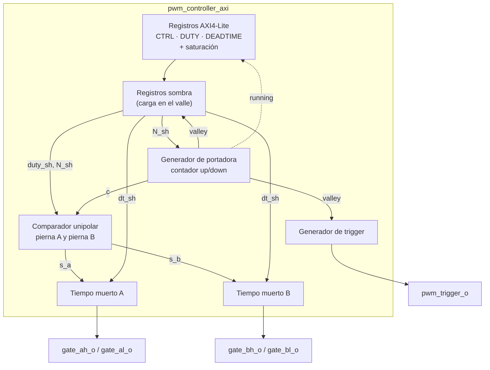
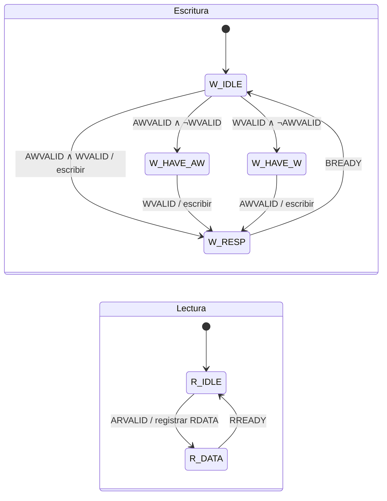
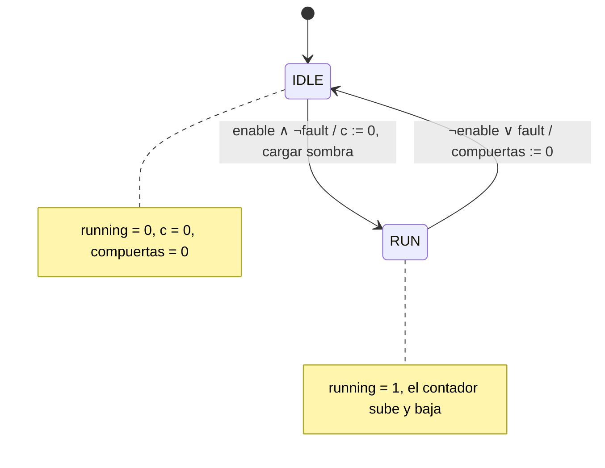
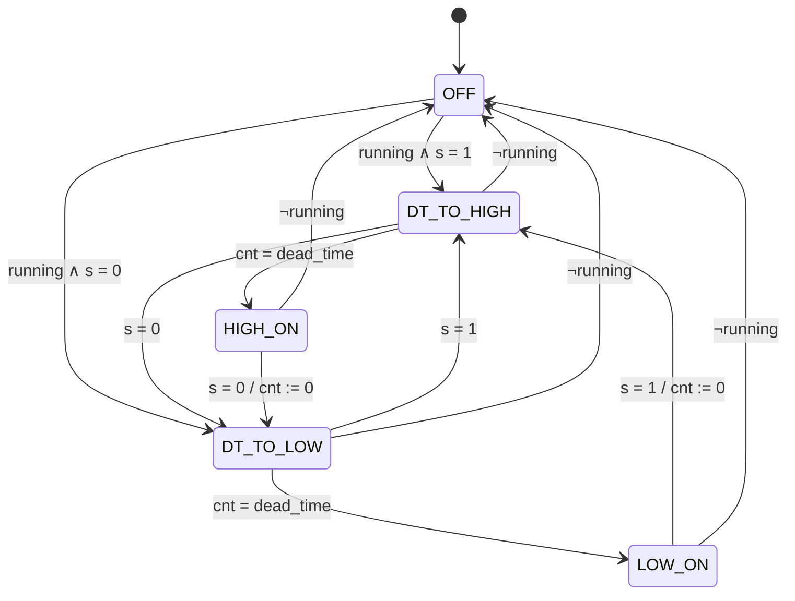

# Planteamiento del diseño
## Proyecto 4 – Control de corriente de un inversor monofásico con un sistema embebido MicroBlaze V y periférico PWM personalizado

<!--
PLANTILLA DEL EQUIPO
- Cada integrante edita solo sus secciones, desde su propia rama creada a partir de develop.
- Responsables: Marvin = MicroBlaze V / Block Design / IP de Xilinx (issue #1)
                Keylor = periférico PWM y registros AXI4-Lite (issue #2)
                Luis Diego = ADC/XADC, firmware y temporización (issue #3)
- Las figuras van en docs/diseno/figuras/ con nombres descriptivos (ej. tercer_nivel_pwm.png).
- Reemplazar cada *(Redactar: ...)* por el contenido correspondiente.
-->

---

## 1. Introducción y comprensión del problema

*(Redactar — todos: el problema en 2–4 párrafos. Inversor monofásico en puente H que regula la corriente de una carga RL, con referencia sinusoidal de 50 Hz y amplitudes de 0,2, 0,5 y 1,0 A pico. Regulador PR discreto ejecutado en un MicroBlaze V. Ciclo del lazo: muestreo ADC → PR → actualización del PWM → buffer. Qué le corresponde a Taller y qué a PEDP.)*

---

## 2. Objetivos del proyecto

**Objetivo general:** *(Redactar)*

**Objetivos específicos:**

1. *(Redactar)*

---

## 3. Arquitectura general y subsistemas

*(Redactar: descripción general de la plataforma.)*

Los principales bloques funcionales considerados son:

- *(Completar)*

**Distribución hardware / software:**

- **Hardware (FPGA):** *(Completar)*
- **Software embebido (C):** *(Completar)*
- **Software externo (PC):** *(Completar)*
- **Etapa de potencia (PEDP):** *(Completar)*

---

## 4. Diagrama de primer nivel

*(Redactar: el sistema digital de la FPGA como un único bloque, con sus interfaces físicas.)*

**Entradas:**

| Señal | Descripción |
|---|---|
| | |

**Salidas:**

| Señal | Descripción |
|---|---|
| | |


---

## 5. Diagrama de segundo nivel

*(Redactar: división del sistema en sus bloques principales: MicroBlaze V y memoria, interconexión AXI, AXI Timer, controlador de interrupciones, PWM Controller, interfaz ADC/XADC, UART Lite y GPIO. Bloques externos: etapa de potencia, sensor y PC.)*


---

## 6. Diagramas de tercer nivel

*(Redactar: introducción breve al tercer nivel.)*

Cada apartado de este nivel incluye: tabla de **señales de entrada**, tabla de **señales de salida**, **señales internas relevantes**, el **diagrama** y la **explicación del bloque**.

### 6.1 Procesador MicroBlaze V, memoria e interconexión

*(Redactar — Marvin, issue #1)*

### 6.2 Periférico PWM personalizado (PWM Controller)

El PWM Controller es el periférico personalizado obligatorio del proyecto. Convierte la acción de control calculada por el MicroBlaze V en las cuatro señales de compuerta del puente H mediante **modulación PWM unipolar con tiempo muerto configurable**. Además genera la señal `pwm_trigger_o`, que indica a la interfaz ADC/XADC el instante en que debe muestrear la corriente de carga. No existe un IP de Xilinx que implemente esta función de forma directa, por lo que se diseña en SystemVerilog con interfaz esclava AXI4-Lite completa.

Todo el periférico opera en **un solo dominio de reloj** (`s_axi_aclk`, 100 MHz), con reset síncrono activo en bajo (`s_axi_aresetn`).

#### Señales de entrada

| Señal | Ancho | Dirección | Descripción |
|---|---:|---|---|
| `s_axi_aclk` | 1 bit | Entrada | Reloj de 100 MHz, el mismo del MicroBlaze V. |
| `s_axi_aresetn` | 1 bit | Entrada | Reset síncrono, activo en bajo. |
| `s_axi_awaddr`, `s_axi_awvalid` | 4 / 1 bit | Entrada | Canal de dirección de escritura AXI4-Lite. |
| `s_axi_wdata`, `s_axi_wstrb`, `s_axi_wvalid` | 32 / 4 / 1 bit | Entrada | Canal de datos de escritura. |
| `s_axi_bready` | 1 bit | Entrada | El maestro acepta la respuesta de escritura. |
| `s_axi_araddr`, `s_axi_arvalid` | 4 / 1 bit | Entrada | Canal de dirección de lectura. |
| `s_axi_rready` | 1 bit | Entrada | El maestro acepta el dato leído. |
| `fault_i` | 1 bit | Entrada | (Opcional) Falla externa, activa en alto. Apaga las compuertas. Se conecta a 0 si no se usa. |

#### Señales de salida

| Señal | Ancho | Dirección | Descripción |
|---|---:|---|---|
| `s_axi_awready`, `s_axi_wready` | 1 bit | Salida | El esclavo acepta dirección y dato de escritura. |
| `s_axi_bresp`, `s_axi_bvalid` | 2 / 1 bit | Salida | Respuesta de escritura (siempre `OKAY`). |
| `s_axi_arready` | 1 bit | Salida | El esclavo acepta la dirección de lectura. |
| `s_axi_rdata`, `s_axi_rresp`, `s_axi_rvalid` | 32 / 2 / 1 bit | Salida | Dato leído y respuesta. |
| `gate_ah_o`, `gate_al_o` | 1 bit | Salida | Compuertas alta y baja de la pierna A. |
| `gate_bh_o`, `gate_bl_o` | 1 bit | Salida | Compuertas alta y baja de la pierna B. |
| `pwm_trigger_o` | 1 bit | Salida | Pulso de sincronización hacia la interfaz ADC/XADC. |

#### Señales internas relevantes (entre subbloques)

| Señal | Ancho | Origen → Destino | Descripción |
|---|---:|---|---|
| `enable_r`, `freq_sel_r` | 1 / 2 bits | Registros AXI → registros sombra | Valores escritos por software en CTRL_STATUS. |
| `duty_ref_r` | 16 bits | Registros AXI → registros sombra | Índice de modulación ya saturado (Q1.15). |
| `dead_time_r` | 10 bits | Registros AXI → registros sombra | Tiempo muerto ya saturado, en ciclos. |
| `running` | 1 bit | Generador de portadora → registros AXI | Estado real del generador (bit RO). |
| `c` | 14 bits | Generador de portadora → comparador | Valor actual de la portadora triangular. |
| `valley` | 1 bit | Generador de portadora → sombra / trigger | Pulso de un ciclo cuando `c = 0`. |
| `N_sh` | 14 bits | Registros sombra → portadora / comparador | Pico de la portadora para la frecuencia activa. |
| `s_a`, `s_b` | 1 bit | Comparador → tiempo muerto A / B | Señal ideal de conmutación de cada pierna, sin tiempo muerto. |

<!-- Reemplazar el Mermaid por figuras/tercer_nivel_pwm.png cuando esté dibujado -->


#### Explicación del bloque

El periférico se organiza en cinco subbloques, detallados en el cuarto nivel (sección 7):

1. **Registros AXI4-Lite (7.1):** reciben las escrituras del MicroBlaze V, saturan `duty_ref` y `dead_time` y devuelven los valores al leer, incluido el bit `running`.
2. **Generador de portadora (7.2):** contador ascendente/descendente que produce una portadora triangular de período `2N` ciclos. `N` depende de `freq_sel`. También genera el pulso `valley`, que sincroniza la carga de registros sombra y el trigger.
3. **Comparador unipolar (7.3):** convierte `duty_ref` en un umbral por pierna y lo compara con la portadora para obtener `s_a` y `s_b`.
4. **Generador de tiempo muerto (7.4):** una instancia por pierna. A partir de `s_a` o `s_b` produce el par de compuertas complementarias con un intervalo de `dead_time` ciclos en el que ambas permanecen apagadas.
5. **Generador de trigger (7.5):** produce `pwm_trigger_o` en el valle de la portadora.

Los valores escritos por software no actúan directamente sobre la modulación. Pasan por **registros sombra** que se cargan únicamente en el valle de la portadora. Así, un cambio de ciclo de trabajo, frecuencia o tiempo muerto nunca deja un período truncado ni produce glitches en las compuertas.

**Parámetros del IP (SystemVerilog `parameter`):**

| Parámetro | Valor por defecto | Significado |
|---|---|---|
| `N_TABLE` | {10000, 5000, 2500, 1250} | Pico del contador por código de `freq_sel`. |
| `DUTY_MAX` | `16'sh7999` (≈ 0,95) | Límite de saturación simétrico de `duty_ref`. |
| `DT_MIN` / `DT_MAX` | 20 / 1023 ciclos | Límites de saturación del tiempo muerto. |
| `DT_RESET` | 100 ciclos (1 µs) | Tiempo muerto después del reset. |
| `TRIG_WIDTH` | 4 ciclos | Ancho del pulso `pwm_trigger_o`. |
| `GATE_ACTIVE_HIGH` | 1 | Polaridad de las compuertas según el driver. |

### 6.3 Adquisición de corriente (interfaz ADC/XADC)

*(Redactar — Luis Diego, issue #3)*

### 6.4 Periféricos de Xilinx: AXI Timer, UART Lite y GPIO

*(Redactar — Marvin, issue #1)*

---

## 7. Diagramas de cuarto nivel

*(Redactar: introducción breve al cuarto nivel.)*

Cada subbloque de este nivel sigue el mismo formato:

> **Objetivo** · **Entradas** (tabla) · **Salidas** (tabla) · **Diagrama** · **Relación con los demás módulos** · **Funcionamiento** · **Diseño y justificación técnica** · **Comportamiento durante el reset** · **Casos especiales y condiciones de borde** · **Estrategia de validación**

### 7.1 Registros AXI4-Lite del PWM

#### Objetivo

Implementar la interfaz esclava AXI4-Lite por la que el MicroBlaze V configura y monitorea el periférico. Contiene el banco de registros CTRL_STATUS, DUTY_REF y DEADTIME, aplica la saturación de los valores escritos y expone el estado `running`.

#### Entradas

| Señal | Ancho | Dirección | Descripción |
|---|---:|---|---|
| `s_axi_aclk`, `s_axi_aresetn` | 1 bit | Entrada | Reloj y reset. |
| Canales AW, W, AR y señales `BREADY`, `RREADY` | — | Entrada | Interfaz AXI4-Lite desde la interconexión. |
| `running` | 1 bit | Entrada | Estado real del generador, desde el generador de portadora. |

#### Salidas

| Señal | Ancho | Dirección | Descripción |
|---|---:|---|---|
| `AWREADY`, `WREADY`, `BRESP`, `BVALID`, `ARREADY`, `RDATA`, `RRESP`, `RVALID` | — | Salida | Respuestas AXI4-Lite. |
| `enable_r` | 1 bit | Salida | Bit `enable` de CTRL_STATUS. |
| `freq_sel_r` | 2 bits | Salida | Campo `freq_sel` de CTRL_STATUS. |
| `duty_ref_r` | 16 bits | Salida | `duty_ref` saturado. |
| `dead_time_r` | 10 bits | Salida | `dead_time` saturado. |

<!-- Reemplazar por figuras/cuarto_nivel_pwm_axi.png -->


#### Relación con los demás módulos

Recibe las transacciones del MicroBlaze V a través de la interconexión AXI y entrega los valores configurados a los registros sombra. Recibe `running` del generador de portadora para que el software pueda leerlo.

**MicroBlaze V → interconexión AXI → registros AXI4-Lite → registros sombra → núcleo PWM**

#### Funcionamiento

La interfaz implementa los cinco canales de AXI4-Lite con dos máquinas de estados independientes, una de escritura y otra de lectura:

- **Escritura:** los canales AW y W pueden llegar en cualquier orden o en el mismo ciclo. La FSM guarda el que llegue primero y espera al otro. Cuando tiene ambos, escribe el registro direccionado respetando `WSTRB` y emite `BVALID` con `BRESP = OKAY`. Vuelve a `W_IDLE` cuando el maestro acepta la respuesta (`BREADY`).
- **Lectura:** al aceptar `ARVALID`, se registra el dato del registro direccionado en `RDATA` y se emite `RVALID` con `RRESP = OKAY`. El dato se mantiene estable hasta `RREADY`.

La dirección se decodifica con los bits `[3:2]`:

$$
\text{reg\_idx} = \text{addr}[3:2] \in \{0: \text{CTRL\_STATUS},\ 1: \text{DUTY\_REF},\ 2: \text{DEADTIME},\ 3: \text{no implementado}\}
$$

La saturación se aplica al escribir, sobre el valor resultante después de aplicar `WSTRB`:

$$
\text{duty\_ref\_r} =
\begin{cases}
+\text{DUTY\_MAX}, & \text{si } d > +\text{DUTY\_MAX} \\
-\text{DUTY\_MAX}, & \text{si } d < -\text{DUTY\_MAX} \\
d, & \text{en otro caso}
\end{cases}
\qquad
\text{dead\_time\_r} = \min(\max(t, \text{DT\_MIN}), \text{DT\_MAX})
$$

#### Diseño y justificación técnica

- **FSM de escritura que acepta AW y W en cualquier orden:** la especificación AXI (UG1037) no garantiza el orden de estos canales. Un esclavo que exija AW antes que W puede bloquear la interconexión.
- **Saturación en la escritura, no en la lectura ni en el núcleo:** el valor almacenado siempre es válido, y el software detecta la saturación comparando lo escrito con lo leído. Esto cumple el requisito del enunciado de saturar toda escritura fuera de rango.
- **Respuesta `OKAY` en direcciones no mapeadas** (lectura 0, escritura ignorada): un error de software no genera una excepción de bus que detenga el lazo de control.
- **Registro DEADTIME adicional (0x08):** el enunciado exige tiempo muerto configurable, pero no define un campo para ello en 0x00 ni en 0x04. Se agrega un tercer registro sin modificar los dos especificados.

#### Comportamiento durante el reset

Mientras `s_axi_aresetn = 0`:

$$
\text{CTRL\_STATUS} = 0, \quad \text{DUTY\_REF} = 0, \quad \text{DEADTIME} = \text{DT\_RESET} = 100
$$

y todas las señales `*VALID` y `*READY` del esclavo permanecen en 0, como exige la especificación AXI. Ambas FSM regresan a su estado `IDLE`.

#### Casos especiales y condiciones de borde

- Escritura de `0x8000` (−1,0) en DUTY_REF: se satura a −`DUTY_MAX`.
- Escritura de 1 en el bit `running` (3): se ignora, porque el bit es de solo lectura.
- `WSTRB` parcial: solo se modifican los bytes habilitados, y luego se aplica la saturación.
- `BREADY` o `RREADY` en 0 durante varios ciclos: la FSM espera sin aceptar nuevas transacciones y sin cambiar `RDATA`, `BRESP` ni `RRESP`.
- Lectura y escritura simultáneas: las FSM son independientes, así que ambas se atienden.

#### Estrategia de validación

Testbench con tareas BFM `axi_write` y `axi_read`. Se verifican los valores de reset, la lectura/escritura de cada campo, los bits reservados (se leen en 0), el bit RO, `WSTRB` parcial, el orden AW/W (antes, después y simultáneo), el backpressure en `BREADY`/`RREADY`, las direcciones no mapeadas y la saturación con valores de borde. Pruebas T1–T8 de la sección 12.1.

---

### 7.2 Generador de portadora y selección de frecuencia

#### Objetivo

Generar la portadora triangular común a ambas piernas, con un período determinado por `freq_sel`. También indica el valle de la portadora y el estado `running`.

#### Entradas

| Señal | Ancho | Dirección | Descripción |
|---|---:|---|---|
| `clk`, `rst_n` | 1 bit | Entrada | Reloj de 100 MHz y reset. |
| `enable_r` | 1 bit | Entrada | Habilitación escrita por software. |
| `fault_i` | 1 bit | Entrada | Falla externa (opcional). |
| `N_sh` | 14 bits | Entrada | Pico de la portadora para la frecuencia activa (registro sombra). |

#### Salidas

| Señal | Ancho | Dirección | Descripción |
|---|---:|---|---|
| `c` | 14 bits | Salida | Valor actual de la portadora, de 0 a N. |
| `valley` | 1 bit | Salida | Pulso de un ciclo cuando `c = 0` (inicio de período). |
| `running` | 1 bit | Salida | 1 mientras el generador está activo. |

<!-- Reemplazar por figuras/cuarto_nivel_portadora.png -->


#### Relación con los demás módulos

**Registros sombra (`N_sh`) → generador de portadora → `c` → comparador unipolar**

**Generador de portadora → `valley` → registros sombra / generador de trigger**

#### Funcionamiento

El generador es un contador ascendente/descendente. En `RUN`, sube de 0 a N y baja de N a 0:

$$
c_{next} =
\begin{cases}
c + 1, & \text{si } dir = \text{up} \wedge c < N - 1 \\
N,\ dir := \text{down}, & \text{si } dir = \text{up} \wedge c = N - 1 \\
c - 1, & \text{si } dir = \text{down} \wedge c > 1 \\
0,\ dir := \text{up}, & \text{si } dir = \text{down} \wedge c = 1
\end{cases}
\qquad
valley = (c = 0) \wedge running
$$

Un período completo dura $2N$ ciclos de reloj, por lo que:

$$
f_{sw} = \frac{f_{clk}}{2N} = \frac{100\ \text{MHz}}{2N}
$$

| `freq_sel` | N | Período (ciclos) | $f_{sw}$ por transistor | Componente dominante en $v_{AB}$ | Resolución ($\log_2 N$) |
|---|---:|---:|---:|---:|---:|
| `00` | 10000 | 20000 | 5 kHz | 10 kHz | ≈ 13,3 bits |
| `01` | 5000 | 10000 | 10 kHz | 20 kHz | ≈ 12,3 bits |
| `10` | 2500 | 5000 | 20 kHz | 40 kHz | ≈ 11,3 bits |
| `11` | 1250 | 2500 | 40 kHz | 80 kHz | ≈ 10,3 bits |

En PWM unipolar, la componente predominante de la tensión diferencial de salida está en $2 f_{sw}$, mientras que cada transistor conmuta a $f_{sw}$.

#### Diseño y justificación técnica

- **Portadora triangular (PWM centrado):** los flancos de ambas piernas quedan simétricos dentro del período, y el valle es un instante natural de muestreo (ver 7.5). Además, cargar los registros sombra en el valle evita pulsos truncados.
- **Cuatro códigos válidos:** el enunciado exige al menos tres. Con los cuatro códigos válidos no existe un `freq_sel` inválido que manejar.
- **N entero y un único reloj:** las frecuencias son exactas y no se necesita un reloj adicional. El contador cabe en 14 bits.
- **Valores dependientes de PEDP:** `N_TABLE` es un parámetro. Si el equipo de potencia elige otra frecuencia, solo cambia la tabla.

#### Comportamiento durante el reset

$$
rst\_n = 0 \Rightarrow c = 0,\ dir = \text{up},\ running = 0,\ valley = 0
$$

#### Casos especiales y condiciones de borde

- **Cambio de `freq_sel` con el generador activo:** el nuevo N se aplica en el siguiente valle, y nunca aparece un período de longitud intermedia.
- **`enable` = 0 o `fault_i` = 1:** paso inmediato a `IDLE`. El apagado no espera al valle, por seguridad del puente H.
- **Reactivación:** el generador arranca siempre desde `c = 0`, con los registros sombra recién cargados.

#### Estrategia de validación

Medición en simulación del número de ciclos entre valles consecutivos para cada `freq_sel` (debe ser exactamente 2N), cambio de frecuencia en caliente sin períodos intermedios y comportamiento de `running` con `enable` y `fault_i`. Pruebas T9, T10 y T16.

---

### 7.3 Comparador unipolar y formato de `duty_ref`

#### Objetivo

Convertir la referencia de modulación `duty_ref` en las señales ideales de conmutación de cada pierna, `s_a` y `s_b`, según la modulación PWM unipolar.

#### Entradas

| Señal | Ancho | Dirección | Descripción |
|---|---:|---|---|
| `c` | 14 bits | Entrada | Portadora. |
| `duty_sh` | 16 bits | Entrada | `duty_ref` (Q1.15 con signo) del registro sombra. |
| `N_sh` | 14 bits | Entrada | Pico de la portadora activa. |

#### Salidas

| Señal | Ancho | Dirección | Descripción |
|---|---:|---|---|
| `s_a` | 1 bit | Salida | 1 = conduce el transistor superior de la pierna A (antes del tiempo muerto). |
| `s_b` | 1 bit | Salida | 1 = conduce el transistor superior de la pierna B (antes del tiempo muerto). |


#### Relación con los demás módulos

**Generador de portadora (`c`) + registros sombra (`duty_sh`, `N_sh`) → comparador → `s_a`, `s_b` → generadores de tiempo muerto**

#### Funcionamiento

`duty_ref` representa el índice de modulación instantáneo $m$ en **Q1.15 con signo**:

$$
m = \frac{duty\_ref}{2^{15}}, \qquad m \in [-1,\ 1)
$$

En PWM unipolar, la pierna A se compara con $+m$ y la pierna B con $-m$ contra la misma portadora. Con la portadora en $[0, N]$, los umbrales son:

$$
th_A = \frac{N\,(2^{15} + duty\_ref)}{2^{16}}, \qquad th_B = \frac{N\,(2^{15} - duty\_ref)}{2^{16}}
$$

$$
s_A = (c < th_A), \qquad s_B = (c < th_B)
$$

Los ciclos de trabajo resultantes y la tensión promedio aplicada a la carga son:

$$
d_A = \frac{1+m}{2}, \qquad d_B = \frac{1-m}{2}, \qquad \bar{v}_{AB} = (d_A - d_B)\,V_{dc} = m\,V_{dc}
$$

| `duty_ref` | $m$ | $d_A$ | $d_B$ | $\bar{v}_{AB}$ |
|---|---:|---:|---:|---:|
| `0x7999` | +0,95 | 97,5 % | 2,5 % | +0,95 $V_{dc}$ |
| `0x4000` | +0,5 | 75 % | 25 % | +0,5 $V_{dc}$ |
| `0x0000` | 0 | 50 % | 50 % | 0 |
| `0xC000` | −0,5 | 25 % | 75 % | −0,5 $V_{dc}$ |
| `0x8667` | −0,95 | 2,5 % | 97,5 % | −0,95 $V_{dc}$ |

Ejemplo a 20 kHz ($N = 2500$) con $m = 0{,}5$: $th_A = 1875$ y $th_B = 625$.

#### Diseño y justificación técnica

- **Q1.15 con signo:** la referencia de la modulación unipolar es bipolar (sinusoidal), así que el software escribe directamente la salida normalizada del PR, con la mayor resolución posible en 16 bits.
- **Relación lineal $\bar{v}_{AB} = m V_{dc}$:** simplifica el diseño del PR en PEDP, porque el modulador se modela como una ganancia $V_{dc}$.
- **Umbrales recalculados solo en el valle:** la multiplicación (1–2 DSP48) queda fuera del camino crítico del comparador y puede segmentarse.
- **Límite $|m| \leq$ `DUTY_MAX`:** el pulso más angosto dura $\frac{1-|m|}{2} T_{sw}$. Si es menor que el tiempo muerto, el generador de tiempo muerto lo elimina y se pierde linealidad. La condición de operación lineal es:

$$
|m| \leq 1 - 2\, t_{dt}\, f_{sw}
$$

Con $t_{dt} = 1\ \mu s$ y $f_{sw} = 20$ kHz: $|m| \leq 0{,}96$, por lo que `DUTY_MAX` ≈ 0,95 deja margen.

#### Comportamiento durante el reset

$duty\_sh = 0$ ($m = 0$). Como el generador no está en `RUN`, las compuertas permanecen apagadas.

#### Casos especiales y condiciones de borde

- **$m = 0$:** ambas piernas al 50 % en fase, con $v_{AB} = 0$ en todo el período (vector cero).
- **$|m|$ cerca de `DUTY_MAX`:** el pulso de una pierna puede quedar más corto que el tiempo muerto. Se elimina sin riesgo de shoot-through (ver 7.4).

#### Estrategia de validación

Modelo de referencia en el testbench que calcula $th_A$, $th_B$ y los anchos de pulso esperados. Para $m \in \{-0{,}95, -0{,}5, 0, 0{,}5, 0{,}95\}$ se comprueba que el ancho medido coincide (±1 ciclo) y que $d_A + d_B = 1$. Pruebas T11 y T14.

---

### 7.4 Generador de tiempo muerto

#### Objetivo

Generar, para cada pierna, el par de señales complementarias `gate_h`/`gate_l` a partir de la señal ideal `s`, insertando un intervalo de `dead_time` ciclos en el que ambos transistores permanecen apagados, para evitar el cortocircuito de la pierna (shoot-through).

#### Entradas

| Señal | Ancho | Dirección | Descripción |
|---|---:|---|---|
| `clk`, `rst_n` | 1 bit | Entrada | Reloj y reset. |
| `s` | 1 bit | Entrada | `s_a` o `s_b`, desde el comparador. |
| `dt_sh` | 10 bits | Entrada | Tiempo muerto en ciclos (registro sombra). |
| `running` | 1 bit | Entrada | Si es 0, fuerza el estado `OFF`. |

#### Salidas

| Señal | Ancho | Dirección | Descripción |
|---|---:|---|---|
| `gate_h` | 1 bit | Salida | Compuerta del transistor superior (registrada). |
| `gate_l` | 1 bit | Salida | Compuerta del transistor inferior (registrada). |

<!-- Reemplazar por figuras/cuarto_nivel_tiempo_muerto.png -->


| Estado | `gate_h` | `gate_l` |
|---|:---:|:---:|
| `OFF` | 0 | 0 |
| `DT_TO_HIGH`, `DT_TO_LOW` | 0 | 0 |
| `HIGH_ON` | 1 | 0 |
| `LOW_ON` | 0 | 1 |

#### Relación con los demás módulos

**Comparador (`s_a`) → tiempo muerto A → `gate_ah_o`, `gate_al_o` → driver de la pierna A**

**Comparador (`s_b`) → tiempo muerto B → `gate_bh_o`, `gate_bl_o` → driver de la pierna B**

#### Funcionamiento

En cada flanco de `s`, la FSM apaga primero el transistor que conducía y pasa a un estado de tiempo muerto. Allí un contador `cnt` cuenta `dead_time` ciclos con ambas compuertas en 0. Al terminar, enciende el transistor complementario:

$$
t_{dt} = dead\_time \times 10\ \text{ns}, \qquad dead\_time \in [20,\ 1023] \Rightarrow t_{dt} \in [0{,}2\ \mu s,\ 10{,}23\ \mu s]
$$

```
s       ________|‾‾‾‾‾‾‾‾‾‾‾‾‾‾‾‾‾‾‾‾‾|_____________
gate_h  ____________|‾‾‾‾‾‾‾‾‾‾‾‾‾‾‾‾‾|_______________
gate_l  ‾‾‾‾‾‾‾‾|_______________________|‾‾‾‾‾‾‾‾‾‾‾‾‾
                |<-t_dt->|              |<-t_dt->|
```

#### Diseño y justificación técnica

- **FSM explícita en lugar de un retardo por flanco:** garantiza por construcción que nunca coinciden `gate_h = 1` y `gate_l = 1`, incluso con pulsos de `s` más cortos que el tiempo muerto.
- **Salidas registradas:** las compuertas salen directamente de flip-flops, sin glitches combinacionales hacia los drivers.
- **Tiempo muerto configurable por registro:** permite ajustarlo desde software durante las pruebas con la etapa desenergizada, sin resintetizar. El valor final depende de los MOSFET y drivers elegidos por PEDP.
- **Saturación con `DT_MIN`:** impide que el software deje la pierna sin tiempo muerto por error.

#### Comportamiento durante el reset

$$
rst\_n = 0 \Rightarrow \text{estado} = \text{OFF},\ gate\_h = 0,\ gate\_l = 0,\ cnt = 0
$$

#### Casos especiales y condiciones de borde

- **Pulso de `s` más corto que $t_{dt}$:** la FSM pasa de un estado de tiempo muerto al otro sin encender ningún transistor. El pulso se pierde, pero sin shoot-through.
- **`running` cae a 0 en cualquier estado:** paso inmediato a `OFF`.
- **Cambio de `dead_time`:** se aplica en el valle (registro sombra), nunca a mitad de un intervalo de tiempo muerto.

#### Estrategia de validación

Aserciones SVA activas durante toda la simulación: `!(gate_ah_o && gate_al_o)`, `!(gate_bh_o && gate_bl_o)`, y que tras cada flanco de bajada de una compuerta la complementaria permanezca en 0 al menos `dead_time` ciclos. Además, se mide el intervalo muerto para `dead_time` ∈ {20, 100, 500}. Pruebas T12 y T13. En placa se mide con osciloscopio con la etapa de potencia desenergizada.

---

### 7.5 Generador de `pwm_trigger_o`

#### Objetivo

Generar la señal de sincronización que indica a la interfaz ADC/XADC el instante de muestreo de la corriente dentro del período de conmutación.

#### Entradas

| Señal | Ancho | Dirección | Descripción |
|---|---:|---|---|
| `clk`, `rst_n` | 1 bit | Entrada | Reloj y reset. |
| `valley` | 1 bit | Entrada | Pulso de inicio de período, desde el generador de portadora. |

#### Salidas

| Señal | Ancho | Dirección | Descripción |
|---|---:|---|---|
| `pwm_trigger_o` | 1 bit | Salida | Pulso de `TRIG_WIDTH` ciclos en el valle de la portadora. |


#### Relación con los demás módulos

**Generador de portadora (`valley`) → generador de trigger → `pwm_trigger_o` → interfaz ADC/XADC (inicio de conversión)**

#### Funcionamiento

Un contador de ancho de pulso se carga con `TRIG_WIDTH` cuando llega `valley` y mantiene la salida en 1 mientras es distinto de cero:

$$
pwm\_trigger\_o = 1 \iff \text{han pasado menos de TRIG\_WIDTH ciclos desde el último } valley
$$

Se produce un pulso por período de conmutación, es decir, a frecuencia $f_{sw}$.

#### Diseño y justificación técnica

- **Muestreo en el valle:** con PWM centrado, en el valle ambas piernas están en el mismo estado (vector cero, $v_{AB} = 0$) y la corriente pasa por el punto medio de su rizado. La muestra coincide con el valor promedio de la corriente en el período, sin aliasing del rizado de conmutación. Además, lejos de la saturación no hay flancos de conmutación cerca del valle, así que la muestra no se contamina con ruido.
- **Pulso de varios ciclos:** la entrada de inicio de conversión del XADC se detecta con más seguridad que con un pulso de un solo ciclo. El ancho final se acordará con la interfaz ADC.
- **Misma referencia que los registros sombra:** la muestra $k$ se toma en el valle $k$, la ISR calcula el PR y escribe `duty_ref`, y el nuevo valor se aplica en el valle $k+1$. La latencia de actuación queda acotada a un período de conmutación.

#### Comportamiento durante el reset

$$
rst\_n = 0 \Rightarrow pwm\_trigger\_o = 0
$$

#### Casos especiales y condiciones de borde

- Con `running = 0` no hay valles, así que no se generan pulsos.
- Cambio de frecuencia: el trigger sigue al nuevo período a partir del valle en que se aplica.

#### Estrategia de validación

Verificar en simulación un pulso por período, de exactamente `TRIG_WIDTH` ciclos, alineado con `c = 0`, y la ausencia de pulsos con `running = 0` (prueba T15). En placa se observa `pwm_trigger_o` junto a una compuerta en el osciloscopio.

---

### 7.6 en adelante: subbloques de la interfaz ADC/XADC

*(Redactar — Luis Diego, issue #3)*

---

## 8. Mapa de memoria, registros e interfaces

### 8.1 Mapa de memoria

*(Completar — Marvin, con los valores del Address Editor de Vivado.)*

| Periférico | Dirección base | Rango | Interfaz |
|---|---|---|---|
| | | | |

### 8.2 Registros del periférico PWM

Los offsets son relativos a la dirección base del PWM Controller. Los registros 0x00 y 0x04 respetan exactamente la definición del enunciado (sección 4.2.3). El 0x08 es una extensión del equipo.

**0x00 — CTRL_STATUS** · reset `0x0000_0000`

| Bits | Campo | Acceso | Reset | Descripción |
|---|---|---|---|---|
| 0 | `enable` | R/W | 0 | 1 = habilita la generación PWM. 0 = apaga las cuatro compuertas de inmediato. |
| 2:1 | `freq_sel` | R/W | `00` | `00` = 5 kHz, `01` = 10 kHz, `10` = 20 kHz, `11` = 40 kHz. Se aplica en el siguiente valle. |
| 3 | `running` | RO | 0 | 1 = el generador está conmutando. Se ignoran escrituras. |
| 31:4 | — | Reservado | 0 | Se leen como 0. Se ignoran escrituras. |

**0x04 — DUTY_REF** · reset `0x0000_0000`

| Bits | Campo | Acceso | Reset | Descripción |
|---|---|---|---|---|
| 15:0 | `duty_ref` | R/W | `0x0000` | Índice de modulación en Q1.15 con signo. Se satura a ±`DUTY_MAX` al escribirse y se lee el valor saturado. Se aplica en el siguiente valle. |
| 31:16 | — | Reservado | 0 | Se leen como 0. Se ignoran escrituras. |

**0x08 — DEADTIME** · reset `0x0000_0064`

| Bits | Campo | Acceso | Reset | Descripción |
|---|---|---|---|---|
| 9:0 | `dead_time` | R/W | 100 | Tiempo muerto en ciclos de 10 ns. Se satura a [20, 1023]. Se aplica en el siguiente valle. |
| 31:10 | — | Reservado | 0 | Se leen como 0. Se ignoran escrituras. |

**0x0C** — No implementado. Se lee como 0 y se ignoran escrituras.

### 8.3 Registros de la interfaz ADC/XADC

*(Completar — Luis Diego: mismo formato que 8.2.)*

### 8.4 Protocolo AXI4-Lite

*(Redactar: canales, handshake `VALID`/`READY`, respuestas y su uso entre el MicroBlaze V y los periféricos.)*

---

## 9. Software embebido y aplicación de PC

### 9.1 Flujo de la aplicación de control

*(Redactar — Luis Diego)*

### 9.2 Temporización del lazo de control

*(Redactar — Luis Diego)*

### 9.3 Implementación del regulador PR

*(Redactar — Luis Diego)*

### 9.4 Buffer de muestras y exportación por UART

*(Redactar — Luis Diego)*

---

## 10. Estrategia de integración con la etapa de potencia

*(Redactar — todos: conexión del sistema digital con la etapa de PEDP y acuerdos pendientes.)*

| Tema | Propuesta actual | Responsable / con quién se acuerda | Estado |
|---|---|---|---|
| Frecuencias de conmutación (`N_TABLE`) | 5 / 10 / 20 / 40 kHz | Keylor – PEDP | Pendiente |
| Tiempo muerto inicial | 1 µs, ajustable de 0,2 a 10,23 µs | Keylor – PEDP (según MOSFET y drivers) | Pendiente |
| Polaridad de las compuertas y niveles lógicos | Activo alto, 3,3 V (`GATE_ACTIVE_HIGH`) | Keylor / Marvin – PEDP | Pendiente |
| Formato de `duty_ref` | Q1.15 con signo, saturado a ±0,95 | Keylor – Luis Diego | Pendiente |
| Instante y ancho de `pwm_trigger_o` | Valle de la portadora, 4 ciclos | Keylor – Luis Diego | Pendiente |
| Señal de falla `fault_i` | Opcional, apaga las compuertas | Keylor – PEDP | Pendiente |

---

## 11. Decisiones de diseño y justificación

- **Arquitectura del sistema:** *(Redactar — Marvin)*
- **Periférico PWM:**
  - Un solo dominio de reloj (100 MHz) para todo el periférico: evita cruces de dominio y simplifica la verificación y el cierre de timing.
  - Portadora triangular (PWM centrado): flancos simétricos y un instante de muestreo natural en el valle, que entrega la corriente promedio del período.
  - `duty_ref` en Q1.15 con signo: representa directamente la referencia bipolar de la modulación unipolar, con relación lineal $\bar{v}_{AB} = m V_{dc}$.
  - Saturación en la escritura con lectura del valor saturado: cumple el requisito del enunciado y permite al software detectar la saturación.
  - Registros sombra cargados en el valle: cambios sin glitches ni períodos truncados, con latencia acotada a un período.
  - Apagado inmediato al deshabilitar o ante falla: prioriza la seguridad del puente H.
  - Registro adicional DEADTIME (0x08): cumple el requisito de tiempo muerto configurable sin modificar los registros 0x00 y 0x04 definidos en el enunciado.
- **Adquisición:** *(Redactar — Luis Diego)*
- **Software:** *(Redactar — Luis Diego)*

---

## 12. Estrategia de validación y plan de implementación

### 12.1 Validación por bloque

*(Completar — cada uno agrega las pruebas de su bloque.)*

**Periférico PWM — testbench autoverificable** (`tb/pwm_controller/tb_pwm_controller.sv`): tareas BFM AXI4-Lite, modelo de referencia, monitores de ancho de pulso, período y tiempo muerto, y aserciones SVA. Cada prueba imprime `PASS`/`FAIL` con el valor esperado y el obtenido, y al final se muestra un resumen. La simulación termina con error si hay algún fallo, así que la corrección no depende de inspeccionar formas de onda.

| # | Prueba | Resultado esperado |
|---|---|---|
| T1 | Valores de reset | CTRL = 0, DUTY = 0, DEADTIME = 100. Compuertas y trigger en 0. |
| T2 | Lectura/escritura de registros | Lo leído coincide con lo escrito. Los bits reservados se leen como 0. |
| T3 | Bit `running` de solo lectura | Escribir 1 en el bit 3 no lo modifica. |
| T4 | `WSTRB` parcial | Solo cambian los bytes habilitados. |
| T5 | Orden AW/W y backpressure | Escritura correcta en todos los órdenes y con `BREADY`/`RREADY` retrasados. |
| T6 | Dirección no mapeada | `OKAY`, lectura 0, ningún registro se modifica. |
| T7 | Saturación de `duty_ref` | `0x7FFF`, `0x8000` y `0x8001` se leen como ±`DUTY_MAX`. Los valores dentro del rango no cambian. |
| T8 | Saturación de `dead_time` | 0 → 20 y 2000 → 1023. |
| T9 | Frecuencias de conmutación | El período medido es exactamente 2N ciclos para cada `freq_sel`. |
| T10 | Cambio de frecuencia en caliente | El cambio ocurre en un valle, sin períodos intermedios. |
| T11 | Modulación unipolar | Anchos de pulso de A y B según el modelo (±1 ciclo) para cinco valores de $m$. |
| T12 | Tiempo muerto | El intervalo con ambas compuertas apagadas es exactamente `dead_time` ciclos en cada transición. |
| T13 | Pulsos menores que el tiempo muerto | Sin shoot-through ni salidas inestables. |
| T14 | Actualización en el valle | `duty_ref` escrito a mitad de período se aplica en el siguiente valle. |
| T15 | `pwm_trigger_o` | Un pulso de `TRIG_WIDTH` ciclos por período, alineado con `c = 0`. Ninguno con `running = 0`. |
| T16 | `enable` y `fault_i` | Compuertas apagadas en ≤ 1 ciclo y `running = 0`. Al reactivar, el generador arranca en el valle. |

Además, se ejecuta el mismo testbench sobre la netlist post-implementación con retardos (simulación post-implementación temporizada), y se verifica slack positivo a 100 MHz.

**Resto del sistema:**

| Bloque | Prueba | Resultado esperado |
|---|---|---|
| | | |

### 12.2 Plan de implementación

| Hito | Contenido | Fecha |
|---|---|---|
| M1 — Diseño del sistema | Documento de diseño (issues #1–#3) | 05/11 (G1) · 06/11 (G2) |
| M2 — Implementación de hardware | Issues #4–#9 | *(Completar)* |
| M3 — Integración y validación | Issues #10–#15 | *(Completar)* |
| M4 — Entrega final | Issues #16–#18, informe y repositorio | 19/11 (G1) · 20/11 (G2) |

### 12.3 Riesgos y mitigaciones

| Riesgo | Mitigación |
|---|---|
| Shoot-through en el puente H por error del PWM | FSM de tiempo muerto con aserciones SVA, `DT_MIN` y pruebas con la etapa desenergizada antes de energizar. |
| Frecuencia o tiempo muerto definitivos de PEDP llegan tarde | Parámetros `N_TABLE` y registro DEADTIME: se ajustan sin rediseñar. |
| Muestreo contaminado por el ruido de conmutación | Muestreo en el valle, lejos de los flancos. |
| | |

---

## 13. Distribución del trabajo

| Persona | Área principal | Issues |
|---|---|---|
| Marvin | *(Completar)* | |
| Keylor | Periférico PWM personalizado: RTL, interfaz AXI4-Lite, testbench autoverificable, verificación y documentación | #2, #5, #8, #11, #14, #17 |
| Luis Diego | *(Completar)* | |
| Todos | Integración y revisión cruzada de pull requests | — |

---

## 14. Referencias

1. AMD, *MicroBlaze V Processor*, [En línea]. Disponible en: https://www.amd.com/en/products/software/adaptive-socs-and-fpgas/microblaze-v.html
2. AMD, *MicroBlaze V Embedded Design Tutorial (UG1711)*, [En línea]. Disponible en: https://docs.amd.com/r/en-US/ug1711-microblaze-v-embedded-design
3. AMD, *MicroBlaze Processor Reference Guide (UG984)*, [En línea]. Disponible en: https://docs.amd.com/r/en-US/ug984-vivado-microblaze-ref
4. AMD, *Vivado Design Suite User Guide: Creating and Packaging Custom IP (UG1118)*, [En línea]. Disponible en: https://docs.amd.com/r/en-US/ug1118-vivado-creating-packaging-custom-ip
5. AMD, *AXI Reference Guide (UG1037)*, [En línea]. Disponible en: https://docs.amd.com/v/u/en-US/ug1037-vivado-axi-reference-guide
6. AMD, *Vitis Unified Software Platform Documentation (UG1416)*, [En línea]. Disponible en: https://docs.amd.com/v/u/en-US/ug1416-vitis-documentation
