# Informe técnico
## Proyecto 4 – Control de corriente de un inversor monofásico con MicroBlaze V y periférico PWM personalizado

<!--
Informe del sistema: PWM y adquisición ADC/XADC.
Las evidencias se identifican por su alcance: simulación, implementación y medición física.
-->

---

## Resumen

Se implementó en una Nexys 4 Rev. B una plataforma de control digital con MicroBlaze V a 100 MHz, PWM unipolar personalizado, adquisición XADC sincronizada, almacenamiento en BRAM y exportación por UART. En la PC se recibieron dos historiales de 2048 muestras RAW a 20 kHz, uno mediante envío automático y otro mediante el botón BTNC. Dos ejecuciones de la prueba AXI en placa verificaron los registros PWM, ambas saturaciones y la restauración de los valores iniciales tras un reset físico. Las formas de onda del PWM y la temporización del modelo XADC se evaluaron en simulación. Quedaron pendientes la validación analógica con entrada conocida y las mediciones del lazo integrado con Potencia.

## Arquitectura e integración del sistema embebido

El punto de partida fue conectar MicroBlaze V con el PWM y el XADC sin cargar al procesador con la generación de pulsos ni con la temporización del disparo. El sistema ejecuta una iteración de adquisición por período. El temporizador establece la base temporal, el PWM sitúa el disparo de adquisición dentro de la portadora y el XADC publica la muestra. El firmware lee la muestra, calcula el error de corriente y, en el modo de control, ejecuta el PR discreto y escribe la referencia PWM. La transmisión UART se atiende en el bucle principal. Así, la espera por espacio en la FIFO queda fuera de la rutina periódica de interrupción (ISR).

La Nexys 4 integra el procesador MicroBlaze V a 100 MHz, memoria local accesible por ILMB y DLMB, interconexión AXI, temporizador, controlador de interrupciones, GPIO, UARTLite, PWM y XADC. El procesador configura los periféricos por registros mapeados en memoria. El hardware dedicado genera la portadora, el tiempo muerto y el disparo XADC con resolución de 10 ns a 100 MHz. La memoria local se amplió de 32 a 128 KiB para alojar el firmware y los dos bancos de captura.

| Periférico | Base AXI | Función |
|---|---|---|
| GPIO | `0x40000000` | Botón de exportación y señales de diagnóstico |
| UARTLite | `0x40600000` | Transferencia a la PC a 115200 baudios, 8N1 |
| AXI INTC | `0x41200000` | Despacho de interrupciones |
| AXI Timer | `0x41C00000` | Base temporal de control |
| XADC | `0x44A00000` | Configuración, estado y muestra adquirida |
| PWM | `0x44A10000` | Modulación, control, tiempo muerto y sincronización |

La interfaz con Procesamiento Electrónico de Potencia comprende las cuatro señales digitales del puente H, la entrada de falla y la señal acondicionada de corriente en VAUX3. El PWM unipolar conmuta las dos piernas de forma complementaria con un intervalo de bloqueo por transición. La tensión diferencial del puente excita la carga RL y la corriente medida cierra el lazo PR. A la fecha de entrega, el equipo de Potencia se encontraba finalizando su etapa. Las pruebas en placa de este informe corresponden al subsistema digital, con el PR inactivo en las capturas RAW.

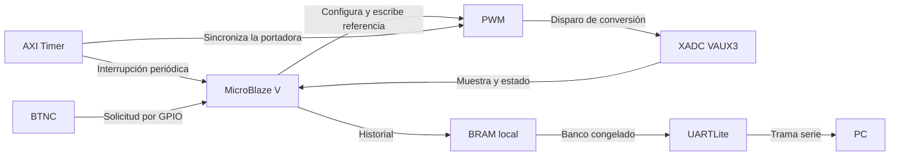

*Flujo funcional del diseño integrado. Las flechas muestran la dirección del evento o del dato. El procesador configura y accede a los periféricos mediante AXI.*

[Documento de diseño](../diseno/planteamiento.md) · [Mapa de direcciones verificado](../../resultados/axi/verificacion_issue_13.md)

### Reloj, reset y memoria

La entrada de reloj de 100 MHz de la placa se asignó al pin E3 y el pulsador CPU RESET activo bajo al pin C12. El reset observado en placa devuelve los periféricos a un estado conocido antes de arrancar el firmware. AXI INTC recibe la interrupción del AXI Timer y la entrega al procesador. UARTLite se usa para exportar las muestras o el resultado de la prueba, mientras JTAG permite descargar el ELF y depurar el arranque.

El mapa reserva `0x00000000–0x0001FFFF` para 128 KiB de memoria local compartida. ILMB y DLMB son dos rutas hacia la misma memoria. La BRAM AXI en `0x10000000–0x10007FFF` quedó accesible por instrucciones según el XSA auditado. Por eso el arreglo de muestras y el estado del firmware se enlazaron en la BRAM local.

[Mapa de direcciones y rutas verificadas](../../resultados/axi/verificacion_issue_13.md) · [Constructor del sistema integrado](../../scripts/build_nexys4.tcl)

Las secciones de PWM y firmware que siguen conservan el texto original del equipo. El apartado final de resultados incorpora las pruebas en placa realizadas después de redactar esas secciones y actualiza el estado experimental al cierre.

## Periférico PWM personalizado

El PWM Controller es el periférico que diseñamos desde cero en SystemVerilog. Recibe del MicroBlaze V el índice de modulación que calcula el regulador PR, por medio de AXI4-Lite. Con eso genera las cuatro compuertas del puente H con modulación unipolar y tiempo muerto, y además el pulso que le indica al ADC cuándo muestrear. El diseño completo por niveles (diagramas de tercer y cuarto nivel) está en el [documento de diseño](../diseno/planteamiento.md#62-periférico-pwm-personalizado-pwm-controller). Aquí se resume lo necesario para entender los resultados.

### Fundamentos

**Portadora triangular y frecuencia.** La portadora es un contador que sube de 0 a N y baja de N a 0 con el reloj de 100 MHz, de modo que

$$
f_{sw} = \frac{f_{clk}}{2N}
$$

Las tres frecuencias que evaluó PEDP quedan con N = 5000 (10 kHz), 3333 (15,0015 kHz) y 2500 (20 kHz).

**Modulación unipolar.** Cada pierna del puente compara la misma portadora con una referencia distinta: la pierna A con $+m$ y la pierna B con $-m$. En la escala de la portadora:

$$
th_A = \frac{N(1+m)}{2}, \qquad th_B = \frac{N(1-m)}{2}, \qquad s_A = (c < th_A), \quad s_B = (c < th_B)
$$

El voltaje promedio en la carga es $\bar v_{AB} = m\,V_{dc}$. Hay dos pulsos por período, así que el rizado de la carga queda en $2f_{sw}$. En el valle y en el pico las dos piernas están en el mismo estado ($v_{AB}=0$), por eso el valle es un buen instante para muestrear la corriente: cae a la mitad de su rizado y lejos de las conmutaciones.

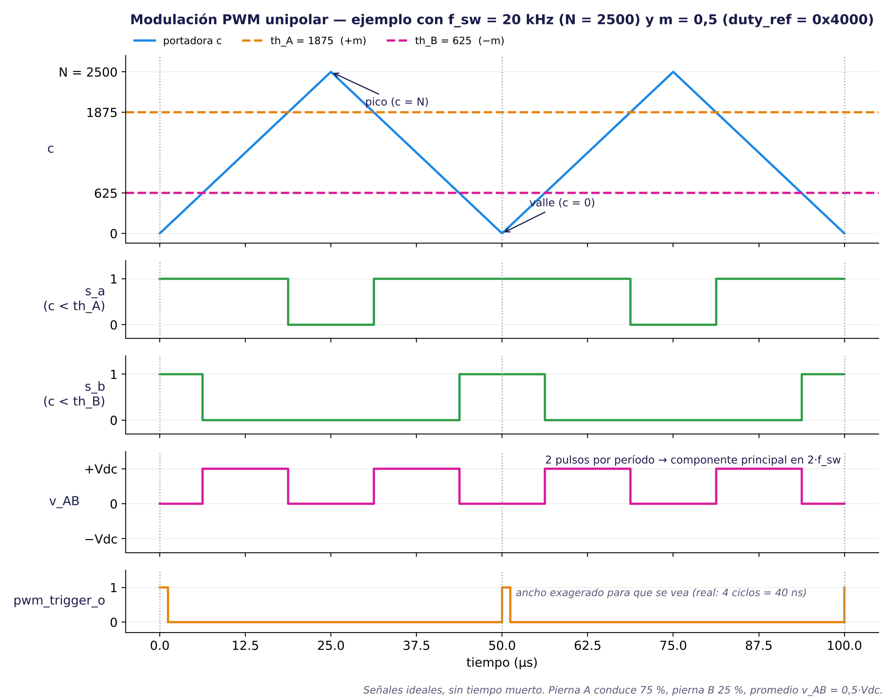

*Figura 0. Modulación unipolar: portadora triangular con los umbrales $th_A$ y $th_B$, señales de cada pierna y voltaje $v_{AB}$ en la carga. En el valle conducen los dos MOSFET superiores y en el pico los dos inferiores, así que en ambos instantes $v_{AB}=0$; los pulsos de $\pm V_{dc}$ aparecen dos veces por período.*

**Tiempo muerto.** El IR2110 no tiene tiempo muerto interno. Si el MOSFET superior y el inferior de una pierna conducen a la vez, la fuente queda en corto (shoot-through). Por eso entre el apagado de uno y el encendido del otro se dejan $t_{dt} = dead\_time \times 10$ ns; PEDP pidió 1 µs. El tiempo muerto le quita ancho a los pulsos, y para que el pulso más corto sobreviva hay que cumplir

$$
|m| \le 1 - 2\,t_{dt}\,f_{sw} = 0{,}96 \quad (1\ \mu s,\ 20\ kHz)
$$

Por eso `duty_ref` se satura en ±0,95.

**Bootstrap.** El IR2110 alimenta la compuerta del MOSFET superior con un capacitor bootstrap que solo se carga mientras conduce el inferior. Al arrancar está descargado, así que antes del primer pulso superior hay que encender los inferiores un rato.

**AXI4-Lite.** Es la versión simple de AXI para registros: cinco canales independientes (AW, W, B, AR, R), cada uno con handshake `VALID`/`READY`, una transferencia por transacción y respuesta `OKAY` o `SLVERR`. El estándar no fija el orden en que llegan AW y W, y el esclavo tiene que aceptar cualquiera.

### Enfoque y decisiones de diseño

| Decisión | Justificación |
|---|---|
| Portadora triangular (no diente de sierra) | Pulsos centrados y un valle sin conmutaciones para muestrear. |
| `duty_ref` en Q1.15 con signo | La salida del PR es una senoidal con signo; la relación con $\bar v_{AB}$ es lineal, así que para el PR el modulador es solo una ganancia $V_{dc}$. |
| Registros sombra cargados en el valle | Un cambio de `duty_ref`, `freq_sel` o `dead_time` a mitad de período nunca corta un pulso. |
| Tiempo muerto con FSM y salidas registradas | Por construcción las dos compuertas de una pierna no pueden estar en 1 a la vez, y no llegan glitches a los drivers. |
| `dead_time` configurable (20–1023 ciclos) | El valor final depende de MOSFET y driver; se ajusta sin resintetizar y el mínimo evita un cero por error de software. |
| `enable` separado de `gates_en` | En WARMUP el firmware necesita la portadora y el trigger del ADC sin pulsos en el puente (contrato C4). |
| Compuertas liberadas en el pico + 20 µs de precarga | En el pico conducen los inferiores; la precarga carga los bootstrap antes del primer pulso superior. |
| `sync_start_i` + `sync_arm` / `sync_done` | El AXI Timer y el PWM arrancan en fase una sola vez; con el mismo reloj y período ya no derivan. `adc_trigger_o` se bloquea hasta sincronizar. |
| `fault_i` con sincronizador de 2 flip-flops | Es una entrada asíncrona externa; la falla apaga las compuertas y borra `gates_en`, y el rearme es explícito. |

### Interfaz del periférico

| Señal | Dir. | Descripción |
|---|---|---|
| `s_axi_aclk`, `s_axi_aresetn` | Entrada | Reloj de 100 MHz y reset activo en bajo. Todo el periférico está en un solo dominio. |
| `s_axi_*` (AW, W, B, AR, R) | E/S | Esclavo AXI4-Lite de 32 bits: cuatro registros de configuración/estado y `DUTY_LATCHED` de solo lectura en la versión integrada. |
| `sync_start_i` | Entrada | `generateout0` del AXI Timer. |
| `fault_i` | Entrada | Falla de la etapa de potencia, activa en alto (0 si no se usa). |
| `gate_ah_o`, `gate_al_o` | Salida | Pierna A (izquierda): FETD4 y FETD2 de la tarjeta de PEDP. |
| `gate_bh_o`, `gate_bl_o` | Salida | Pierna B (derecha): FETD1 y FETD3. |
| `pwm_trigger_o` | Salida | Pulso de 4 ciclos (40 ns) en cada valle. Diagnóstico. |
| `adc_trigger_o` | Salida | `pwm_trigger_o` habilitado por `sync_done`. Va a la interfaz ADC/XADC. |

Parámetros del IP: `N_00`…`N_11` (5000/3333/2500/2500), `DUTY_MAX` = 31129, `DT_RESET` = 100, `PHASE_RESET` = 1000, `TRIG_WIDTH` = 4, `PRECHARGE_CYC` = 2000 y `GATE_ACTIVE_LOW` = 0, porque las entradas HIN/LIN del IR2110 son activas en alto.

### Registros AXI4-Lite

Offsets relativos a la base que asigna el Address Editor. El detalle de cada campo está en la [sección 8.2 del diseño](../diseno/planteamiento.md#82-registros-del-periférico-pwm).

| Offset | Registro | Bits | Acceso | Reset | Semántica |
|---|---|---|---|---|---|
| 0x00 | CTRL_STATUS | [0] `enable` | R/W | 0 | Corre portadora y trigger; 0 apaga todo. |
| | | [2:1] `freq_sel` | R/W | 00 | 10 / 15 / 20 / 20 kHz. Se aplica en el valle. |
| | | [3] `running` | RO | 0 | Generador activo. |
| | | [4] `gates_en` | R/W | 0 | Libera compuertas en el pico; 0 las bloquea de inmediato. Una falla lo borra. |
| | | [5] `gates_on` | RO | 0 | Compuertas habilitadas. |
| | | [6] `fault` | RO | 0 | Falla presente. |
| | | [7] `sync_arm` | R/W | 0 | Arma la sincronización (solo con `enable` = 1 y `gates_en` = 0). Se borra solo. |
| | | [8] `sync_done` | RO | 0 | Ya se sincronizó con el Timer. |
| | | [9] `precharge` | RO | 0 | Precarga del bootstrap en curso. |
| | | [10] `power_ready` | RO | 0 | Conmutación normal. |
| 0x04 | DUTY_REF | [15:0] | R/W | 0 | Q1.15 con signo, saturado a `0x7999` / `0x8667` (±0,95). |
| 0x08 | DEADTIME | [9:0] | R/W | 100 | Ciclos de 10 ns, saturado a 20…1023. |
| 0x0C | SYNC_PHASE | [13:0] | R/W | 1000 | Posición de carga de la portadora. `SLVERR` si se escribe con el PWM habilitado, con compuertas activas o con un valor ≥ N. |
| 0x10 | DUTY_LATCHED | [15:0] referencia; [16] VALID | RO | 0 | Referencia Q1.15 cargada en el valle. VALID se activa tras una carga con PWM habilitado y se borra al deshabilitarlo. |

Los bits reservados se leen en 0. Los campos RO de CTRL_STATUS no se modifican al escribir. En la versión integrada, una escritura a DUTY_LATCHED o un acceso a una dirección no implementada o desalineada devuelve SLVERR. Lo que se lee de DUTY_REF y DEADTIME es el valor ya saturado, así el firmware puede detectar la saturación.

DUTY_LATCHED se agregó durante la integración con adquisición y firmware. Las tablas de 85 pruebas RTL y 25 pruebas posimplementación de este apartado corresponden a la verificación del PWM aislado anterior a esa ampliación; sus resultados se conservan con ese alcance.

### Diagramas de estado

**Esclavo AXI4-Lite.** La escritura y la lectura son dos FSM independientes. La de escritura acepta AW y W en cualquier orden.

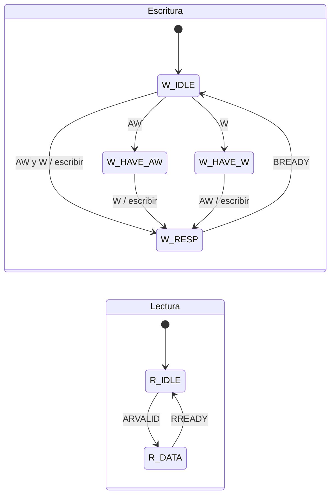

**Habilitación de compuertas.** Este diagrama describe el comportamiento visto desde los bits de estado: `gates_on`, `precharge` y `power_ready`.

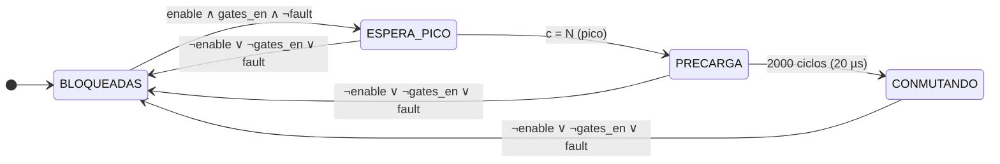

En PRECARGA los dos MOSFET inferiores conducen ($v_{AB}=0$) y los superiores están apagados. En CONMUTANDO cada pierna sigue la FSM de tiempo muerto.

**Tiempo muerto (una instancia por pierna).**

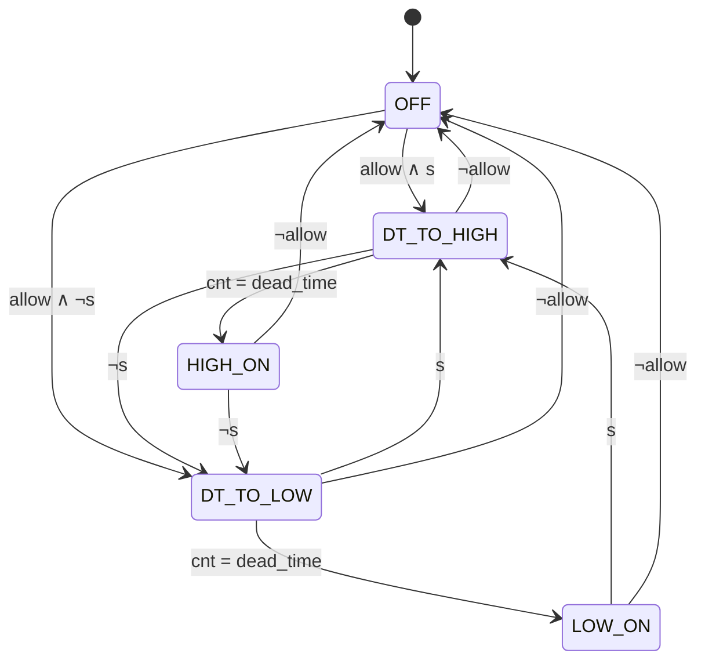

Solo `HIGH_ON` enciende `gate_h` y solo `LOW_ON` enciende `gate_l`. Los dos estados `DT_*` dejan ambas compuertas en 0.

### Verificación por simulación con autochequeo

Hay dos testbenches en `tb/pwm_controller/`, los dos autoverificables. Cada prueba imprime `PASS`/`FAIL` con el valor esperado y el medido, y al final un resumen. Si algo falla, termina con `$fatal`, así el resultado no depende de mirar formas de onda.

- `tb_pwm_controller.sv` (comportamiento, RTL): 85 pruebas en 13 grupos. Además de los puertos, observa señales internas (`c`, `s_a`, `s_b`, `valley`) para medir los umbrales exactos.
- `tb_pwm_controller_post_impl.sv` (post-implementación temporizada): 25 pruebas que solo usan los puertos del periférico, porque en la netlist implementada las señales internas cambian de nombre.

Un monitor revisa en cada ciclo de toda la simulación que nunca estén en 1 a la vez las dos compuertas de una misma pierna.

#### Simulación de comportamiento (Vivado 2026.1, xsim)

| Grupo | Qué se verifica | Criterio de paso | Resultado |
|---|---|---|---|
| T1 | Valores de reset | CTRL = 0, DUTY = 0, DEADTIME = 100, SYNC_PHASE = 1000, salidas en 0 | 5/5 PASS |
| T2 | Lectura/escritura AXI4-Lite | AW antes y después de W, `WSTRB` parcial, `BREADY`/`RREADY` retrasados, RO no escribible, reservados en 0, `OKAY` | 9/9 PASS |
| T3 | Saturación | `0x7FFF`→`0x7999`, `0x8000`/`0x8001`→`0x8667`, `dead_time` 0→20 y 2000→1023 | 7/7 PASS |
| T4 | Frecuencias | Período = 2N ciclos para los 4 códigos | 4/4 PASS (10000, 6666, 5000, 5000) |
| T5 | Cambio de frecuencia en marcha | El período en curso termina completo; el nuevo N rige desde el valle | 2/2 PASS |
| T6 | Modulación unipolar, m = −0,95…0,95 | $s_A$, $s_B$ altos $2\,th-1$ ciclos; $d_A+d_B \ge 2N-4$; `gate_ah` = $s_A$ − `dead_time` | 15/15 PASS |
| T7 | Tiempo muerto | Intervalo = `dead_time` exacto (20, 100, 500); pulso < `dead_time` no conmuta | 5/5 PASS |
| T8 | `pwm_trigger_o` | 1 por período, 4 ciclos, sube con c = 1 tras el valle; sin trigger deshabilitado | 4/4 PASS |
| T9 | `enable` = 0 | Compuertas en 0 en ≤ 2 ciclos, `running` = 0 | 3/3 PASS |
| T10 | `gates_en` (WARMUP) | Trigger corre sin compuertas; liberación en el pico; bloqueo inmediato | 5/5 PASS |
| T11 | Sincronización C4 | Carga en `SYNC_PHASE`, valle 4000 ciclos después, una sola carga, `SLVERR` en los casos prohibidos, `adc_trigger_o` bloqueado hasta `sync_done` | 16/16 PASS |
| T12 | `fault_i` | Compuertas en 0 en ≤ 4 ciclos, `gates_en` borrado, no se rearma solo | 4/4 PASS |
| T13 | Precarga del bootstrap | Inferiores ≥ 20 µs antes que superiores (m = 0; 0,445; 0,95), bits `precharge`/`power_ready` | 5/5 PASS |
| Global | Shoot-through | 0 eventos en toda la simulación | PASS |

**Resultado: 85 pruebas, 85 PASS, 0 FAIL** (log completo en [`resultados/pwm/sim_pwm_vivado.txt`](../../resultados/pwm/sim_pwm_vivado.txt)).

*Figura 1. Resumen de la simulación de comportamiento: 85/85 PASS.*

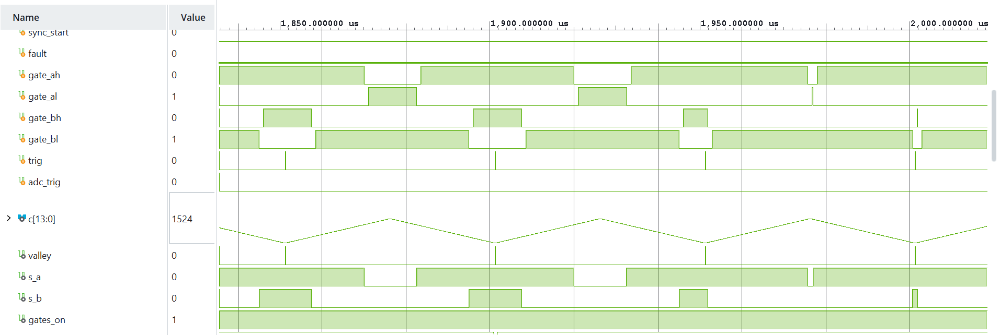

*Figura 2. Portadora `c`, señales `s_a`/`s_b` y las cuatro compuertas a 20 kHz con m = 0,5. El cambio a m = 0,95 se aplica recién en el valle siguiente (registros sombra).*

*Figura 3. Tiempo muerto entre la caída de una compuerta y la subida de la complementaria: marcadores en 1 870 015 ns y 1 871 015 ns, es decir 1,000 µs.*

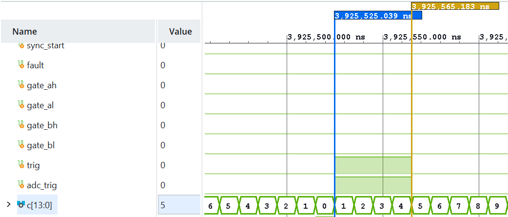

*Figura 4. `pwm_trigger_o` y `adc_trigger_o` en el valle de la portadora: 40 ns (de 3 925 525 a 3 925 565 ns).*

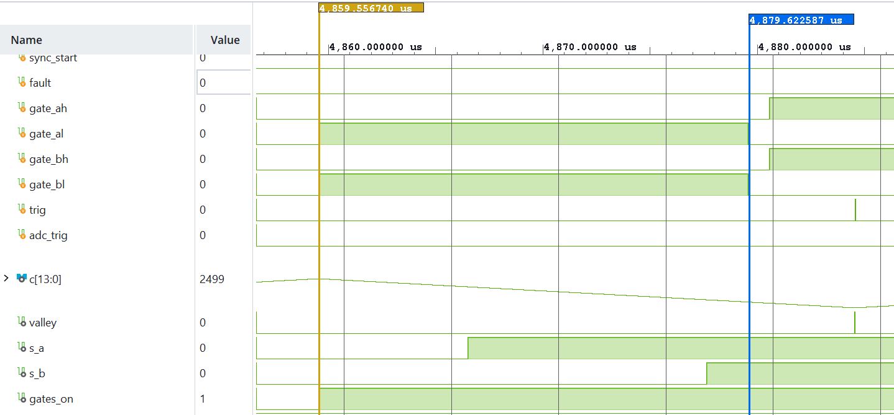

*Figura 5. Arranque: al subir `gates_on` conducen los dos MOSFET inferiores durante la precarga (~20 µs). Los superiores empiezan a conmutar unos 21 µs después.*

#### Simulación post-implementación temporizada

Se simuló la netlist de `impl_1` (xc7a100tcsg324-1) con los retardos SDF en la esquina lenta, a 100 MHz. Las medidas de tiempo muerto se hacen en ns, entre los flancos reales de los pines, para incluir el retardo y el skew de cada salida.

| Grupo | Qué se verifica | Criterio de paso | Resultado |
|---|---|---|---|
| P1 | Reset, registros y saturación | Igual que T1/T3 | 6/6 PASS |
| P2 | Frecuencias | Período de `pwm_trigger_o` = 2N | 3/3 PASS (10000, 6666, 5000) |
| P3 | Modulación, tiempo muerto, trigger (20 kHz, m = 0,5) | `gate_ah` = 3649 ± 2 ciclos; $t_{dt}$ = 1000 ± 10 ns; trigger de 4 ciclos | 3/3 PASS ($t_{dt}$ = 999,79…1000,21 ns) |
| P4 | `gates_en` y `enable` | Compuertas en 0, trigger sigue con `gates_en` = 0 y se detiene con `enable` = 0 | 3/3 PASS |
| P5 | Sincronización | `adc_trigger_o` bloqueado antes; trigger 4001 (+0…2) ciclos después de `sync_start_i`; `sync_done` = 1 | 4/4 PASS (4003 ciclos) |
| P6 | Precarga | Inferiores ≥ 2000 ciclos antes que superiores; `precharge` → `power_ready` | 3/3 PASS (2101 y 2100 ciclos) |
| P7 | `fault_i` | Compuertas en 0, `fault` = 1, `gates_en` borrado | 2/2 PASS |
| Global | Shoot-through | 0 eventos | PASS |

**Resultado: 25 pruebas, 25 PASS, 0 FAIL, sin violaciones de setup/hold** (log en [`resultados/pwm/sim_pwm_postimpl.txt`](../../resultados/pwm/sim_pwm_postimpl.txt)).

### Uso de recursos y análisis de timing

El periférico se sintetizó e implementó solo, como top, en un proyecto de prueba de Vivado 2026.1 con la restricción `create_clock -period 10.000 [get_ports s_axi_aclk]`.

| Recurso | Usado | Disponible | % |
|---|---:|---:|---:|
| Slice LUTs | 329 | 63 400 | 0,52 |
| Slice Registers (FF) | 209 | 126 800 | 0,16 |
| Slices | 115 | 15 850 | 0,73 |
| DSP48E1 | 2 | 240 | 0,83 |
| BRAM | 0 | 135 | 0 |
| BUFG | 1 | 32 | 3,13 |
| IOB | 96 | 210 | 45,71 |

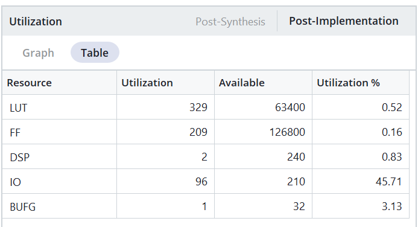

*Figura 6. Utilización post-implementación del PWM Controller.*

Los 96 IOB aparecen solo porque el módulo se implementó como top y todos sus puertos AXI salen a pines. Dentro del Block Design esos puertos son conexiones internas y el PWM usa solo los 6 pines de compuertas y triggers. Los 2 DSP son los multiplicadores $N(2^{15} \pm duty)$ de los umbrales.

| Métrica (100 MHz) | Valor |
|---|---:|
| WNS (setup) | 2,233 ns |
| TNS | 0 ns (0 de 440 endpoints fallan) |
| WHS (hold) | 0,170 ns |
| WPWS (ancho de pulso) | 4,500 ns |
| Frecuencia máxima estimada, $1/(10 - \text{WNS})$ | ≈ 128 MHz |

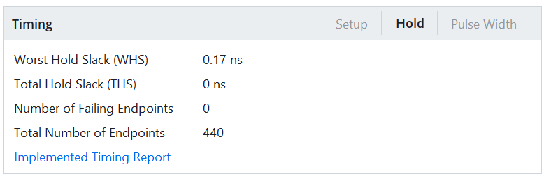

*Figura 7. Resumen de timing: se cumplen todas las restricciones.*

El camino crítico va de `u_core/duty_sh_reg[6]` (registro sombra del duty) a la entrada A del DSP48E1 de `u_compare/th_b_reg`. Tiene 4 niveles de lógica: tres CARRY4 de la resta $2^{15} - duty$ y un LUT1. El retardo de datos es 3,80 ns (1,71 ns de lógica y 2,09 ns de ruteo). El resto del presupuesto se lo lleva el setup de la entrada A del DSP. Con 2,2 ns de holgura no hace falta segmentar, y el umbral solo cambia una vez por período, en el valle. Si algún día se necesitara más frecuencia, bastaría con registrar $2^{15} \pm duty$ antes del DSP: el valor sombra se carga miles de ciclos antes de usarse.

El reporte de DRC dio 2 critical warnings y 7 warnings. Todos son por las I/O sin `LOC`/`IOSTANDARD` de la implementación aislada; en el sistema completo los pines vienen del XDC de la Nexys 4.

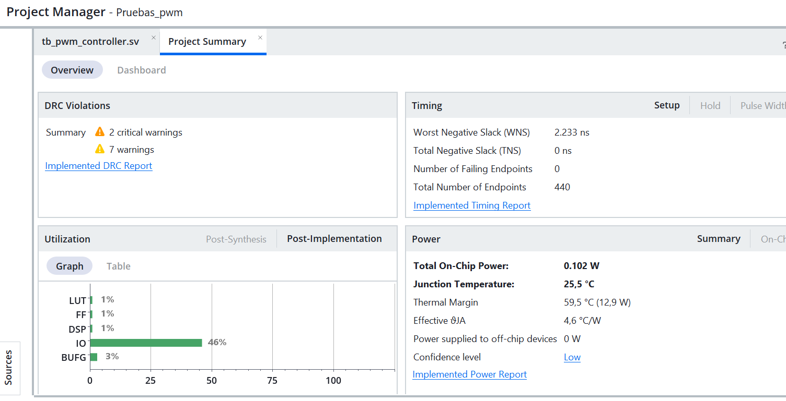

*Figura 8. Project Summary de la implementación del PWM aislado.*

### Análisis de resultados

**Frecuencia.** Los períodos medidos coinciden exactamente con 2N en RTL y en la netlist temporizada. El único error está en 15 kHz, y viene del diseño, no de la implementación: N = 3333 en vez de 3333,3 da 15,0015 kHz (0,01 %). El AXI Timer usa el mismo período (TLR0 = 6664, es decir 6666 ciclos), así que la sincronización no deriva.

**Modulación.** Con N = 2500 y m = 0,5, la teoría da $th_A = 1875$, es decir 75 % del período (3750 ciclos). Se midieron 3749: la comparación estricta $c < th$ en una portadora discreta deja cada pierna en alto $2\,th - 1$ ciclos. Por eso $d_A + d_B$ da 4998 de 5000, y 4996 en m = ±0,95, donde además se redondea el producto $N(2^{15} \pm duty)/2^{16}$. El error es de unos pocos ciclos de 5000 (menos de 0,1 %) y es igual en las dos piernas, así que casi se cancela en $\bar v_{AB} = (d_A - d_B)V_{dc}$. `gate_ah` queda exactamente 100 ciclos más corto que $s_A$, que es lo que se espera del tiempo muerto.

**Tiempo muerto.** En RTL es exactamente `dead_time` × 10 ns. En la netlist temporizada se midió entre 999,79 y 1000,21 ns. La diferencia de ±0,21 ns es el skew entre los caminos flip-flop → OBUF → pin de cada compuerta. Es despreciable frente a 1 µs, y frente al retardo de propagación del IR2110, que es del orden de 100 ns y puede variar hasta unos 10 ns entre el canal alto y el bajo según la hoja de datos. Esa diferencia solo se puede medir en la placa.

**Diferencias entre RTL y netlist.** Ningún resultado funcional cambió, pero aparecieron dos detalles del banco de pruebas que vale la pena documentar:

- La primera versión del testbench post-implementación medía el tiempo muerto contando ciclos, muestreando los pines en el flanco del reloj, y dio 99 y 101 ciclos (FAIL). El retardo reloj→pin de unos 10 ns hace que una compuerta cambie justo antes de un flanco de muestreo y la complementaria justo después. Se corrigió midiendo en ns sobre los flancos reales.
- El reset se soltaba justo en el flanco de subida del reloj y generó violaciones de setup/hold en los registros sombra. En el sistema real `s_axi_aresetn` viene del Processor System Reset, sincronizado al reloj. En el testbench se pasó a soltarlo en el flanco de bajada.

Por la misma razón P5 midió 4003 ciclos (RTL: 4002): hay un ciclo extra por el retardo de entrada de `sync_start_i` y de salida de `pwm_trigger_o` hasta los pines del modelo. En el Block Design el Timer y el PWM están conectados por dentro de la FPGA, sin IOB, así que esa latencia no aparece. De todos modos 10 ns frente a los 10 µs de fase es despreciable.

**Arranque.** La precarga dura 2100–2101 ciclos (21 µs) en lugar de exactamente 2000, porque después de los 20 µs la FSM sale de `LOW_ON` y respeta el tiempo muerto (100 ciclos) antes del primer pulso superior. Con m = 0,95 la pierna B tarda 25,4 µs, porque su primer pulso superior llega recién cuando $s_B$ vuelve a 1 en el período siguiente. En todos los casos se cumple el mínimo de 20 µs, y en ningún momento conducen a la vez el MOSFET superior y el inferior de una pierna.

**Recursos.** El periférico ocupa menos del 1 % de la lógica de la Artix-7. El costo dominante no son los registros AXI sino los contadores (portadora, tiempo muerto, precarga, fase) y los dos multiplicadores, que el sintetizador mapeó a DSP.

### Validación en FPGA

El enunciado pide comprobar las compuertas y el tiempo muerto con la etapa de potencia desenergizada antes de cualquier ensayo energizado. La prueba se hará con el sistema MicroBlaze V completo y osciloscopio, sobre los pines de las compuertas:

| Prueba | Criterio de aceptación |
|---|---|
| Frecuencia de cada pierna con `freq_sel` = 00/01/10 | 10 / 15 / 20 kHz ± 0,1 % |
| Tiempo muerto entre compuertas de la misma pierna | 1 µs (± retardo de propagación medido) en las dos transiciones, sin solapamiento |
| Duty con m = 0, ±0,5 y ±0,95 | Coincide con $(1 \pm m)/2$ menos el tiempo muerto |
| `pwm_trigger_o` contra una compuerta | 40 ns, en el valle (centro del intervalo en que conducen los dos MOSFET superiores) |
| Arranque con `gates_en` = 1 | Primero ambos inferiores durante ~20 µs, luego conmutación |
| `fault_i` o `gates_en` = 0 | Las 4 compuertas en 0 de inmediato |

*(Completar con las capturas del osciloscopio y los valores medidos.)*

### Análisis crítico

**Logros.**
- El periférico cumple con lo que pide el enunciado: AXI4-Lite completo, PWM unipolar, tiempo muerto configurable, saturación y trigger para el ADC.
- También cumple lo que se acordó después con firmware y PEDP: sincronización con el Timer, WARMUP sin pulsos, precarga del bootstrap y entrada de falla.
- Pasó 85/85 pruebas en RTL y 25/25 en la netlist temporizada, sin un solo evento de shoot-through, con 2,2 ns de holgura a 100 MHz y menos del 1 % de la FPGA.

**Limitaciones.**
- Las pruebas en placa confirmaron el acceso AXI y el comportamiento de los registros PWM. Sin embargo, todavía no se han medido físicamente las formas de onda de las compuertas ni los retardos reales hasta los drivers.
- El tiempo muerto es igual para las dos transiciones y las dos piernas. Si el IR2110 y los MOSFET apagan más lento de lo que encienden, podría convenir un valor distinto para cada flanco.
- La distorsión que el tiempo muerto le mete a $v_{AB}$ depende del signo de la corriente, y el PWM no la compensa: queda en manos del PR.
- La salida en 15 kHz no es exacta (0,01 %).

**Mejoras posibles.**
- Compensar el tiempo muerto en hardware según el signo de la corriente medida.
- Agregar un contador de períodos o un registro de diagnóstico para que el firmware detecte si se perdió una actualización de `duty_ref`.
- Registrar $2^{15} \pm duty$ antes del DSP si se necesitara más frecuencia de reloj.
- Usar un reloj que permita N entero para 15 kHz, si PEDP termina usando esa frecuencia.

**Lecciones aprendidas.**
- Un testbench que solo mira puertos y mide en tiempo real, no en ciclos, es el que sirve para la simulación temporizada.
- Varias decisiones que parecían de detalle salieron de hablar con el equipo de potencia: la precarga del bootstrap, liberar las compuertas en el pico, el valor del tiempo muerto. Sin eso el diseño habría pasado todas las simulaciones y aun así habría fallado en la placa. Así pasó con T13: con m = 0,95 los inferiores nunca alcanzaban a encender antes del primer pulso superior.

---

## Adquisición ADC/XADC, firmware de control y transmisión UART

### Objetivo y alcance del subsistema

Se desarrolló el subsistema digital encargado de adquirir datos del XADC, comprobar su validez, ejecutar el procesamiento periódico y conservar un historial exportable por UART. El trabajo comprendió el motor de adquisición y su interfaz AXI4-Lite, los controladores de acceso a registros, el núcleo portable del regulador, la supervisión temporal, el almacenamiento de muestras y las herramientas de recepción en PC.

La implementación se integró con la arquitectura MicroBlaze V y el PWM del sistema mediante contratos de registros, sincronización, memoria y habilitación de compuertas. Se utilizó la Nexys 4 original, con FPGA `xc7a100tcsg324-1` y reloj de 100 MHz.

Este apartado presenta el diseño realizado, las decisiones de implementación y los resultados obtenidos mediante pruebas de software, simulación e implementación en las herramientas AMD. Las verificaciones físicas incorporadas posteriormente se presentan en el apartado «Resultados de integración y verificación en placa». Se distinguen explícitamente los resultados de simulación, implementación y ejecución real en la Nexys 4.

### Fundamentos y configuración del XADC

El XADC de la FPGA entrega un resultado de 12 bits. Se seleccionó VAUX3 en modo unipolar y conversión por evento, para que la adquisición dependa de `CONVST` en lugar de ejecutarse libremente. La relación ideal utilizada para interpretar el código es

$$
V_{diff} \approx \frac{raw}{4096}\,(1\,\mathrm{V}), \qquad 0 \le raw \le 4095
$$

El tamaño nominal de un código es aproximadamente 244,14 µV; este valor representa resolución de cuantización y no exactitud medida. Los 12 bits útiles se extraen de `DO[15:4]`. El rango de entrada y el funcionamiento por evento se fundamentan en [UG480: función de transferencia](https://docs.amd.com/r/en-US/ug480_7Series_XADC/ADC-Transfer-Functions) y [UG480: muestreo por evento](https://docs.amd.com/r/en-US/ug480_7Series_XADC/Event-Driven-Sampling).

La conversión de código a corriente requiere conocer la ganancia, el offset y la polaridad del sensor. Esos parámetros todavía no están confirmados; por ello, la aplicación de verificación exporta códigos crudos y deja vacíos los campos de corriente y control. No se utiliza una calibración supuesta para presentar resultados en amperios.

| Parámetro | Configuración implementada | Motivo |
|---|---|---|
| Canal analógico | VAUX3; dirección DRP `0x13` | Mantener el mismo canal en Wizard, wrapper y restricciones |
| Interfaz del Wizard | DRP, modo por evento, sin promediado | Disparar una conversión y recuperar su resultado explícitamente |
| DCLK / ADCCLK | 100 MHz / 25 MHz, divisor 4 | Compatibilidad con la plataforma integrada |
| Pulso `CONVST` | 4 ciclos DCLK, 40 ns | Duración definida por el motor de adquisición |
| Asentamiento mínimo del wrapper | 20 ciclos DCLK, 200 ns | Evitar solicitudes consecutivas sin intervalo de reposo |
| Watchdog de adquisición | 800 ciclos DCLK, 8 µs | Detectar una conversión o lectura que no termina |
| Reset e inicialización | Reset de 8 ciclos y espera de 100000 ciclos, 1 ms; después se exige BUSY bajo | Impedir el arranque antes de publicar `READY` |

Los intervalos configurados no sustituyen la comprobación del acondicionamiento analógico ni del asentamiento del sensor real.

### Arquitectura implementada e interfaz AXI

El recorrido de datos es `PWM → wrapper de adquisición → XADC → registros atómicos → MicroBlaze V → bancos de captura → UART → PC`. El hardware controla la conversión; el procesador lee resultados publicados y verifica su validez.

| Archivo | Función en el subsistema |
|---|---|
| [`xadc_acquisition.sv`](../../rtl/xadc_if/xadc_acquisition.sv) | Detecta el disparo, genera `CONVST`, espera EOC, solicita la lectura DRP y publica la muestra; vigila timeout y overrun |
| [`xadc_axi_lite.sv`](../../rtl/xadc_if/xadc_axi_lite.sv) | Expone control, estado, dato y tiempos mediante AXI4-Lite; acepta AW y W de forma independiente |
| [`xadc_startup_guard.sv`](../../rtl/xadc_if/xadc_startup_guard.sv) | Coordina reset del convertidor y disponibilidad para nuevas conversiones |
| [`tdd_mmio.c`](../../vitis/drivers/tdd_mmio.c) | Lee una tupla coherente y maneja los registros del PWM |
| [`tdd_timer.c`](../../vitis/drivers/tdd_timer.c) | Configura el período y reconoce la interrupción sin recargar el contador |
| [`control_core.c`](../../vitis/app/control_core.c) y [`reference_lut.h`](../../vitis/app/reference_lut.h) | Implementan calibración, referencia senoidal, ecuación discreta del PR, conversión Q1.15 y validación numérica |
| [`control_runtime.c`](../../vitis/app/control_runtime.c) | Coordina el servicio periódico, los estados de arranque, los límites temporales y el histórico de control |
| [`main.c`](../../vitis/bsp/main.c) y [`board_config.h`](../../vitis/bsp/board_config.h) | Adaptan el núcleo a MMIO, INTC y entradas de usuario; conservan el arranque diagnóstico mientras los parámetros físicos no estén confirmados |
| [`adc_verify.c`](../../vitis/app/adc_verify.c) | Comprueba sincronización, secuencia, antigüedad y errores; entrega las muestras al historial |
| [`capture.c`](../../vitis/app/capture.c) | Administra dos bancos, congela capturas y serializa la trama con CRC32 |
| [`adc_verify_main.c`](../../vitis/bsp/adc_verify_main.c) | Inicializa la plataforma SDT, conecta INTC, atiende el botón y transmite desde el bucle principal |
| [`receive_adc_verification.py`](../../scripts/receive_adc_verification.py) y [`capture_receiver.py`](../../scripts/capture_receiver.py) | Conservan los bytes recibidos y generan CSV, metadatos e informe de recepción |

El motor de adquisición recorre IDLE, PULSE, WAIT_EOC, ISSUE_READ, WAIT_DRP y PUBLISH. Al aceptar un disparo conserva el tiempo de solicitud; al finalizar la lectura actualiza `DATA`, `SEQ` y `SAMPLE_TIME` juntos. La marca de tiempo representa la aceptación de la solicitud, no la entrada a la ISR ni el fin de conversión.

El periférico no mantiene una cola de solicitudes. Un disparo recibido mientras no puede comenzar otra conversión activa `OVERRUN`. Si vence el watchdog, entra en ERROR y descarta respuestas tardías. Borrar el indicador de timeout no recupera el motor: se requiere reset coordinado y una nueva espera de `READY`.

El wrapper ADC ocupa la base `0x44A00000`. El Wizard está detrás de esa interfaz; el firmware utiliza el mapa del wrapper y no el mapa de un Wizard AXI continuo.

| Offset | Registro | Acceso | Semántica principal |
|---|---|---|---|
| `0x00` | CTRL | R/W y pulsos de control | Bit 0: ENABLE; bit 1: SYNC_MODE; bit 2: START_SW; bit 3: RESET |
| `0x04` | STATUS | RO | Bits 0–3: VALID, BUSY, OVERRUN y TIMEOUT |
| `0x08` | DATA | RO | Código de 12 bits, extendido con ceros |
| `0x0C` | SEQ | RO | Número de publicación, de 32 bits |
| `0x10` | SAMPLE_TIME | RO | Tiempo de aceptación de la solicitud |
| `0x14` | ERR_CLEAR | W1C | Escribir 1 en bits 2/3 borra OVERRUN/TIMEOUT; no rearma ERROR |
| `0x18` | TICKS | RO | Contador libre de 32 bits a 100 MHz |
| `0x1C` | READY | RO | Bit 0: convertidor disponible después de la inicialización |

Las respuestas AXI se conservan mientras el maestro no las acepta. Las escrituras a registros de solo lectura y los accesos no implementados o desalineados generan `SLVERR`. Para cambiar SYNC_MODE se debe deshabilitar primero la admisión y esperar a que termine la operación aceptada; intentar cambiarlo mientras el ENABLE previo está activo o BUSY está alto se rechaza.

Una actualización atómica del hardware no convierte varias lecturas del procesador en una transacción única. El driver lee `SEQ → DATA → SAMPLE_TIME → STATUS → SEQ`; acepta el conjunto si las dos secuencias coinciden, el dato es válido y no existen errores. Si cambia SEQ, repite la lectura hasta un máximo de dos intentos. Así evita mezclar el dato de una conversión con el tiempo de otra.

### Sincronización con PWM y AXI Timer

El Timer y el PWM utilizan el mismo reloj y el mismo número de ciclos por período. El primer pulso `generateout0`, con `sync_arm` activo y compuertas bloqueadas, carga la portadora en fase 1000 subiendo. El PWM confirma `sync_done`; a partir de ese momento habilita `adc_trigger_o`. Los pulsos posteriores del Timer no vuelven a cargar la portadora.

La fase de 1000 ciclos coloca el evento periódico del Timer aproximadamente 10 µs después del valle. La entrada efectiva a la ISR agrega la latencia del procesador y del controlador de interrupciones; esa latencia todavía debe medirse. El disparo de conversión procede del hardware y no de una escritura realizada por la ISR.

Para cuenta descendente en Generate con recarga automática se utiliza `TLR0 = P − 2`, donde P es el período en ciclos; esta relación se verifica en [PG079: programación de Generate](https://docs.amd.com/r/en-US/pg079-axi-timer/Generate-Mode?contentId=Ql~m4FYIVyRZj1ht3pJyFw). El firmware reconoce TINT escribiendo uno en ese bit y conserva la configuración del contador.

| Selección | P, ciclos | Período | TLR0 | Frecuencia obtenida |
|---|---:|---:|---:|---:|
| 10 kHz | 10000 | 100 µs | 9998 | 10000 Hz |
| 15 kHz nominal | 6666 | 66,66 µs | 6664 | 15001,50015 Hz |
| 20 kHz | 5000 | 50 µs | 4998 | 20000 Hz |

Se conserva el período entero como referencia temporal; no se redondea la opción intermedia a 15000 Hz para comprobar continuidad. Entre muestras consecutivas se exige incremento unitario de SEQ y diferencia de SAMPLE_TIME igual a P, utilizando aritmética sin signo para atravesar el wrap del contador.

### Procesamiento digital y ejecución periódica del control

El firmware se organizó en un núcleo de cálculo independiente del hardware y una capa de ejecución conectada a los periféricos. Esta separación permitió probar las operaciones numéricas y las secuencias de fallo en C nativo, y enlazar después las mismas funciones con el BSP SDT de MicroBlaze V. La interfaz `tdd_bus`, formada por contexto y funciones de lectura/escritura, permitió utilizar registros simulados en las pruebas y accesos MMIO ordenados en la aplicación de placa.

**Calibración y referencia.** La conversión implementada es `i[k] = (raw[k] − offset_code) × gain_a_per_code`. La ganancia incorpora la escala y el signo del sensado. La configuración comprueba que los parámetros sean finitos, que la ganancia no sea cero y que los umbrales raw sean coherentes. Su implementación no implica que los parámetros del sensor ya hayan sido medidos.

La referencia de 50 Hz se genera con un acumulador de fase de 32 bits y una tabla de 65 valores de un cuarto de seno. La simetría por cuadrantes y la interpolación lineal permiten obtener la señal completa sin evaluar una función trigonométrica en cada interrupción. El incremento de fase se calcula a partir del período entero del sistema, de modo que la opción de 15 kHz nominal conserva su frecuencia real. El cambio entre amplitudes de 0,2, 0,5 y 1 A mantiene la fase y se aplica en el límite de muestra, mediante una solicitud del bucle principal a la ISR.

**Regulador discreto.** Para el error `e[k] = i_ref[k] − i[k]`, el núcleo implementa la ecuación de segundo orden

$$
u[k] = b_0e[k] + b_1e[k-1] + b_2e[k-2] - a_1u[k-1] - a_2u[k-2]
$$

Los coeficientes se reciben como configuración y las memorias de error y salida se actualizan después de validar el cálculo. Se comprueban valores no finitos y las condiciones del denominador de segundo orden utilizadas por el validador. Estas comprobaciones detectan configuraciones numéricas inválidas; no demuestran estabilidad del lazo completo con la planta, los retardos y las saturaciones reales. Los coeficientes definitivos requieren la aprobación del diseño de control.

La salida se interpreta en voltios y se adapta al PWM mediante `m[k] = u[k]/Vdc`. Después se convierte a Q1.15 con redondeo y límite configurable, respetando el máximo digital de ±31129 códigos. La validación de configuración también exige margen respecto al tiempo muerto. Si el mando supera el límite aprobado, el supervisor entra en FAULT; no se implementó un mecanismo de anti-windup cuyo comportamiento no hubiera sido definido y verificado.

**Secuencia de arranque.** La ejecución integrada utiliza los estados siguientes:

| Estado | Comportamiento implementado |
|---|---|
| WARMUP | Mantiene compuertas bloqueadas mientras se verifica sincronización y se obtiene una primera muestra válida dentro del plazo permitido |
| PRECHARGE | Mantiene mando cero y comprueba continuidad mientras el PWM realiza su secuencia de precarga; no acumula el estado del PR |
| RUNNING | Verifica disponibilidad de la etapa PWM, procesa cada muestra, actualiza el comando pendiente y registra el histórico |
| FAULT | Bloquea compuertas, deshabilita PWM, conserva la causa y permite atender la exportación del intervalo válido disponible |

El runtime solicita la habilitación después de establecer la primera tupla válida; el PWM ejecuta la liberación en el pico y la precarga acordada. La fase de la referencia se establece cuando se confirma `power_ready`. Esta secuencia se ejercitó con periféricos y datos de prueba; su funcionamiento con los drivers del puente corresponde a la validación física.

**Supervisión temporal y de datos.** Cada servicio reconoce la interrupción antes del cálculo y comprueba secuencia, período, antigüedad y rango de la muestra. Antes de escribir el mando exige una reserva para completar MMIO y respetar el margen al siguiente valle. Al finalizar la escritura vuelve a comprobar el tiempo. Una violación provoca bloqueo y registra la causa, en lugar de utilizar un comando fuera del plazo configurado.

El núcleo y el runtime se compilaron para la configuración real RV32IM/ILP32 con extensiones zicsr/zifencei/zicbom. El procesador no dispone de FPU ni de las extensiones A y C; se evitó depender de operaciones atómicas de lectura-modificación-escritura y de un perfil de instrucciones distinto. Los cálculos float32 se enlazaron con el soporte de software correspondiente. El enlace satisfactorio no sustituye la medición del tiempo de ejecución.

### Aplicación independiente de verificación de adquisición

La aplicación de adquisición se separó del regulador PR para poder verificar datos, memoria y comunicación sin depender de coeficientes de control ni calibración. Sus estados son SYNC, DATA, RUNNING y FAULT. SYNC comprueba el armado; DATA espera una primera tupla posterior a la sincronización; RUNNING exige continuidad. Una muestra con errores, demasiado antigua, incoherente o con discontinuidad lleva a FAULT y detiene el PWM. No hay rearme automático.

La ISR del Timer reconoce la fuente, comprueba el estado del PWM, lee la muestra y la incorpora al banco activo. Rechaza una antigüedad de al menos un período. También comprueba que no estén activos los permisos de compuertas, precarga o conmutación. La aplicación no solicita `gates_en`, no ejecuta el PR y mantiene las cuatro salidas de compuerta bloqueadas.

El primer banco completo solicita una exportación automática. BTNC permite solicitar capturas posteriores, con antirrebote de 20 ms. El bucle principal conserva un bloque pendiente de hasta 32 bytes y envía como máximo ocho bytes por iteración, consultando la disponibilidad de UART Lite. Si la FIFO está llena conserva los bytes para otra iteración; la ISR no espera a que termine la transmisión.

GPIO debug[0], en JA7/G13, marca el servicio de interrupción. LED0 indica FAULT en esta aplicación. Se conservan contadores de interrupciones y muestras, edades mínima/máxima y duración máxima instrumentada. Esta última no incluye todo el despacho y prólogo/epílogo del BSP, por lo que todavía no es una medición de WCET completo.

La aplicación general de control permanece en `vitis/bsp/main.c`. Sus confirmaciones de sensor, PR, modulación, protección y temporización siguen desactivadas en `board_config.h`. La integración añade `DUTY_LATCHED` en `PWM_BASE + 0x10`, de solo lectura, para distinguir la referencia cargada en el valle del comando pendiente. Ese registro permite registrar el estado digital del modulador; no mide el voltaje del puente ni los efectos del tiempo muerto. Los resultados del PWM aislado mostrados antes corresponden a su versión de verificación; no constituyen una prueba física de esta ampliación.

### Almacenamiento y formato de exportación

El historial utiliza dos bancos circulares de 2048 registros. Cada registro ocupa 12 bytes: código ADC de 16 bits, referencia en mA de 16 bits, salida PR float32 y dos referencias PWM Q1.15 de 16 bits. Los arreglos ocupan en total

$$
2 \times 2048 \times 12 = 49152\;\mathrm{bytes} = 48\;\mathrm{KiB}
$$

Al solicitar una captura, la ISR congela el banco anterior y continúa en el otro, sin copiar todos los registros. El transmisor recorre el banco congelado y lo libera al terminar. Los indicadores de propiedad usan operaciones atómicas de carga/almacenamiento; no se depende de instrucciones de lectura-modificación-escritura de la extensión A, ausente en este MicroBlaze V.

La trama TDD4 v3 contiene cabecera de 48 bytes, N registros y CRC32/ISO-HDLC de cuatro bytes. La cabecera identifica tipo de captura, cantidad, período, secuencia inicial, tiempo inicial y flags. El tipo 1 contiene historial de control; el tipo 2 se utiliza en la prueba RAW. En tipo 2, el registro contiene el código ADC y diez bytes reservados a cero; la ganancia y el offset de cabecera también se reservan en cero. El receptor no interpreta esos ceros como una calibración válida.

Para un banco completo, la longitud es 48 + 2048 × 12 + 4 = 24628 bytes. Con UART a 115200 baudios y formato 8N1, el tiempo mínimo nominal de envío es

$$
t_{UART,min} = \frac{24628\times 10}{115200} \approx 2{,}13785\;\mathrm{s}
$$

Ese valor supone transmisión continua sin pausas de software ni del enlace. La adquisición continúa mientras se exporta, pero el historial es circular: conserva las muestras recientes y no constituye un registro continuo de toda la ejecución. A 20 kHz, 2048 muestras cubren 102,35 ms entre la primera y la última.

El receptor verifica CRC, versión, tipo, tamaño, período y flags; conserva el flujo original y genera CSV/JSON. En RAW deja vacías las columnas de corriente, referencia y salida PR. La aceptación de una trama acredita su formato y consistencia, no la exactitud analógica ni la fase física de muestreo.

### Integración de memoria y construcción del sistema

Los 48 KiB de registros superan por sí solos los 32 KiB de memoria local del proyecto base. La reconstrucción integrada amplía a 128 KiB la BRAM compartida por ILMB y DLMB y ubica los datos en `.bss` accesible por el puerto de datos. Se descartó colocar el historial en la BRAM AXI de `0x10000000`, porque el diseño revisado la conecta al puerto de instrucciones y no ofrece una ruta para las cargas y escrituras de datos.

Los constructores generan el BSP y el linker desde el XSA integrado. `audit_adc_memory.py` contrasta las secciones asignadas del ELF con los rangos y rutas de datos/instrucciones del hardware. El linker de referencia de `vitis/bsp/lscript.ld` también utiliza la memoria local de 128 KiB.

| Aplicación | Extremo superior de las secciones | Espacio hasta 131072 bytes | Reserva de stack / heap solicitada |
|---|---:|---:|---:|
| Adquisición, cada uno de los tres ELF | 80784 bytes | 50288 bytes | 8192 / 4096 bytes |
| Control en configuración diagnóstica | 89928 bytes | 41144 bytes | 8192 / 4096 bytes |

El espacio restante y las reservas del linker no equivalen al consumo máximo dinámico medido de stack. Las cuatro aplicaciones se enlazaron con el BSP SDT real y pasaron la auditoría de memoria. La compilación y la auditoría de memoria, por sí solas, no demuestran ejecución en FPGA. La ejecución física de las aplicaciones utilizadas en las pruebas AXI y de adquisición se documenta posteriormente; no se extiende esa validación a todas las aplicaciones compiladas.

### Método de verificación y resultados obtenidos

La verificación se realizó en tres niveles. Primero se ejercitaron el RTL y el firmware portable con estímulos controlados: protocolo AXI, timeout, overrun, secuencias, wrap, bancos circulares y exportación. Después se utilizó el Wizard XADC generado por Vivado con el modelo analógico UNISIM, conectado al PWM y al wrapper reales. Finalmente, los datos publicados se reprodujeron con el driver C y se transmitieron a través del modelo funcional pos-síntesis de UART Lite.

En la simulación nativa, el maestro AXI y los eventos del Timer son estímulos del banco de pruebas. La entrada analógica se proporciona mediante `SIM_MONITOR_FILE`; no se simula un sensor de corriente ni se ejecutan instrucciones de MicroBlaze. La reproducción C utiliza las tuplas obtenidas del modelo, pero tampoco representa ejecución en el procesador de la FPGA.

| Configuración de la simulación | Muestras publicadas | Código ideal | Código observado | Diferencia entre SAMPLE_TIME consecutivos |
|---|---:|---:|---:|---:|
| 10 kHz, 0,25 V | 6 | 1024 | 1024 | 10000 ciclos |
| 15 kHz nominal, 0,50 V | 6 | 2048 | 2048 | 6666 ciclos |
| 20 kHz, 0,75 V | 6 | 3072 | 3072 | 5000 ciclos |

En los 18 eventos registrados, trigger→CONVST fue de 10 ns, CONVST→EOC estuvo entre 1050 y 1070 ns, y CONVST→publicación estuvo entre 1130 y 1150 ns. No hubo publicaciones anteriores al armado; las cuatro compuertas permanecieron bloqueadas. Se comprobó la coherencia de los registros y la retención de respuestas AXI durante esperas del maestro.

El máximo observado de 1150 ns desde CONVST hasta publicación es menor que el watchdog de 8000 ns y que el menor período de 50000 ns. Este margen corresponde al modelo y no incluye el tiempo de ejecución del procesador; no demuestra cumplimiento del deadline del control completo.

| Verificación adicional | Resultado | Alcance |
|---|---|---|
| Wrapper ADC/AXI | 312 comprobaciones satisfactorias | RTL con respuestas del convertidor controladas |
| Núcleo de control e histórico | 80901 comprobaciones satisfactorias | C nativo: operaciones numéricas, estados y captura; el conteo incluye iteraciones |
| Runtime de control | 205 comprobaciones satisfactorias | Reconocimiento de Timer, bloqueo y límites antes/después de MMIO |
| Cadena PWM/adquisición y reproducción C | 106 comprobaciones RTL y 127 comprobaciones de runtime | Tres períodos exactos; estímulos de Timer y respuestas de ADC controlados |
| Servicio de adquisición RAW | 34904 comprobaciones satisfactorias | C nativo: tres períodos, buffer, transmisión, fallas y wrap |
| Protocolo y receptor | 14 pruebas satisfactorias | Compatibilidad de formatos, límites, CRC y exportación |
| XADC nativo → driver C | 18 tuplas, tres capturas RAW decodificadas | Seis registros por captura, marcadas como cortas |
| UART Lite funcional | 372 bytes coincidentes y tres CRC correctos a 115200/8N1 | Modelo de la IP; sin enlace USB físico |
| FIFO UART llena | 29258 consultas registradas durante la simulación | Comprobación de espera y conservación de bytes en el emisor del banco |
| Banco completo | Exportación sintética de 2048 registros aceptada por el receptor | Prueba C/PC; independiente de las capturas nativas cortas |

Los conteos de comprobaciones incluyen iteraciones y no representan igual cantidad de casos independientes. Las seis muestras por configuración y el uso de un voltaje distinto en cada frecuencia no constituyen un barrido de linealidad ni una caracterización estadística del ADC.

La evidencia de simulación comprende las 18 tuplas de adquisición, los eventos de disparo y conversión y los resúmenes de ejecución. Las tablas anteriores recogen los resultados obtenidos y sus límites. Las trazas originales se conservan en la rama personal de verificación; los datos sintéticos se identifican como tales y no representan mediciones del inversor.

La reconstrucción integrada completó síntesis, implementación y generación del bitstream. El reporte del sistema a 100 MHz indica WNS = 0,465 ns, TNS = 0 y WHS = 0,041 ns, sin extremos fallidos de setup ni hold. La síntesis reportó 43 bloques BRAM, 4806 LUT, 4040 flip-flops y 6 DSP. Estos recursos corresponden al sistema integrado, no al ADC aislado. El cierre temporal de las rutas analizadas no sustituye mediciones de fase, jitter, WCET o retardos externos.

### Resultado de la integración y alcance experimental

La entrega digital comprende las fuentes de adquisición y control en `rtl/` y `vitis/`, los constructores de plataforma y firmware en `scripts/` y el receptor de PC. Se conservaron el proyecto base de MicroBlaze V y las restricciones compartidas, mientras el constructor realiza la ampliación de memoria y las conexiones de adquisición sobre una copia de trabajo. Se generaron el BIT, el XSA y los ejecutables de adquisición para las tres frecuencias, además del ELF de control en configuración diagnóstica.

Las pruebas propias verificaron la coherencia de los registros, las conversiones del modelo XADC, la sincronización digital, los bancos de captura, el formato de transmisión y el enlace con memoria accesible. El uso de una aplicación RAW independiente permitió entregar una prueba ejecutable sin activar el regulador ni las compuertas del puente.

La sección posterior «Resultados de integración y verificación en placa» documenta las pruebas AXI y las capturas RAW realizadas en la Nexys 4. La siguiente tabla distingue las verificaciones físicas ya incorporadas de las mediciones que permanecen pendientes. Los resultados de simulación conservan su alcance original.

| Comprobación física | Evidencia por incorporar |
|---|---|
| Lectura de conversiones desde MicroBlaze V | Verificada en placa a 20 kHz con dos capturas RAW completas de 2048 muestras; faltan las pruebas físicas a 10 y 15 kHz |
| Respuesta a una entrada analógica conocida | Voltaje medido, condiciones de conexión y códigos mínimo, máximo y promedio |
| Adquisición durante exportación | Capturas antes y después del envío, estado final y continuidad de secuencia/tiempo |
| UART real | Verificada mediante dos transferencias completas a la PC, una automática y otra solicitada con BTNC; el estado de los indicadores de la segunda trama requiere confirmación adicional |
| Temporización | Período y jitter de GPIO_ISR, fase PWM→CONVST/EOC y duración del servicio con el despacho completo |

Las mediciones deberán identificar la placa, el BIT/XSA/ELF utilizado, la señal aplicada y los instrumentos. Hasta su incorporación, la evidencia presentada acredita el desarrollo digital y los ensayos descritos, sin afirmar funcionamiento experimental del lazo energizado.

### Análisis crítico y conclusiones del aporte digital

La implementación permite controlar cuándo se solicita una conversión, asociar dato y tiempo, detectar discontinuidades y exportar un historial mientras continúa la adquisición. Las pruebas confirmaron esos mecanismos en los modelos utilizados y la construcción de aplicaciones que caben en memoria accesible por el procesador. La separación entre ISR y transmisión evita que el envío de una trama de más de dos segundos forme parte del trabajo periódico de muestreo.

La revisión de memoria mostró que un ELF enlazado no basta para demostrar integración: el procesador debe disponer de una ruta de datos hacia la región donde se ubican sus variables. La ampliación de LMB y la auditoría contra el XSA resuelven ese requisito en la versión entregada, aunque todavía corresponde comprobar el arranque real.

Las pruebas posteriores en la Nexys 4 confirmaron la ejecución de aplicaciones de diagnóstico, la adquisición de historiales RAW y su exportación por UART. Permanecen pendientes la calibración y polaridad del sensor, la caracterización analógica con una entrada conocida y las mediciones temporales del lazo completo. El ensayo analógico simulado también tuvo un tamaño reducido. La aplicación RAW permite avanzar sin inventar esos parámetros, pero no acredita el seguimiento de corriente, la respuesta del PR ni el funcionamiento energizado del inversor. Para evaluar el control completo también se requieren coeficientes aprobados, límites de modulación, protecciones y mediciones temporales reales.

El trabajo digital entregó una cadena implementada desde el disparo de conversión hasta el almacenamiento y la recepción en PC, junto con el núcleo de procesamiento y su supervisor periódico. Se resolvieron las dependencias de sincronización, propiedad de memoria y ubicación del histórico, y se generaron productos de hardware y software compatibles para continuar la integración en placa.

Los resultados obtenidos permiten evaluar por separado los mecanismos de adquisición, control y comunicación, y delimitan lo que debe contrastarse mediante mediciones físicas. La contribución experimental del sistema completará ese contraste y el análisis conjunto del inversor.

## Resultados de integración y verificación en placa

### Verificación AXI en la Nexys 4

El firmware de prueba ejecutó transacciones AXI desde el MicroBlaze V con la portadora y el permiso de compuertas deshabilitados. Leyó los valores iniciales antes de escribir, verificó los campos reservados y de solo lectura, aplicó referencias con ambos signos y escribió valores diferentes en el tiempo muerto y la fase de sincronización. Después de la primera corrida se pulsó el botón físico CPU RESET. El programa volvió a ejecutarse desde BRAM sin recargar el ELF ni el bitstream.

| Comprobación | Observación |
|---|---|
| Restauración tras reset | `CTRL_STATUS` y `DUTY_REF` en cero, `DEADTIME=100`, `SYNC_PHASE=1000` y `DUTY_LATCHED=0` al inicio de ambas corridas |
| Escritura y lectura de referencias | `0x1234` para +4660 y `0xEDCC` para −4660 |
| Saturación positiva y negativa | `0x7FFF → 0x7999` y `0x8000 → 0x8667` |
| Campos protegidos | La escritura no alteró campos de solo lectura ni reservados |
| Sombra con PWM detenido | `DUTY_LATCHED=0x00008667`, con `VALID=0` |
| Resultado | Dos `PASS AXI_PWM #13` por UART |

[Procedimiento, mapa y hashes](../../resultados/axi/verificacion_issue_13.md) · [Transcripción UART](../../resultados/axi/uart_pwm_axi_test_final.log) · [Firmware de prueba](../../vitis/bsp/pwm_axi_test_main.c) · [PR #35](https://github.com/IE-TDD-EL3313/Proyecto_4/pull/35)

### Diagnóstico de saturación y análisis crítico del PWM

La verificación inicial de placa mostró que la orden positiva `0x7FFF` quedaba limitada a `0x3239`. El wrapper del Block Design estaba pasando `DUTY_MAX` como la cadena `"31129"`. Al truncarla a 16 bits, los caracteres finales `2` y `9` daban exactamente los bytes `0x32` y `0x39`. El banco de registros terminó usando 12 857 como límite. Las pruebas aisladas instanciaban el valor numérico, lo que explica por qué la discrepancia apareció al ejecutar el diseño integrado.

Se declaró el parámetro como `int` en la interfaz del PWM y se hizo explícita la conversión a 16 bits al conectarlo al banco de registros. El wrapper corregido generó `.DUTY_MAX(31129)`. En Q1.15, el límite observado pasó de aproximadamente 0,3924 a 0,9500. Se reportaron 85/85 comprobaciones RTL y 86/86 con el wrapper corregido, además de las dos corridas UART que confirmaron el comportamiento en placa. Las 25 pruebas temporizadas del PWM aislado corresponden a la campaña previa identificada arriba.

El ensayo de placa verifica las transacciones AXI y el estado de los registros. Quedan pendientes las mediciones de frecuencia y tiempo muerto en las salidas PWM y la correlación temporal entre el disparo PWM y la publicación XADC en la FPGA. Se preparó una instrumentación ILA, pero la corrida de Vivado terminó en `create_debug_core` con el error `[Vivado 12-29205]`, antes de generar un bitstream instrumentado. Un monitor digital con contadores y salida UART queda como alternativa para esa verificación.

### Adquisición y transmisión verificadas en la Nexys 4

Se usó la plataforma integrada de 128 KiB en la Nexys 4, con reloj de 100 MHz, VAUX3 desconectado y las compuertas bloqueadas. La prueba automática utilizó `adc_verify_20khz.elf`. La segunda utilizó `control_inversor_app.elf` con `TDD_DIAGNOSTIC_HISTORY=1`, que habilita la exportación del historial RAW al pulsar BTNC mientras el PR permanece inactivo. La PC recibió los datos mediante UARTLite y guardó un CSV por ensayo.

| Magnitud | Envío automático | Envío por BTNC |
|---|---:|---:|
| Muestras RAW recibidas | 2048 | 2048 |
| Números de secuencia | 2–2049 | 29 223–31 270 |
| Saltos de secuencia | 0 | 0 |
| Intervalo registrado | 50 µs | 50 µs |
| Tiempo entre primera y última muestra | 102,35 ms | 102,35 ms |
| Mínimo / máximo, códigos RAW | 57 / 495 | 449 / 502 |
| Promedio, códigos RAW | 438,36 | 474,45 |
| Indicadores de trama | CRC válido y `flags=0` | `flags` sin confirmar mediante la salida UART y el CSV disponibles |

El período configurado de 5000 ciclos a 100 MHz da 50 µs por muestra y una frecuencia de muestreo de 20 kHz. La separación entre los extremos de cada captura es de 2047 intervalos. El CSV conserva una secuencia consecutiva y una base temporal uniforme. Estos datos describen el historial recibido y su período reportado. El jitter de la ISR y el cumplimiento del plazo del lazo con el PR activo requieren instrumentación temporal adicional.

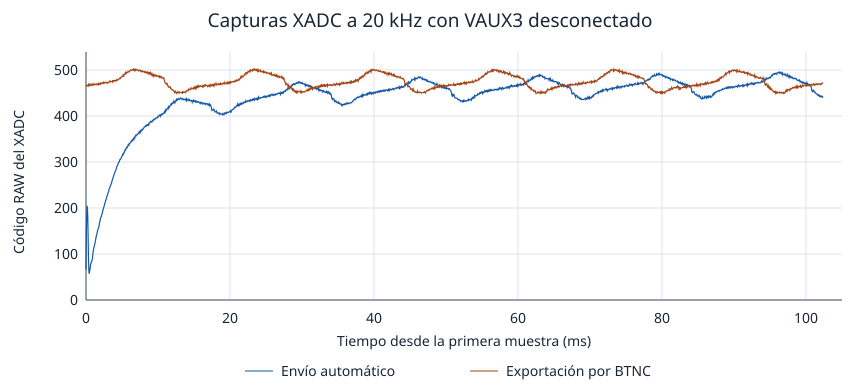

*Figura 9. Capturas XADC en placa a 20 kHz con VAUX3 desconectado. Ambas curvas utilizan la misma escala temporal y vertical.*

La primera toma incluye un transitorio de arranque. Después se observa una componente recurrente cercana a 60 Hz, compatible con captación de ruido por una entrada flotante. El montaje utilizado deja indeterminado el origen de esa componente y la relación entre los códigos y una corriente física. La segunda toma demuestra el recorrido desde el evento de BTNC hasta la recepción del banco completo en la PC.

[CSV automático](evidencias/xadc_raw_automatico.csv) · [CSV de BTNC](evidencias/xadc_raw_btnc.csv) · [Registro de verificación del XADC](https://github.com/IE-TDD-EL3313/Proyecto_4/issues/6#issuecomment-7055549949)

### Memoria y temporización del sistema integrado

Dos bancos de 2048 registros de 12 bytes requieren 49 152 bytes. Esa reserva supera los 32 KiB del proyecto base antes de incluir código, pila y heap. En el XSA integrado se habilitaron 128 KiB de BRAM local compartida y se verificó con el mapa del enlazador y la auditoría XSA/ELF que la memoria estuviera accesible por las rutas correctas. La BRAM AXI adicional tiene ruta de instrucciones en este diseño.

| Aplicación | Huella de BRAM local | Margen libre |
|---|---:|---:|
| Verificación ADC RAW a 20 kHz | 80 256 B | 50 816 B |
| Historial RAW solicitado mediante BTNC | 88 112 B | 42 960 B |
| Prueba AXI del PWM | 20 952 B | 110 120 B |

En el sistema integrado previo a la corrección de `DUTY_MAX` se reportaron WNS = +0,465 ns y WHS = +0,041 ns. En la corrida del bitstream corregido se reportaron **WNS = +1,065 ns, WHS = +0,041 ns y cero endpoints con violaciones**, a 100 MHz para las restricciones definidas. Las cifras de utilización integrada citadas en la sección previa corresponden a la reconstrucción original. El cierre de temporización estática evalúa las rutas cubiertas por las restricciones de Vivado. El tiempo real de ejecución del control se mide ejecutando el firmware en el procesador.

### Matriz de cumplimiento y trazabilidad de requisitos

La siguiente matriz relaciona los requisitos principales del Proyecto 4 de EL3313 con las verificaciones documentadas. Se distingue entre resultados obtenidos mediante simulación, pruebas ejecutadas físicamente en la Nexys 4 y actividades que todavía requieren validación experimental.

| Requisito | Evidencia documentada | Estado |
|---|---|---|
| Sistema embebido MicroBlaze V | Arquitectura a 100 MHz, BRAM, interfaces AXI y aplicaciones ejecutadas en FPGA | Verificado parcialmente en placa |
| Periférico PWM personalizado AXI4-Lite | Testbench de autochequeo, simulación temporizada y pruebas de registros AXI | Verificado en simulación y parcialmente en placa |
| PWM unipolar y tiempo muerto | Formas de onda y comprobaciones del periférico mediante simulación | Verificado en simulación; pendiente medición física |
| Saturación de referencia PWM | Pruebas AXI de saturación positiva y negativa en la Nexys 4 | Verificado en placa |
| Sincronización PWM–XADC | Pruebas digitales y simulaciones del subsistema | Verificado en simulación; pendiente correlación temporal física |
| Adquisición mediante XADC | Dos capturas RAW completas de 2048 muestras a 20 kHz | Verificado digitalmente en placa; pendiente calibración analógica |
| Almacenamiento de muestras | Historiales completos recuperados desde el sistema embebido | Verificado en placa |
| Exportación mediante UART | Transferencias automáticas y mediante BTNC recibidas en la PC | Verificado en placa |
| Firmware de control | Implementación y pruebas de software; aplicaciones de diagnóstico ejecutadas en FPGA | Verificado parcialmente; PR integrado pendiente |
| Temporización del sistema | Análisis de timing de implementación e instrumentación parcial del firmware | Verificado parcialmente; pendiente medición completa de jitter y WCET |
| Integración con inversor monofásico | Interfaces digitales y preparación para conexión con la etapa de potencia | Pendiente validación conjunta |
| Seguimiento de corriente mediante PR | Arquitectura de control preparada para integrar los parámetros definitivos | Pendiente validación experimental |

Los estados anteriores se refieren exclusivamente a las evidencias documentadas. La ejecución de aplicaciones de diagnóstico no equivale a demostrar el funcionamiento del controlador PR en lazo cerrado. Asimismo, la recepción de muestras RAW con VAUX3 desconectado verifica la cadena digital de adquisición y exportación, pero no constituye una medición calibrada de corriente.

---

### Conclusiones y trabajo pendiente

1. La plataforma digital se implementó para 100 MHz y se validó el acceso integrado a los registros PWM desde MicroBlaze V. La comparación entre simulación y banco permitió rastrear una diferencia de saturación hasta el tipo del parámetro en el wrapper. La corrección quedó confirmada mediante dos ejecuciones exitosas de la prueba AXI en placa, con un reset físico entre ambas.
2. Se verificaron en placa la adquisición RAW a 20 kHz, el almacenamiento de 2048 muestras consecutivas y su recepción por UART, tanto en el envío automático como mediante BTNC. La ampliación de BRAM conserva el historial completo y la separación entre ISR y transmisión evita esperar por la UART dentro del servicio periódico.
3. La verificación temporizada de la netlist del PWM respalda la generación de las formas de onda previstas. Falta medir en placa el tiempo muerto, la frecuencia y la relación temporal entre el disparo y la publicación del XADC. También queda pendiente aplicar una entrada conocida a VAUX3 para comprobar su respuesta analógica.
4. El equipo de Potencia se encontraba finalizando su etapa al cierre de este informe. Quedan pendientes la incorporación de los coeficientes aprobados, la validación experimental del seguimiento de corriente con el PR activo y la medición del tiempo de ejecución y del jitter del lazo durante la exportación.
5. El proceso de integración evidenció la importancia de combinar verificaciones funcionales, simulaciones temporizadas y pruebas físicas. Aunque los testbenches permitieron comprobar el comportamiento del PWM y los módulos de adquisición, las pruebas AXI en la Nexys 4 revelaron una discrepancia en la saturación que fue necesario rastrear hasta la parametrización del wrapper. Esta experiencia confirmó que la verificación aislada de un periférico no sustituye su validación dentro del sistema embebido completo y que las evidencias deben distinguir claramente entre simulación, implementación y ejecución real.

---

## Referencias bibliográficas

- AMD, *AXI Reference Guide (UG1037)*. https://docs.amd.com/v/u/en-US/ug1037-vivado-axi-reference-guide
- AMD, *Vivado Design Suite User Guide: Creating and Packaging Custom IP (UG1118)*. https://docs.amd.com/r/en-US/ug1118-vivado-creating-packaging-custom-ip
- AMD, *Vivado Design Suite User Guide: Logic Simulation (UG900)*. https://docs.amd.com/r/en-US/ug900-vivado-logic-simulation
- AMD, *7 Series DSP48E1 Slice User Guide (UG479)*. https://docs.amd.com/v/u/en-US/ug479_7Series_DSP48E1
- Infineon, *IR2110(S)/IR2113(S) High and Low Side Driver*, hoja de datos.
- N. Mohan, T. Undeland y W. Robbins, *Power Electronics: Converters, Applications, and Design*, 3.ª ed., Wiley, 2003, cap. 8 (inversores monofásicos, PWM unipolar y tiempo muerto).
- AMD, [*7 Series FPGAs and Zynq-7000 SoC XADC User Guide*, UG480](https://docs.amd.com/r/en-US/ug480_7Series_XADC): función de transferencia, entrada unipolar, muestreo por evento y DRP.
- AMD, [*AXI Timer LogiCORE IP Product Guide*, PG079](https://docs.amd.com/r/en-US/pg079-axi-timer): modo Generate, recarga e interrupciones.

**Documentación propia del proyecto.** Los archivos RTL, C, Python y las evidencias experimentales se identifican mediante sus rutas en las secciones correspondientes.
