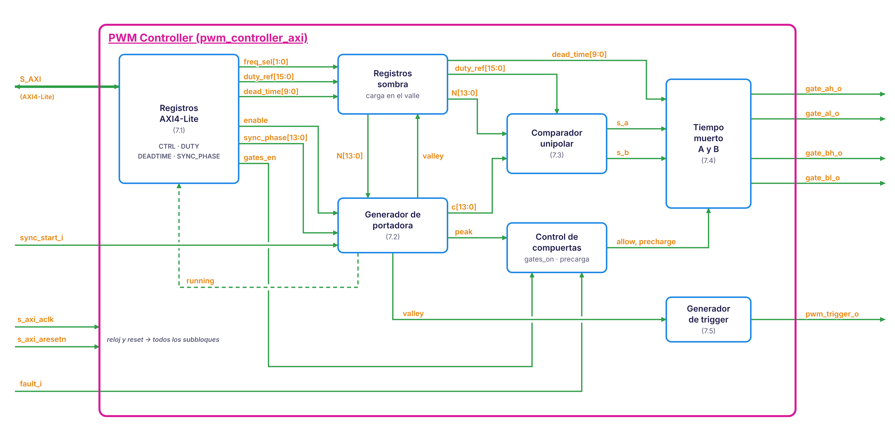
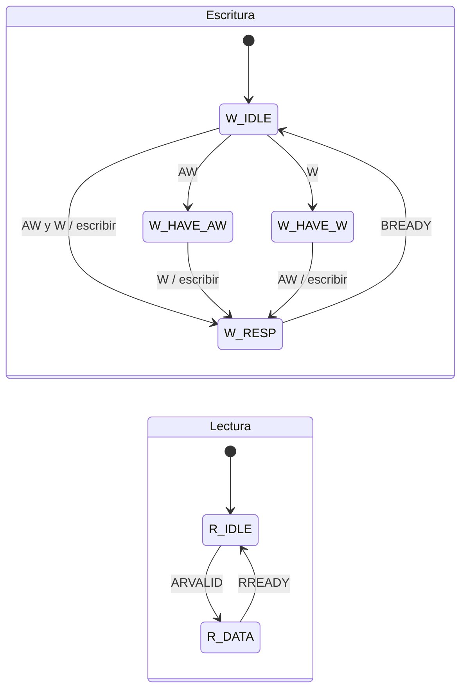
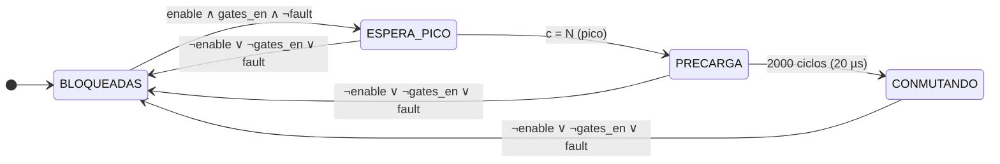
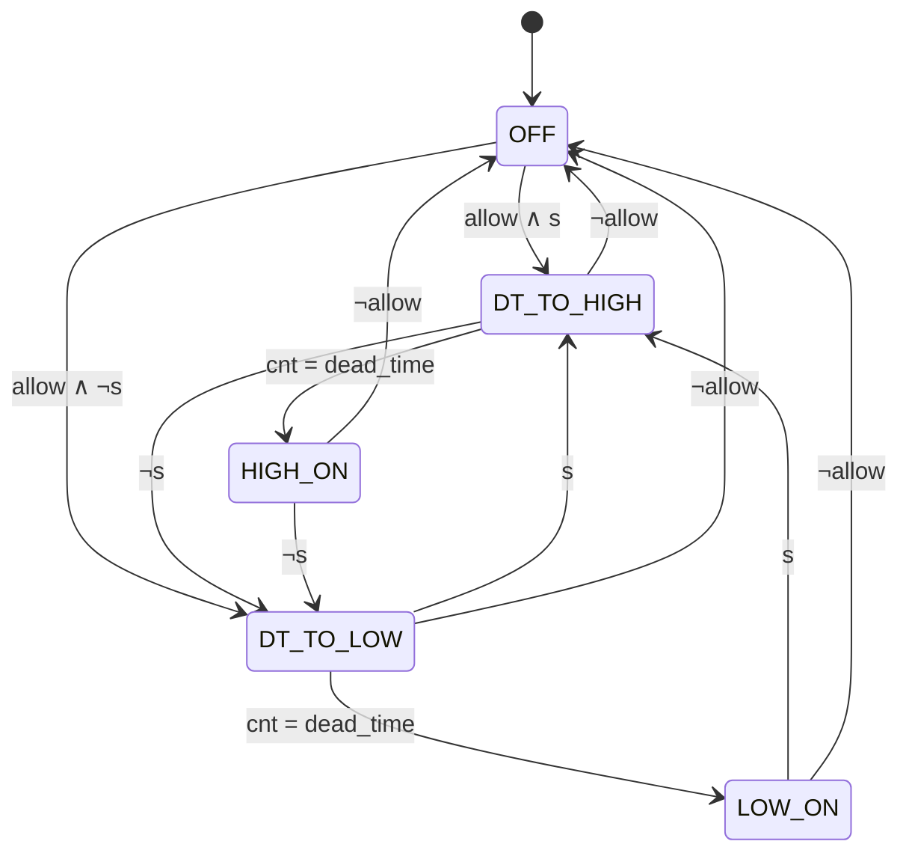
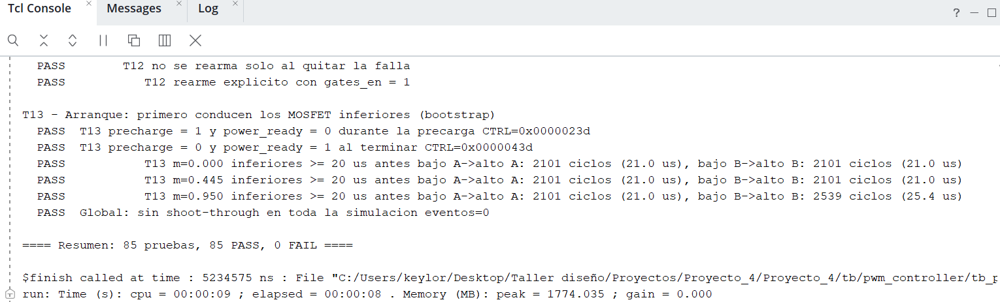
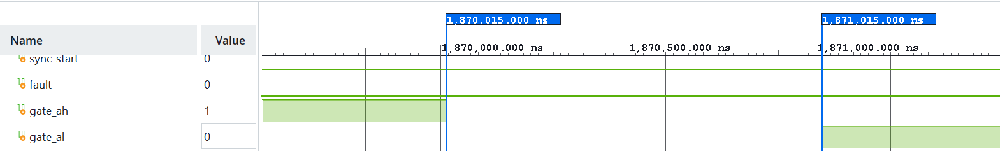

# Informe técnico
## Proyecto 4 – Control de corriente de un inversor monofásico con MicroBlaze V y periférico PWM personalizado

<!--
Cada integrante agrega sus secciones. Las de este archivo corresponden al periférico PWM (Keylor).
Figuras del informe: docs/informe/figuras/. Evidencias en texto: resultados/pwm/.
-->

---

## Periférico PWM personalizado

El PWM Controller es el periférico que diseñamos desde cero en SystemVerilog. Recibe del MicroBlaze V el índice de modulación que calcula el regulador PR, por medio de AXI4-Lite. Con eso genera las cuatro compuertas del puente H con modulación unipolar y tiempo muerto, y además el pulso que le indica al ADC cuándo muestrear. El diseño completo por niveles (diagramas de tercer y cuarto nivel) está en el [documento de diseño](../diseno/planteamiento.md#62-periférico-pwm-personalizado-pwm-controller). Aquí se resume lo necesario para entender los resultados.

### Fundamentos

**Portadora triangular y frecuencia.** La portadora es un contador que sube de 0 a N y baja de N a 0 con el reloj de 100 MHz, de modo que

$$
f_{sw} = \frac{f_{clk}}{2N}
$$

Las tres frecuencias que evaluó PEDP quedan con N = 5000 (10 kHz), 3333 (15,0015 kHz) y 2500 (20 kHz).

**Modulación unipolar.** Cada pierna del puente compara la misma portadora con una referencia distinta: la pierna A con $+m$ y la pierna B con $-m$. En la escala de la portadora:

$$
th_A = \frac{N(1+m)}{2}, \qquad th_B = \frac{N(1-m)}{2}, \qquad s_A = (c < th_A), \quad s_B = (c < th_B)
$$

El voltaje promedio en la carga es $\bar v_{AB} = m\,V_{dc}$. Hay dos pulsos por período, así que el rizado de la carga queda en $2f_{sw}$. En el valle y en el pico las dos piernas están en el mismo estado ($v_{AB}=0$), por eso el valle es un buen instante para muestrear la corriente: cae a la mitad de su rizado y lejos de las conmutaciones.

**Tiempo muerto.** El IR2110 no tiene tiempo muerto interno. Si el MOSFET superior y el inferior de una pierna conducen a la vez, la fuente queda en corto (shoot-through). Por eso entre el apagado de uno y el encendido del otro se dejan $t_{dt} = dead\_time \times 10$ ns; PEDP pidió 1 µs. El tiempo muerto le quita ancho a los pulsos, y para que el pulso más corto sobreviva hay que cumplir

$$
|m| \le 1 - 2\,t_{dt}\,f_{sw} = 0{,}96 \quad (1\ \mu s,\ 20\ kHz)
$$

Por eso `duty_ref` se satura en ±0,95.

**Bootstrap.** El IR2110 alimenta la compuerta del MOSFET superior con un capacitor bootstrap que solo se carga mientras conduce el inferior. Al arrancar está descargado, así que antes del primer pulso superior hay que encender los inferiores un rato.

**AXI4-Lite.** Es la versión simple de AXI para registros: cinco canales independientes (AW, W, B, AR, R), cada uno con handshake `VALID`/`READY`, una transferencia por transacción y respuesta `OKAY` o `SLVERR`. El estándar no fija el orden en que llegan AW y W, y el esclavo tiene que aceptar cualquiera.

### Enfoque y decisiones de diseño

| Decisión | Justificación |
|---|---|
| Portadora triangular (no diente de sierra) | Pulsos centrados y un valle sin conmutaciones para muestrear. |
| `duty_ref` en Q1.15 con signo | La salida del PR es una senoidal con signo; la relación con $\bar v_{AB}$ es lineal, así que para el PR el modulador es solo una ganancia $V_{dc}$. |
| Registros sombra cargados en el valle | Un cambio de `duty_ref`, `freq_sel` o `dead_time` a mitad de período nunca corta un pulso. |
| Tiempo muerto con FSM y salidas registradas | Por construcción las dos compuertas de una pierna no pueden estar en 1 a la vez, y no llegan glitches a los drivers. |
| `dead_time` configurable (20–1023 ciclos) | El valor final depende de MOSFET y driver; se ajusta sin resintetizar y el mínimo evita un cero por error de software. |
| `enable` separado de `gates_en` | En WARMUP el firmware necesita la portadora y el trigger del ADC sin pulsos en el puente (contrato C4). |
| Compuertas liberadas en el pico + 20 µs de precarga | En el pico conducen los inferiores; la precarga carga los bootstrap antes del primer pulso superior. |
| `sync_start_i` + `sync_arm` / `sync_done` | El AXI Timer y el PWM arrancan en fase una sola vez; con el mismo reloj y período ya no derivan. `adc_trigger_o` se bloquea hasta sincronizar. |
| `fault_i` con sincronizador de 2 flip-flops | Es una entrada asíncrona externa; la falla apaga las compuertas y borra `gates_en`, y el rearme es explícito. |

### Interfaz del periférico

| Señal | Dir. | Descripción |
|---|---|---|
| `s_axi_aclk`, `s_axi_aresetn` | Entrada | Reloj de 100 MHz y reset activo en bajo. Todo el periférico está en un solo dominio. |
| `s_axi_*` (AW, W, B, AR, R) | E/S | Esclavo AXI4-Lite de 32 bits, 4 registros. |
| `sync_start_i` | Entrada | `generateout0` del AXI Timer. |
| `fault_i` | Entrada | Falla de la etapa de potencia, activa en alto (0 si no se usa). |
| `gate_ah_o`, `gate_al_o` | Salida | Pierna A (izquierda): FETD4 y FETD2 de la tarjeta de PEDP. |
| `gate_bh_o`, `gate_bl_o` | Salida | Pierna B (derecha): FETD1 y FETD3. |
| `pwm_trigger_o` | Salida | Pulso de 4 ciclos (40 ns) en cada valle. Diagnóstico. |
| `adc_trigger_o` | Salida | `pwm_trigger_o` habilitado por `sync_done`. Va a la interfaz ADC/XADC. |

Parámetros del IP: `N_00`…`N_11` (5000/3333/2500/2500), `DUTY_MAX` = 31129, `DT_RESET` = 100, `PHASE_RESET` = 1000, `TRIG_WIDTH` = 4, `PRECHARGE_CYC` = 2000 y `GATE_ACTIVE_LOW` = 0, porque las entradas HIN/LIN del IR2110 son activas en alto.

### Registros AXI4-Lite

Offsets relativos a la base que asigna el Address Editor. El detalle de cada campo está en la [sección 8.2 del diseño](../diseno/planteamiento.md#82-registros-del-periférico-pwm).

| Offset | Registro | Bits | Acceso | Reset | Semántica |
|---|---|---|---|---|---|
| 0x00 | CTRL_STATUS | [0] `enable` | R/W | 0 | Corre portadora y trigger; 0 apaga todo. |
| | | [2:1] `freq_sel` | R/W | 00 | 10 / 15 / 20 / 20 kHz. Se aplica en el valle. |
| | | [3] `running` | RO | 0 | Generador activo. |
| | | [4] `gates_en` | R/W | 0 | Libera compuertas en el pico; 0 las bloquea de inmediato. Una falla lo borra. |
| | | [5] `gates_on` | RO | 0 | Compuertas habilitadas. |
| | | [6] `fault` | RO | 0 | Falla presente. |
| | | [7] `sync_arm` | R/W | 0 | Arma la sincronización (solo con `enable` = 1 y `gates_en` = 0). Se borra solo. |
| | | [8] `sync_done` | RO | 0 | Ya se sincronizó con el Timer. |
| | | [9] `precharge` | RO | 0 | Precarga del bootstrap en curso. |
| | | [10] `power_ready` | RO | 0 | Conmutación normal. |
| 0x04 | DUTY_REF | [15:0] | R/W | 0 | Q1.15 con signo, saturado a `0x7999` / `0x8667` (±0,95). |
| 0x08 | DEADTIME | [9:0] | R/W | 100 | Ciclos de 10 ns, saturado a 20…1023. |
| 0x0C | SYNC_PHASE | [13:0] | R/W | 1000 | Posición de carga de la portadora. `SLVERR` si se escribe con el PWM habilitado, con compuertas activas o con un valor ≥ N. |

Los bits reservados se leen en 0 y escribir en un bit RO no tiene efecto. Lo que se lee de DUTY_REF y DEADTIME es el valor ya saturado, así el firmware puede detectar la saturación.

### Diagramas de estado

**Esclavo AXI4-Lite.** La escritura y la lectura son dos FSM independientes. La de escritura acepta AW y W en cualquier orden.

**Habilitación de compuertas.** Este diagrama describe el comportamiento visto desde los bits de estado: `gates_on`, `precharge` y `power_ready`.

En PRECARGA los dos MOSFET inferiores conducen ($v_{AB}=0$) y los superiores están apagados. En CONMUTANDO cada pierna sigue la FSM de tiempo muerto.

**Tiempo muerto (una instancia por pierna).**

Solo `HIGH_ON` enciende `gate_h` y solo `LOW_ON` enciende `gate_l`. Los dos estados `DT_*` dejan ambas compuertas en 0.

### Verificación por simulación con autochequeo

Hay dos testbenches en `tb/pwm_controller/`, los dos autoverificables. Cada prueba imprime `PASS`/`FAIL` con el valor esperado y el medido, y al final un resumen. Si algo falla, termina con `$fatal`, así el resultado no depende de mirar formas de onda.

- `tb_pwm_controller.sv` (comportamiento, RTL): 85 pruebas en 13 grupos. Además de los puertos, observa señales internas (`c`, `s_a`, `s_b`, `valley`) para medir los umbrales exactos.
- `tb_pwm_controller_post_impl.sv` (post-implementación temporizada): 25 pruebas que solo usan los puertos del periférico, porque en la netlist implementada las señales internas cambian de nombre.

Un monitor revisa en cada ciclo de toda la simulación que nunca estén en 1 a la vez las dos compuertas de una misma pierna.

#### Simulación de comportamiento (Vivado 2026.1, xsim)

| Grupo | Qué se verifica | Criterio de paso | Resultado |
|---|---|---|---|
| T1 | Valores de reset | CTRL = 0, DUTY = 0, DEADTIME = 100, SYNC_PHASE = 1000, salidas en 0 | 5/5 PASS |
| T2 | Lectura/escritura AXI4-Lite | AW antes y después de W, `WSTRB` parcial, `BREADY`/`RREADY` retrasados, RO no escribible, reservados en 0, `OKAY` | 9/9 PASS |
| T3 | Saturación | `0x7FFF`→`0x7999`, `0x8000`/`0x8001`→`0x8667`, `dead_time` 0→20 y 2000→1023 | 7/7 PASS |
| T4 | Frecuencias | Período = 2N ciclos para los 4 códigos | 4/4 PASS (10000, 6666, 5000, 5000) |
| T5 | Cambio de frecuencia en marcha | El período en curso termina completo; el nuevo N rige desde el valle | 2/2 PASS |
| T6 | Modulación unipolar, m = −0,95…0,95 | $s_A$, $s_B$ altos $2\,th-1$ ciclos; $d_A+d_B \ge 2N-4$; `gate_ah` = $s_A$ − `dead_time` | 15/15 PASS |
| T7 | Tiempo muerto | Intervalo = `dead_time` exacto (20, 100, 500); pulso < `dead_time` no conmuta | 5/5 PASS |
| T8 | `pwm_trigger_o` | 1 por período, 4 ciclos, sube con c = 1 tras el valle; sin trigger deshabilitado | 4/4 PASS |
| T9 | `enable` = 0 | Compuertas en 0 en ≤ 2 ciclos, `running` = 0 | 3/3 PASS |
| T10 | `gates_en` (WARMUP) | Trigger corre sin compuertas; liberación en el pico; bloqueo inmediato | 5/5 PASS |
| T11 | Sincronización C4 | Carga en `SYNC_PHASE`, valle 4000 ciclos después, una sola carga, `SLVERR` en los casos prohibidos, `adc_trigger_o` bloqueado hasta `sync_done` | 16/16 PASS |
| T12 | `fault_i` | Compuertas en 0 en ≤ 4 ciclos, `gates_en` borrado, no se rearma solo | 4/4 PASS |
| T13 | Precarga del bootstrap | Inferiores ≥ 20 µs antes que superiores (m = 0; 0,445; 0,95), bits `precharge`/`power_ready` | 5/5 PASS |
| Global | Shoot-through | 0 eventos en toda la simulación | PASS |

**Resultado: 85 pruebas, 85 PASS, 0 FAIL** (log completo en [`resultados/pwm/sim_pwm_vivado.txt`](../../resultados/pwm/sim_pwm_vivado.txt)).

*Figura 1. Resumen de la simulación de comportamiento: 85/85 PASS.*

*Figura 2. Portadora `c`, señales `s_a`/`s_b` y las cuatro compuertas a 20 kHz con m = 0,5. El cambio a m = 0,95 se aplica recién en el valle siguiente (registros sombra).*

*Figura 3. Tiempo muerto entre la caída de una compuerta y la subida de la complementaria: marcadores en 1 870 015 ns y 1 871 015 ns, es decir 1,000 µs.*

*Figura 4. `pwm_trigger_o` y `adc_trigger_o` en el valle de la portadora: 40 ns (de 3 925 525 a 3 925 565 ns).*

*Figura 5. Arranque: al subir `gates_on` conducen los dos MOSFET inferiores durante la precarga (~20 µs). Los superiores empiezan a conmutar unos 21 µs después.*

#### Simulación post-implementación temporizada

Se simuló la netlist de `impl_1` (xc7a100tcsg324-1) con los retardos SDF en la esquina lenta, a 100 MHz. Las medidas de tiempo muerto se hacen en ns, entre los flancos reales de los pines, para incluir el retardo y el skew de cada salida.

| Grupo | Qué se verifica | Criterio de paso | Resultado |
|---|---|---|---|
| P1 | Reset, registros y saturación | Igual que T1/T3 | 6/6 PASS |
| P2 | Frecuencias | Período de `pwm_trigger_o` = 2N | 3/3 PASS (10000, 6666, 5000) |
| P3 | Modulación, tiempo muerto, trigger (20 kHz, m = 0,5) | `gate_ah` = 3649 ± 2 ciclos; $t_{dt}$ = 1000 ± 10 ns; trigger de 4 ciclos | 3/3 PASS ($t_{dt}$ = 999,79…1000,21 ns) |
| P4 | `gates_en` y `enable` | Compuertas en 0, trigger sigue con `gates_en` = 0 y se detiene con `enable` = 0 | 3/3 PASS |
| P5 | Sincronización | `adc_trigger_o` bloqueado antes; trigger 4001 (+0…2) ciclos después de `sync_start_i`; `sync_done` = 1 | 4/4 PASS (4003 ciclos) |
| P6 | Precarga | Inferiores ≥ 2000 ciclos antes que superiores; `precharge` → `power_ready` | 3/3 PASS (2101 y 2100 ciclos) |
| P7 | `fault_i` | Compuertas en 0, `fault` = 1, `gates_en` borrado | 2/2 PASS |
| Global | Shoot-through | 0 eventos | PASS |

**Resultado: 25 pruebas, 25 PASS, 0 FAIL, sin violaciones de setup/hold** (log en [`resultados/pwm/sim_pwm_postimpl.txt`](../../resultados/pwm/sim_pwm_postimpl.txt)).

### Uso de recursos y análisis de timing

El periférico se sintetizó e implementó solo, como top, en un proyecto de prueba de Vivado 2026.1 con la restricción `create_clock -period 10.000 [get_ports s_axi_aclk]`.

| Recurso | Usado | Disponible | % |
|---|---:|---:|---:|
| Slice LUTs | 329 | 63 400 | 0,52 |
| Slice Registers (FF) | 209 | 126 800 | 0,16 |
| Slices | 115 | 15 850 | 0,73 |
| DSP48E1 | 2 | 240 | 0,83 |
| BRAM | 0 | 135 | 0 |
| BUFG | 1 | 32 | 3,13 |
| IOB | 96 | 210 | 45,71 |

*Figura 6. Utilización post-implementación del PWM Controller.*

Los 96 IOB aparecen solo porque el módulo se implementó como top y todos sus puertos AXI salen a pines. Dentro del Block Design esos puertos son conexiones internas y el PWM usa solo los 6 pines de compuertas y triggers. Los 2 DSP son los multiplicadores $N(2^{15} \pm duty)$ de los umbrales.

| Métrica (100 MHz) | Valor |
|---|---:|
| WNS (setup) | 2,233 ns |
| TNS | 0 ns (0 de 440 endpoints fallan) |
| WHS (hold) | 0,170 ns |
| WPWS (ancho de pulso) | 4,500 ns |
| Frecuencia máxima estimada, $1/(10 - \text{WNS})$ | ≈ 128 MHz |

*Figura 7. Resumen de timing: se cumplen todas las restricciones.*

El camino crítico va de `u_core/duty_sh_reg[6]` (registro sombra del duty) a la entrada A del DSP48E1 de `u_compare/th_b_reg`. Tiene 4 niveles de lógica: tres CARRY4 de la resta $2^{15} - duty$ y un LUT1. El retardo de datos es 3,80 ns (1,71 ns de lógica y 2,09 ns de ruteo). El resto del presupuesto se lo lleva el setup de la entrada A del DSP. Con 2,2 ns de holgura no hace falta segmentar, y el umbral solo cambia una vez por período, en el valle. Si algún día se necesitara más frecuencia, bastaría con registrar $2^{15} \pm duty$ antes del DSP: el valor sombra se carga miles de ciclos antes de usarse.

El reporte de DRC dio 2 critical warnings y 7 warnings. Todos son por las I/O sin `LOC`/`IOSTANDARD` de la implementación aislada; en el sistema completo los pines vienen del XDC de la Nexys 4.

*Figura 8. Project Summary de la implementación del PWM aislado.*

### Análisis de resultados

**Frecuencia.** Los períodos medidos coinciden exactamente con 2N en RTL y en la netlist temporizada. El único error está en 15 kHz, y viene del diseño, no de la implementación: N = 3333 en vez de 3333,3 da 15,0015 kHz (0,01 %). El AXI Timer usa el mismo período (TLR0 = 6664, es decir 6666 ciclos), así que la sincronización no deriva.

**Modulación.** Con N = 2500 y m = 0,5, la teoría da $th_A = 1875$, es decir 75 % del período (3750 ciclos). Se midieron 3749: la comparación estricta $c < th$ en una portadora discreta deja cada pierna en alto $2\,th - 1$ ciclos. Por eso $d_A + d_B$ da 4998 de 5000, y 4996 en m = ±0,95, donde además se redondea el producto $N(2^{15} \pm duty)/2^{16}$. El error es de unos pocos ciclos de 5000 (menos de 0,1 %) y es igual en las dos piernas, así que casi se cancela en $\bar v_{AB} = (d_A - d_B)V_{dc}$. `gate_ah` queda exactamente 100 ciclos más corto que $s_A$, que es lo que se espera del tiempo muerto.

**Tiempo muerto.** En RTL es exactamente `dead_time` × 10 ns. En la netlist temporizada se midió entre 999,79 y 1000,21 ns. La diferencia de ±0,21 ns es el skew entre los caminos flip-flop → OBUF → pin de cada compuerta. Es despreciable frente a 1 µs, y frente al retardo de propagación del IR2110, que es del orden de 100 ns y puede variar hasta unos 10 ns entre el canal alto y el bajo según la hoja de datos. Esa diferencia solo se puede medir en la placa.

**Diferencias entre RTL y netlist.** Ningún resultado funcional cambió, pero aparecieron dos detalles del banco de pruebas que vale la pena documentar:

- La primera versión del testbench post-implementación medía el tiempo muerto contando ciclos, muestreando los pines en el flanco del reloj, y dio 99 y 101 ciclos (FAIL). El retardo reloj→pin de unos 10 ns hace que una compuerta cambie justo antes de un flanco de muestreo y la complementaria justo después. Se corrigió midiendo en ns sobre los flancos reales.
- El reset se soltaba justo en el flanco de subida del reloj y generó violaciones de setup/hold en los registros sombra. En el sistema real `s_axi_aresetn` viene del Processor System Reset, sincronizado al reloj. En el testbench se pasó a soltarlo en el flanco de bajada.

Por la misma razón P5 midió 4003 ciclos (RTL: 4002): hay un ciclo extra por el retardo de entrada de `sync_start_i` y de salida de `pwm_trigger_o` hasta los pines del modelo. En el Block Design el Timer y el PWM están conectados por dentro de la FPGA, sin IOB, así que esa latencia no aparece. De todos modos 10 ns frente a los 10 µs de fase es despreciable.

**Arranque.** La precarga dura 2100–2101 ciclos (21 µs) en lugar de exactamente 2000, porque después de los 20 µs la FSM sale de `LOW_ON` y respeta el tiempo muerto (100 ciclos) antes del primer pulso superior. Con m = 0,95 la pierna B tarda 25,4 µs, porque su primer pulso superior llega recién cuando $s_B$ vuelve a 1 en el período siguiente. En todos los casos se cumple el mínimo de 20 µs, y en ningún momento conducen a la vez el MOSFET superior y el inferior de una pierna.

**Recursos.** El periférico ocupa menos del 1 % de la lógica de la Artix-7. El costo dominante no son los registros AXI sino los contadores (portadora, tiempo muerto, precarga, fase) y los dos multiplicadores, que el sintetizador mapeó a DSP.

### Validación en FPGA

El enunciado pide comprobar las compuertas y el tiempo muerto con la etapa de potencia desenergizada antes de cualquier ensayo energizado. La prueba se hará con el sistema MicroBlaze V completo y osciloscopio, sobre los pines de las compuertas:

| Prueba | Criterio de aceptación |
|---|---|
| Frecuencia de cada pierna con `freq_sel` = 00/01/10 | 10 / 15 / 20 kHz ± 0,1 % |
| Tiempo muerto entre compuertas de la misma pierna | 1 µs (± retardo de propagación medido) en las dos transiciones, sin solapamiento |
| Duty con m = 0, ±0,5 y ±0,95 | Coincide con $(1 \pm m)/2$ menos el tiempo muerto |
| `pwm_trigger_o` contra una compuerta | 40 ns, en el valle (centro del intervalo en que conducen los dos MOSFET superiores) |
| Arranque con `gates_en` = 1 | Primero ambos inferiores durante ~20 µs, luego conmutación |
| `fault_i` o `gates_en` = 0 | Las 4 compuertas en 0 de inmediato |

*(Completar con las capturas del osciloscopio y los valores medidos.)*

### Análisis crítico

**Logros.**
- El periférico cumple con lo que pide el enunciado: AXI4-Lite completo, PWM unipolar, tiempo muerto configurable, saturación y trigger para el ADC.
- También cumple lo que se acordó después con firmware y PEDP: sincronización con el Timer, WARMUP sin pulsos, precarga del bootstrap y entrada de falla.
- Pasó 85/85 pruebas en RTL y 25/25 en la netlist temporizada, sin un solo evento de shoot-through, con 2,2 ns de holgura a 100 MHz y menos del 1 % de la FPGA.

**Limitaciones.**
- Todavía no hay medición en la placa, así que no están caracterizados los retardos reales hasta los drivers.
- El tiempo muerto es igual para las dos transiciones y las dos piernas. Si el IR2110 y los MOSFET apagan más lento de lo que encienden, podría convenir un valor distinto para cada flanco.
- La distorsión que el tiempo muerto le mete a $v_{AB}$ depende del signo de la corriente, y el PWM no la compensa: queda en manos del PR.
- La salida en 15 kHz no es exacta (0,01 %).

**Mejoras posibles.**
- Compensar el tiempo muerto en hardware según el signo de la corriente medida.
- Agregar un contador de períodos o un registro de diagnóstico para que el firmware detecte si se perdió una actualización de `duty_ref`.
- Registrar $2^{15} \pm duty$ antes del DSP si se necesitara más frecuencia de reloj.
- Usar un reloj que permita N entero para 15 kHz, si PEDP termina usando esa frecuencia.

**Lecciones aprendidas.**
- Un testbench que solo mira puertos y mide en tiempo real, no en ciclos, es el que sirve para la simulación temporizada.
- Varias decisiones que parecían de detalle salieron de hablar con el equipo de potencia: la precarga del bootstrap, liberar las compuertas en el pico, el valor del tiempo muerto. Sin eso el diseño habría pasado todas las simulaciones y aun así habría fallado en la placa. Así pasó con T13: con m = 0,95 los inferiores nunca alcanzaban a encender antes del primer pulso superior.

### Referencias

1. AMD, *AXI Reference Guide (UG1037)*. https://docs.amd.com/v/u/en-US/ug1037-vivado-axi-reference-guide
2. AMD, *Vivado Design Suite User Guide: Creating and Packaging Custom IP (UG1118)*. https://docs.amd.com/r/en-US/ug1118-vivado-creating-packaging-custom-ip
3. AMD, *Vivado Design Suite User Guide: Logic Simulation (UG900)*. https://docs.amd.com/r/en-US/ug900-vivado-logic-simulation
4. AMD, *7 Series DSP48E1 Slice User Guide (UG479)*. https://docs.amd.com/v/u/en-US/ug479_7Series_DSP48E1
5. Infineon, *IR2110(S)/IR2113(S) High and Low Side Driver*, hoja de datos.
6. N. Mohan, T. Undeland y W. Robbins, *Power Electronics: Converters, Applications, and Design*, 3.ª ed., Wiley, 2003, cap. 8 (inversores monofásicos, PWM unipolar y tiempo muerto).
